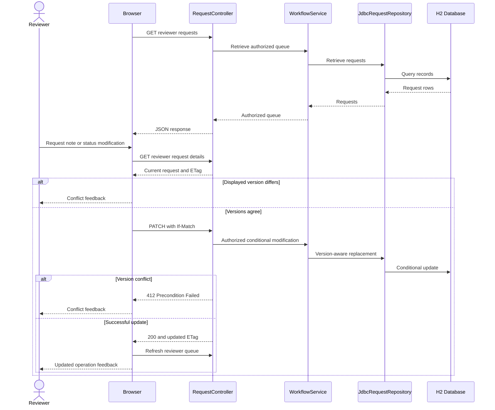

# API and Tool Boundary Contracts

**Project:** CampusConnect  
**Team:** Team 2 — Codex Ramblers  
**Assignment:** A6 — Cycle 2 Final Release Candidate  
**Owner:** Shú Perez  
**Document backup:** Giancarlo Herrera  
**Last Updated:** 2026-11-24  
**Target Release:** `a6-final-release`  
**Status:** Implementation-aligned documentation; final verification pending

---

## 1. Purpose and Scope

This document defines the implemented REST interfaces and internal component contracts for CampusConnect.

The contracts cover:

- Student support request submission.
- Student-owned request retrieval.
- Reviewer request listing and inspection.
- Request status transitions.
- Reviewer resolution notes.
- Transactional persistence.
- Optimistic concurrency.
- Session-based synthetic identity.
- Authorization and failure handling.
- Browser-to-REST communication.

CampusConnect uses HTML, CSS, vanilla JavaScript, Java, Spring Boot, Spring JDBC, Maven, and file-backed H2.

The implemented interface is a REST HTTP API using JSON rather than the server-rendered interface originally proposed during Assignment 3.

The approved Cycle 2 browser presentation layer communicates with the existing REST API through same-origin HTTP requests. Direct HTTP clients remain supported.

The default local address is `http://127.0.0.1:8080/`. The optional hostname `campusconnect.local` requires a local mapping to loopback.

The application remains restricted to a local classroom demonstration using synthetic data.

Final acceptance requires verification against the exact Assignment 6 release candidate.

---

## 2. Contract Summary

| ID | Consumer | Provider | Interaction | Requirements | Status |
|---|---|---|---|---|---|
| API-001 | Student HTTP Client | RequestController / WorkflowService | Submit support request | REQ-001, REQ-003 | Implemented |
| API-002 | Student HTTP Client | RequestController / WorkflowService | Retrieve student-owned requests | REQ-002 | Implemented |
| API-003 | Reviewer HTTP Client | RequestController / WorkflowService | List and inspect requests | REQ-004 | Implemented |
| API-004 | Reviewer HTTP Client | RequestController / WorkflowService | Update request status | REQ-005 | Implemented |
| API-005 | Reviewer HTTP Client | RequestController / WorkflowService | Save or replace resolution note | REQ-006 | Implemented |
| API-006 | WorkflowService | RequestRepository / JdbcRequestRepository | Persist and retrieve records | REQ-001 through REQ-006 | Implemented |
| API-007 | RequestController | HTTP Session / DemoIdentity | Select and retrieve synthetic identity | REQ-001 through REQ-006 | Implemented |

Implemented status indicates that corresponding behavior exists in the reviewed source code. It does not independently establish final acceptance or successful test execution.

The browser presentation layer acts as a student or reviewer HTTP client. It does not introduce additional business API contracts.

### 2.1 HTTP Endpoint Summary

| Contract | Method | Endpoint | Authorized Identity | Success |
|---|---|---|---|---|
| API-007 | POST | `/api/demo/identity` | Demo participant | 200 |
| API-001 | POST | `/api/requests` | Student | 201 |
| API-002 | GET | `/api/requests` | Student | 200 |
| API-002 | GET | `/api/requests/{id}` | Owning student | 200 |
| API-003 | GET | `/api/reviewer/requests` | Reviewer | 200 |
| API-003 | GET | `/api/reviewer/requests/{id}` | Reviewer | 200 |
| API-004 | PATCH | `/api/requests/{id}/status` | Reviewer | 200 |
| API-005 | PATCH | `/api/requests/{id}/note` | Reviewer | 200 |

Both PATCH endpoints require the current request version through the `If-Match` header.

### 2.2 Browser Endpoint Usage

The implemented browser presentation layer directly uses seven of the eight existing REST endpoints.

| Contract | Method | Endpoint | Browser Usage |
|---|---|---|---|
| API-007 | POST | `/api/demo/identity` | Select or switch synthetic identity |
| API-001 | POST | `/api/requests` | Submit a student support request |
| API-002 | GET | `/api/requests` | Retrieve student-owned requests |
| API-002 | GET | `/api/requests/{id}` | Available through REST; not directly invoked by the browser workflow |
| API-003 | GET | `/api/reviewer/requests` | Retrieve the reviewer queue |
| API-003 | GET | `/api/reviewer/requests/{id}` | Retrieve current request details and ETag before modification |
| API-004 | PATCH | `/api/requests/{id}/status` | Submit a conditional status update |
| API-005 | PATCH | `/api/requests/{id}/note` | Submit a conditional resolution note update |

API-006 remains an internal persistence contract and is not directly accessible to the browser.

---

## 3. Shared Contract Rules

### 3.1 Communication Protocol

The application exposes REST endpoints through `RequestController`.

Requests containing JSON bodies should use:

```http
Content-Type: application/json
```

The client must preserve the server-issued session cookie between identity selection and subsequent protected requests.

Individual request responses include an ETag representing the current record version.

List responses return JSON arrays of request records.

The browser presentation layer uses the Fetch API with same-origin REST requests and browser-managed session cookies.

The frontend and REST API are served by the same Spring Boot application.

The browser does not communicate directly with the workflow service, repository, or database.

### 3.2 Request Validation

Validation is implemented through `RequestValidator`.

| Field | Validation Rule |
|---|---|
| title | Required; 5–100 characters after trimming |
| category | Required; Academic, IT, Campus Services, or Other |
| description | Required; 10–2,000 characters after trimming |

All length boundaries are inclusive.

Surrounding whitespace is removed before validation and storage.

Missing, whitespace-only, unsupported, and out-of-range values are rejected.

These rules implement the requirements associated with Q-001.

Browser input controls may assist users with valid submissions but do not replace authoritative backend validation.

### 3.3 System-Managed Fields

The application assigns and maintains:

- Unique UUID-based request identifier.
- Student ownership from the selected server-session identity.
- Initial status `Submitted`.
- Initial empty resolution note.
- Creation timestamp.
- Last-updated timestamp.
- Initial version `0`.

Clients cannot override system-managed ownership through submitted identity fields.

Students cannot edit or delete submitted requests through the implemented API.

### 3.4 Status and Transition Rules

The supported status values are:

- `Submitted`
- `In Progress`
- `Resolved`

| Current Status | New Status | Condition |
|---|---|---|
| Submitted | In Progress | Reviewer authorization and current version |
| In Progress | Resolved | Reviewer authorization, current version, and saved nonblank resolution note |
| Resolved | In Progress | Reviewer authorization and current version |

All other transitions are rejected.

Reopening preserves the existing request identifier, owner, creation timestamp, and resolution note.

These rules implement the requirements associated with Q-002.

### 3.5 Resolution Note Rules

Each request contains one current student-visible resolution note.

- Only Reviewer may save or replace the note.
- Maximum length is 2,000 characters after trimming.
- Null or whitespace-only text is normalized to an empty string.
- Empty text is permitted while Submitted or In Progress.
- Clearing text while Resolved is prohibited.
- Resolution requires previously saved nonblank text.
- Reopening preserves existing resolution text.
- Note edits and status transitions are separate operations.
- Comment threads and note-edit history are not implemented.

These rules implement the requirements associated with Q-003.

The browser provides separate controls for saving resolution notes and modifying request status.

Unsaved browser note text does not satisfy the backend requirement for a previously saved resolution note.

### 3.6 Role and Ownership Rules

Supported synthetic identities:

- `student-a`
- `student-b`
- `reviewer`

The selected identity is stored in the server-side HTTP session.

The controller retrieves the selected identity and passes it to the workflow service.

The workflow service enforces role and ownership restrictions.

| Operation | Student | Reviewer |
|---|---|---|
| Create request | Allowed | Denied |
| List own requests | Allowed | Denied |
| Retrieve owned request | Allowed | Denied through student endpoint |
| List all requests | Denied | Allowed |
| Retrieve reviewer request details | Denied | Allowed |
| Update status | Denied | Allowed |
| Update resolution note | Denied | Allowed |

Client-provided `X-User-ID`, `X-User-Role`, and ownership fields do not grant authorization.

Switching the selected demo identity does not modify existing request ownership.

The selector intentionally permits classroom impersonation and does not provide real authentication.

Browser role-specific controls are presentation features rather than authoritative security boundaries.

Multiple browser tabs sharing the same session cookie may share the selected server-side identity. Independent browser profiles should be used for simultaneous student and reviewer demonstrations.

These rules implement the requirements associated with Q-004.

### 3.7 Persistence and Consistency

The workflow service coordinates repository operations using Spring transactions.

Persistence uses JDBC and file-backed H2.

Successful updates preserve:

- Request identifier.
- Student ownership.
- Title.
- Category.
- Description.
- Creation timestamp.

Successful updates change:

- The applicable status or resolution note.
- Last-updated timestamp.
- Record version.

Rejected operations must not modify stored records.

Failed storage operations must not return false success confirmations.

A failed listing must be distinguishable from a successful empty listing.

Temporary browser state is not an independent persistent request datastore.

The backend response and stored database record remain authoritative.

---

## 4. Detailed Interface Contracts

### API-001 — Submit Support Request

**Method:** POST  
**Endpoint:** `/api/requests`  
**Authorized Identity:** Student A or Student B  
**DTO:** `CreateRequestDto`  
**Related Requirements:** REQ-001, REQ-003  
**Acceptance Criteria:** AC-REQ-001-01, AC-REQ-001-02, AC-REQ-003-01, AC-REQ-003-02  
**Status:** Implemented; final verification pending

#### Request Body

```json
{
  "title": "Unable to access course materials",
  "category": "IT",
  "description": "The course materials are unavailable through the student portal."
}
```

The DTO also contains a `studentID` field for compatibility with the existing model.

However, the controller does not use that field to determine ownership. The stored student identity is obtained exclusively from the server session.

#### DTO Structure

| Field | Java Type | Purpose |
|---|---|---|
| studentID | String | Not authoritative; ignored for ownership assignment |
| title | String | Request title |
| category | String | Supported request category |
| description | String | Request description |

#### Successful Response

```http
HTTP/1.1 201 Created
ETag: "0"
```

The response body contains the created `SupportRequest` record.

#### Failure Responses

| Status | Condition |
|---|---|
| 400 | Invalid request fields or malformed JSON |
| 403 | Missing student identity or unauthorized role |
| 503 | Storage or transaction failure |

#### Contract Invariants

- A successful creation generates a unique UUID.
- Ownership is assigned from the server session.
- Initial status is Submitted.
- Initial resolution note is empty.
- Initial version is 0.
- Invalid submissions do not create records.
- Success is returned only after the storage operation completes.

#### Browser Integration

The student request form submits the title, category, and description through this endpoint.

The browser does not assign the request identifier, student ownership, initial status, timestamps, or record version.

Following successful creation, the browser refreshes the student request dashboard.

---

### API-002 — Retrieve Student-Owned Requests

**Methods:** GET  
**Endpoints:**

- `/api/requests`
- `/api/requests/{id}`

**Authorized Identity:** Student A or Student B  
**Related Requirement:** REQ-002  
**Acceptance Criteria:** AC-REQ-002-01, AC-REQ-002-02, AC-REQ-002-03  
**Status:** Implemented; final verification pending

#### Request

No JSON request body is required.

The selected student identity is obtained from the server session.

The individual retrieval endpoint requires a request identifier in the URL.

#### Successful Response

```http
HTTP/1.1 200 OK
```

The list endpoint returns a JSON array containing only requests owned by the selected student.

An empty successful list returns:

```json
[]
```

The individual endpoint returns one `SupportRequest` record and its current ETag.

#### Failure Responses

| Status | Condition |
|---|---|
| 403 | Missing student identity or unauthorized role |
| 404 | Unknown request identifier or request owned by another student |
| 503 | Storage or retrieval failure |

#### Contract Invariants

- Ownership is enforced by the workflow service.
- Students cannot retrieve another student's records.
- Cross-student access returns 404 rather than exposing request existence.
- Retrieved records contain the current saved status and resolution note.
- A failed retrieval is not represented as a successful empty result.

#### Browser Integration

The student dashboard retrieves records through `GET /api/requests`.

The browser displays the returned request information, including status and saved resolution notes.

Status filtering is performed against the returned student-owned request list.

The individual student request-detail endpoint remains available through the REST API but is not directly invoked by the implemented browser workflow.

---

### API-003 — Reviewer Request Listing and Inspection

**Methods:** GET  
**Endpoints:**

- `/api/reviewer/requests`
- `/api/reviewer/requests/{id}`

**Authorized Identity:** Reviewer  
**Related Requirement:** REQ-004  
**Acceptance Criteria:** AC-REQ-004-01, AC-REQ-004-02  
**Status:** Implemented; final verification pending

#### Request

No JSON request body is required.

The individual retrieval endpoint requires a request identifier.

#### Successful Response

```http
HTTP/1.1 200 OK
```

The listing endpoint returns requests across both synthetic student identities.

The individual endpoint returns the selected request and its current ETag.

#### Failure Responses

| Status | Condition |
|---|---|
| 403 | Missing reviewer identity or student attempting reviewer access |
| 404 | Unknown request identifier |
| 503 | Storage or retrieval failure |

#### Contract Invariants

- Reviewer authorization is enforced server-side.
- Student sessions cannot access reviewer-only endpoints.
- Reviewer access includes requests from both synthetic students.
- Server-side pagination and filtering are not part of the reviewed implementation.
- Empty results remain distinguishable from storage failures.

#### Browser Integration

The reviewer dashboard retrieves the complete reviewer queue through `GET /api/reviewer/requests`.

The browser may filter the returned records by status without introducing a separate filtering endpoint.

Before submitting a reviewer modification, the browser retrieves the individual request through `GET /api/reviewer/requests/{id}` to obtain its current record version and ETag.

The retrieved version is compared with the version originally displayed to the reviewer.

---

### API-004 — Update Request Status

**Method:** PATCH  
**Endpoint:** `/api/requests/{id}/status`  
**Authorized Identity:** Reviewer  
**DTO:** `UpdateStatusDto`  
**Related Requirement:** REQ-005  
**Acceptance Criteria:** AC-REQ-005-01, AC-REQ-005-02, AC-REQ-004-02  
**Status:** Implemented; final verification pending

#### Required Header

```http
If-Match: "0"
```

The supplied version must correspond to the current request version.

#### Request Body

```json
{
  "status": "In Progress"
}
```

#### DTO Structure

| Field | Java Type | Purpose |
|---|---|---|
| status | String | Requested new status |
| resolutionNote | String | Legacy DTO field; non-null values are rejected by the status endpoint |

Resolution notes must be saved through API-005 rather than included in the status update.

#### Successful Response

```http
HTTP/1.1 200 OK
ETag: "1"
```

The response body contains the updated request.

The returned version is incremented from the previous stored version.

#### Failure Responses

| Status | Condition |
|---|---|
| 400 | Unsupported status, invalid transition, malformed version, non-null resolutionNote, or missing required saved resolution text |
| 403 | Missing reviewer identity or unauthorized role |
| 404 | Unknown request identifier |
| 412 | Stale request version |
| 428 | Missing or blank If-Match header |
| 503 | Storage or transaction failure |

#### Contract Invariants

- Only Reviewer may update status.
- Only supported transitions are permitted.
- Resolving requires previously saved nonblank resolution text.
- Reopening preserves existing resolution text.
- Successful updates increment the record version.
- Stale updates are rejected.
- Rejected operations preserve existing stored data.

#### Browser Integration

The browser presents reviewer controls corresponding to the supported status transitions.

Before submitting a status modification, the browser retrieves current reviewer request details and checks the version against the originally displayed record.

The status request includes the applicable If-Match header and the requested status.

The browser does not combine resolution note changes with status modifications.

Unsaved reviewer note changes must be addressed before submitting a status modification through the browser.

The backend remains responsible for authoritative transition validation and concurrency enforcement.

---

### API-005 — Save or Replace Resolution Note

**Method:** PATCH  
**Endpoint:** `/api/requests/{id}/note`  
**Authorized Identity:** Reviewer  
**DTO:** `UpdateNoteDto`  
**Related Requirement:** REQ-006  
**Acceptance Criteria:** AC-REQ-006-01, AC-REQ-004-02  
**Status:** Implemented; final verification pending

#### Required Header

```http
If-Match: "1"
```

#### Request Body

```json
{
  "resolutionNote": "Course access permissions have been corrected."
}
```

#### DTO Structure

| Field | Java Type | Purpose |
|---|---|---|
| resolutionNote | String | Current reviewer note or resolution text |

#### Successful Response

```http
HTTP/1.1 200 OK
ETag: "2"
```

The response contains the updated request and its current version.

#### Failure Responses

| Status | Condition |
|---|---|
| 400 | Note exceeds 2,000 trimmed characters, clearing while Resolved, or malformed version |
| 403 | Missing reviewer identity or unauthorized role |
| 404 | Unknown request identifier |
| 412 | Stale request version |
| 428 | Missing or blank If-Match header |
| 503 | Storage or transaction failure |

#### Contract Invariants

- Only Reviewer may save or replace notes.
- Text is trimmed before storage.
- Null text is normalized to an empty string.
- Empty text is allowed unless the request is Resolved.
- Note changes do not independently change request status.
- Successful updates increment the record version.
- The owning student can retrieve the latest saved note.
- Rejected updates preserve existing stored content.

#### Browser Integration

The browser provides a separate reviewer resolution note input and save operation.

Unsaved note text remains temporary browser state.

Before submitting the note modification, the browser retrieves current reviewer request details and checks the displayed version against the retrieved version and ETag.

The browser submits the resolutionNote field and applicable If-Match header.

The saved note becomes authoritative only after the backend successfully completes the modification.

---

### API-006 — Request Repository Operations

**Consumer:** `WorkflowService`  
**Provider:** `RequestRepository` / `JdbcRequestRepository`  
**Related Requirements:** REQ-001 through REQ-006  
**Acceptance Criteria:** AC-REQ-003-01, AC-REQ-003-02 and supporting persistence requirements  
**Status:** Implemented; final verification pending

This is an internal application contract rather than a public HTTP endpoint.

#### Repository Operations

| Operation | Responsibility |
|---|---|
| insert | Persist a newly created request |
| findById | Retrieve a request by identifier |
| findByStudentID | Retrieve requests belonging to a student |
| findAll | Retrieve all stored requests |
| replace | Persist an updated request using the expected version |

#### Persistence Contract

- Requests use UUID-based identifiers.
- Records are stored through Spring JDBC.
- The default database is file-backed H2.
- Database operations are coordinated through Spring transactions.
- Updates compare the expected version with the stored version.
- Failed version comparisons prevent conflicting writes.
- Repository operations are not exposed directly as public API endpoints.
- Authorization and workflow rules remain the responsibility of WorkflowService.

The browser presentation layer does not directly invoke repository operations.

#### Default Database Location

```text
jdbc:h2:file:./data/campusconnect
```

The database location is relative to the application working directory.

Ordinary restart retention requires reuse of the same database store.

Same-store restart persistence was demonstrated during the recorded November 24, 2026, operational exercises.

Backup restoration, disaster recovery, and distributed deployment require separate verification.

Reference: [Runtime Evidence](../observability/runtime-evidence.md).

---

### API-007 — Synthetic Identity Context

**Method:** POST  
**Endpoint:** `/api/demo/identity`  
**Consumer:** HTTP Client  
**Provider:** `RequestController` / `DemoIdentity` / HTTP Session  
**Related Requirements:** REQ-001 through REQ-006  
**Acceptance Criteria:** AC-REQ-002-03, AC-REQ-004-02 and supporting role checks  
**Status:** Implemented; final verification pending

#### Request Body

```json
{
  "identity": "student-a"
}
```

Supported values:

- `student-a`
- `student-b`
- `reviewer`

#### Successful Response

```http
HTTP/1.1 200 OK
```

```json
{
  "identity": "student-a"
}
```

The selected identity is stored in the server session using:

```text
campusconnect.demoIdentity
```

The client must retain its session cookie for subsequent operations.

#### Failure Responses

| Status | Condition |
|---|---|
| 400 | Malformed or unreadable JSON body |
| 403 | Unsupported or missing identity value |

#### Contract Invariants

- Only fixed synthetic identities are accepted.
- Identity selection does not modify stored request ownership.
- Protected operations require an appropriate selected identity.
- Client-supplied role headers cannot replace session authorization.
- The selector intentionally allows switching between demo identities.
- The selector is not real authentication or institutional SSO.

#### Browser Integration

The browser provides identity selection controls for Student A, Student B, and Reviewer.

Following successful identity selection, the browser loads the corresponding student or reviewer dashboard.

The browser uses its same-origin session cookie for subsequent protected operations.

Changing the displayed identity is not independently sufficient to change backend authorization.

The server-side session remains authoritative.

Identity switching is not equivalent to production authentication or server-side logout.

Multiple browser tabs may share the same session identity.

---

## 5. Shared Response and Error Contracts

### 5.1 SupportRequest Response Model

The implemented domain response is represented by the `SupportRequest` record.

| Field | Java Type | Description |
|---|---|---|
| id | String | Unique request UUID |
| studentID | String | Stored synthetic student owner |
| title | String | Validated request title |
| category | String | Validated request category |
| description | String | Validated request description |
| status | String | Current workflow status |
| resolutionNote | String | Current reviewer note |
| createdAt | Instant | Server-generated creation timestamp |
| updatedAt | Instant | Server-managed modification timestamp |
| version | long | Current optimistic concurrency version |

Illustrative response:

```json
{
  "id": "550e8400-e29b-41d4-a716-446655440000",
  "studentID": "student-a",
  "title": "Unable to access course materials",
  "category": "IT",
  "description": "The course materials are unavailable through the student portal.",
  "status": "Submitted",
  "resolutionNote": "",
  "createdAt": "2026-11-24T18:00:00Z",
  "updatedAt": "2026-11-24T18:00:00Z",
  "version": 0
}
```

This example illustrates the response structure and is not captured runtime evidence.

The browser consumes this response model when rendering student and reviewer request information.

The browser does not independently generate authoritative values for system-managed fields.

### 5.2 HTTP Error Responses

`ApiExceptionHandler` translates workflow and storage exceptions into HTTP responses.

| HTTP Status | Application Error Code | Meaning |
|---|---|---|
| 400 Bad Request | BAD_INPUT | Invalid input or prohibited workflow operation |
| 403 Forbidden | DENIED | Missing or unauthorized identity |
| 404 Not Found | NOT_FOUND | Unknown or inaccessible request |
| 412 Precondition Failed | CONFLICT | Stale request version |
| 428 Precondition Required | PRECONDITION_REQUIRED | Missing required version header |
| 503 Service Unavailable | STORAGE_ERROR | Storage or transaction failure |

Handled application errors use the following JSON structure:

```json
{
  "code": "DENIED",
  "errors": [
    "The Reviewer demo identity is required."
  ]
}
```

The `errors` field contains a list of error messages.

This schema describes errors handled by `ApiExceptionHandler`; unrelated framework-generated errors are not assumed to use the same structure.

### 5.3 Optimistic Concurrency Contract

Both reviewer modification endpoints require `If-Match`.

The version must be a single quoted, nonnegative numeric value within the Java long range.

Valid format:

```http
If-Match: "2"
```

The controller rejects missing, blank, malformed, and out-of-range version values.

The workflow service compares the expected version with the current record version.

The repository performs a version-aware replacement to prevent conflicting writes.

A successful update:

1. Preserves immutable request fields.
2. Updates the applicable status or note.
3. Advances the last-updated timestamp.
4. Increments the version.
5. Returns the new ETag.

A stale update returns:

```http
HTTP/1.1 412 Precondition Failed
```

The client must retrieve the current request and its latest ETag before attempting another modification.

Automatic overwrite of newer data is prohibited.

#### Browser Concurrency Coordination

The browser supplements the existing optimistic concurrency contract through the following sequence:

1. Retrieve the reviewer request list.
2. Retain the version associated with the displayed request.
3. Receive a reviewer note or status modification action.
4. Retrieve the current individual reviewer request and ETag.
5. Compare the retrieved version and ETag with the originally displayed version.
6. Prevent the modification if a version mismatch is detected.
7. Submit the applicable PATCH request with If-Match when the versions agree.
8. Interpret the backend response.
9. Refresh relevant request information following successful modification.



The browser-side version check does not eliminate the possibility of a concurrent modification occurring between retrieval and submission.

The backend remains responsible for the authoritative version comparison and atomic conditional update.

The browser does not automatically retry stale modifications or overwrite newer stored records.

### 5.4 Browser Response Handling

The browser presentation layer interprets successful and failed REST responses.

| Response | Browser Responsibility |
|---|---|
| 200 OK | Process successful retrieval, identity selection, or modification |
| 201 Created | Confirm successful request creation |
| 400 Bad Request | Communicate invalid input or prohibited workflow operation |
| 403 Forbidden | Communicate authorization failure and clear or reset protected interface state |
| 404 Not Found | Communicate missing or inaccessible resources |
| 412 Precondition Failed | Communicate stale-version conflict without automatically overwriting newer data |
| 428 Precondition Required | Communicate missing conditional update information |
| 503 Service Unavailable | Communicate application storage or transaction failure |
| Network failure | Communicate unsuccessful communication or an unconfirmed operation outcome |

A network failure does not independently establish whether a submitted operation was committed.

The browser must not automatically repeat a potentially completed modification without establishing the current application state.

A confirmed successful modification followed by a failed dashboard refresh must remain distinguishable from a failed modification.

A failed listing must not be displayed as a successful empty result.

### 5.5 Static Resource Delivery Boundary

Spring Boot serves the implemented browser presentation resources from:

`src/main/resources/static/`

These resources include HTML, CSS, and JavaScript.

Static resource delivery supports browser presentation and does not introduce additional business REST endpoints.

Open `http://127.0.0.1:8080/` by default. A workstation that maps `campusconnect.local` to loopback can also use `http://campusconnect.local:8080/`.

Access to frontend resources does not grant authorization to protected REST endpoints.

---

## 6. AI and External Tool Boundaries

The implemented support request workflow does not include runtime AI, external service APIs, or institutional integrations.

Accordingly:

- No AI model is authorized to create or modify request state.
- No external service is assumed to participate in authorization or persistence.
- Real Loyola authentication and institutional systems remain excluded.
- Automated email and text-message notifications are not implemented.
- Development-time AI assistance must be recorded in the AI Use Log.
- AI-assisted changes require human review and verification.

Future external integrations require requirements review, architecture approval, security assessment, and documented governance decisions.

### 6.1 Verification and Demonstration Tool Boundaries

Local engineering support scripts interact with the application through the existing HTTP interfaces.

| Tool | Purpose | Contract Boundary |
|---|---|---|
| Postman / cURL | Direct REST interaction and verification | Must preserve applicable session and version requirements |
| `scripts/frontend-smoke-test.sh` | Verify frontend resources and selected REST permission boundaries | Does not establish comprehensive browser interaction coverage or create persistent request records |
| `scripts/demo-data.sh` | Create synthetic demonstration records and reviewer updates | Modifies the configured persistent database through existing authorized REST operations |

The demonstration data script does not directly modify the database or bypass backend authorization and workflow rules.

Sequential existing-record matching reduces unnecessary duplicate creation.

Atomic duplicate prevention across concurrent script executions and automatic recovery from interrupted preparation are not established.

References:

- [AI Use Policy](../ai/ai-policy.md)
- [AI Use Log](../ai/ai-use-log.md)
- [Frontend Smoke Testing Script](../../scripts/frontend-smoke-test.sh)
- [Demonstration Data Script](../../scripts/demo-data.sh)

---

## 7. Architecture Decisions and Dependencies

| Reference | Implemented Behavior or Remaining Boundary | Affected Contracts |
|---|---|---|
| Q-001 | Request field validation and supported categories | API-001, API-006 |
| Q-002 | Supported statuses and permitted transitions | API-002, API-004, API-006 |
| Q-003 | Resolution note length and clearing restrictions | API-002, API-005, API-006 |
| Q-004 | Fixed synthetic identities and stable ownership | API-001 through API-007 |
| ADR-001 | Production technology stack remains deferred | All contracts |
| ADR-002 | Local Java, Spring Boot, Maven, and H2 architecture; REST implementation replaces proposed server-rendered interface | All contracts |
| ADR-003 | Transactional updates and optimistic version checking | API-004, API-005, API-006 |
| ADR-004 | Local persistence and recovery expectations | API-006 |
| ADR-0005 | Clarifies transactional JDBC and file-backed H2 implementation | API-006 |
| ADR-006 | REST interface alignment and approved browser presentation extension | API-001 through API-005, API-007 |

ADR-002 through ADR-004 were historically approved on October 16, 2026.

The original design included Thymeleaf and Post/Redirect/Get. The reviewed implementation uses REST endpoints extended by a same-origin static browser presentation layer.

Post/Redirect/Get is not claimed as an implemented API capability.

The Cycle 2 browser presentation direction is documented in the [Cycle 2 Maturity Plan](../planning/cycle2-maturity-plan.md) and the corresponding [ADR-006](../decisions/ADR-006-rest-api-interface-alignment.md) amendment.

Stronger duplicate-submission prevention, idempotency, and exact retry handling remain separate concerns.

Architecture decisions must remain consistent with the final implementation and release limitations.

---

## 8. Verification and Boundary Test Scenarios

The following scenarios preserve the existing negative-path and boundary test identifiers while aligning expected behavior with the implemented HTTP contracts.

| Test ID | Contract | Scenario | Expected Behavior |
|---|---|---|---|
| NEG-001 | API-001 | Invalid required request fields | 400; no record created |
| NEG-002 | API-001, API-006 | Two successful request creations | Distinct UUIDs |
| NEG-003 | API-002 | Student accesses another student's request | 404; no information disclosed |
| NEG-004 | API-002 | Unknown request identifier | 404 |
| NEG-005 | API-003 | Student attempts reviewer listing | 403 |
| NEG-006 | API-004 | Student attempts status update | 403; no modification |
| NEG-007 | API-004 | Unsupported status transition | 400; status preserved |
| NEG-008 | API-005 | Student attempts note update | 403; note preserved |
| NEG-009 | API-001, API-006 | Storage failure during creation | 503; no false success |
| NEG-010 | API-004, API-006 | Storage failure during status update | 503; no false success |
| NEG-011 | API-007 | Missing or invalid session identity | 403 for protected operation |
| NEG-012 | API-004 | Status update for nonexistent request | 404 |
| NEG-013 | API-005 | Note update for nonexistent request | 404 |
| NEG-014 | API-005, API-006 | Storage failure during note update | 503; no false success |
| NEG-015 | API-001 | Title length of 4 or 101 characters | 400 |
| NEG-016 | API-001 | Description length of 9 or 2,001 characters | 400 |
| NEG-017 | API-001 | Missing or unsupported category | 400 |
| NEG-018 | API-001, API-007 | Reviewer attempts student submission | 403 |
| NEG-019 | API-002, API-007 | Student B lists requests | No Student A records returned |
| NEG-020 | API-004 | Resolve without saved nonblank note | 400 |
| NEG-021 | API-004 | Reopen resolved request with current version | 200; existing note preserved |
| NEG-022 | API-005 | Clear resolution note while Resolved | 400 |
| NEG-023 | API-005 | Note exceeds 2,000 trimmed characters | 400 |
| NEG-024 | API-006 | Restart against same local database | Stored records remain available |
| NEG-025 | API-007 | Forged role or ownership information | Cannot override session identity |
| NEG-026 | API-003, API-006 | Storage failure during reviewer listing | 503 rather than empty success |
| NEG-027 | API-005 | Replace existing note with current version | 200; latest note stored |
| NEG-028 | API-004, API-006 | Successful status update | Preserve immutable fields; update timestamp and version |
| NEG-029 | API-004 | Stale If-Match during status update | 412; no modification |
| NEG-030 | API-005 | Stale If-Match during note update | 412; no modification |
| NEG-031 | API-004, API-005 | Missing or blank If-Match | 428 |
| NEG-032 | API-004, API-005 | Malformed or out-of-range If-Match | 400 |
| NEG-033 | API-004 | Non-null resolutionNote included in status update | 400 |
| NEG-034 | API-007 | Unsupported synthetic identity | 403 |
| NEG-035 | API-001, API-004, API-005, API-007 | Malformed JSON body | 400 |

NEG-029 through NEG-035 are proposed additional verification identifiers for the implemented HTTP boundary behavior. They must be reconciled with the central test catalog before final acceptance.

For scenarios testing workflow behavior, supply otherwise valid request bodies, identities, identifiers, and version headers so that the intended boundary is isolated.

### 8.1 Verification Boundaries

- Expected outcomes are not recorded test results.
- Automated and manual verification must identify the tested revision.
- Boundary tests should cover valid minimum and maximum lengths.
- Authorization tests must verify server-side enforcement.
- Rejected operations must preserve existing stored records.
- Concurrent update tests must verify that stale writes cannot overwrite newer data.
- Persistence verification must reuse the same database location.
- HTTP resource verification does not independently establish browser JavaScript behavior.
- Browser interaction verification does not replace backend authorization tests.
- Final acceptance evidence must be recorded separately.

### 8.2 Browser Integration Verification Scenarios

The following scenarios describe browser integration expectations associated with existing API contracts.

They do not introduce additional formal test identifiers or replace the central test catalog.

| Contract | Browser Scenario | Expected Behavior |
|---|---|---|
| API-007 | Select a supported synthetic identity | Appropriate student or reviewer dashboard becomes available |
| API-007 | Switch from Reviewer to Student B | Subsequent protected reviewer operations are denied |
| API-001 | Submit valid student request | Successful creation and refreshed student request information |
| API-001 | Submit invalid student request | Validation feedback without false success |
| API-002 | Retrieve student request dashboard | Only records owned by the selected student are displayed |
| API-003 | Retrieve reviewer queue | Requests across both synthetic students are available |
| API-003 | Apply browser status filter | Displayed records reflect the selected filter |
| API-004 | Submit supported status modification | Successful update and refreshed request information |
| API-004 | Attempt resolution without saved note | Operation prevented or rejected |
| API-005 | Save reviewer resolution note | Latest saved note becomes available to the owning student |
| API-004, API-005 | Attempt modification using stale displayed version | Conflict feedback without overwriting newer data |
| API-004, API-005 | Backend rejects conditional update | Failure communicated without false success |
| API-002, API-003 | Request listing fails | Failure remains distinguishable from a successful empty result |
| API-001, API-004, API-005 | Confirmed modification followed by failed refresh | Modification success and refresh failure remain distinguishable |
| Static resources | Request unavailable frontend resource | Appropriate missing-resource response |

These scenarios describe expected integration behavior rather than independently recorded test results.

### 8.3 Recorded Verification Evidence

The following previously recorded November 24, 2026, verification results support the reviewed API and browser integration contracts.

| Verification Context | Recorded Results |
|---|---|
| Local frontend verification by Shú Perez | 38 smoke checks passed, zero failed |
| Local demonstration data preparation | Six synthetic requests created and ten reviewer updates completed |
| Integrated browser candidate `373a0f6` | 38 passing HTTP smoke checks and scoped Chromium workflow verification |
| Integrated browser candidate repeat demonstration setup | Six existing matching requests skipped |
| Integrated revision `0860160bc458af670c7944ccd035d21425e7511d` | 51 Maven tests passed with zero failures, errors, or skips |
| Packaged HTTP workflow verification | 36 checks passed |
| Packaged restart verification | Five checks passed |
| Separate Windows exercise reported by Giancarlo Herrera | Ten of ten manual workflow checks passed and same-store restart retention reported |

The Linux build, packaged HTTP workflow, and restart checks were performed by Codex.

Giancarlo Herrera performed and reported the separate Windows browser and restart exercise.

The recorded Chromium exercise covered student request submission, student isolation, reviewer modifications, stale-edit rejection, and owner visibility.

Supporting evidence:

- [Runtime Evidence](../observability/runtime-evidence.md)
- [Integrated CI Execution](https://github.com/victordodan/-comp330-f26-team-02/actions/runs/45543404188)
- [Final Test Evidence](../testing/final-test-evidence.md)
- [Packaged Workflow Transcript](../../test-evidence/a6-operations-0860160/workflow.jsonl)
- [Packaged Restart Transcript](../../test-evidence/a6-operations-0860160/restart.jsonl)

These results retain their original execution contexts and tested revisions.

They do not independently establish that every listed boundary scenario has passed or that the final tagged release has been verified.

---

## 9. Review and Release Verification

Before final Assignment 6 acceptance:

- [ ] Confirm endpoint paths and HTTP methods against the final controller implementation.
- [ ] Confirm browser endpoint usage against the final frontend implementation.
- [ ] Confirm DTO fields against the final Java records.
- [ ] Confirm validation rules against RequestValidator.
- [ ] Confirm authorization and lifecycle rules against WorkflowService.
- [ ] Confirm HTTP status and error mappings against ApiExceptionHandler.
- [ ] Confirm repository and persistence behavior.
- [ ] Verify stale-version rejection for both PATCH endpoints.
- [ ] Confirm browser-side version comparison and If-Match handling.
- [ ] Verify missing and malformed version handling.
- [ ] Verify student ownership isolation.
- [ ] Confirm shared browser session behavior is accurately documented.
- [ ] Confirm browser response handling and temporary state boundaries.
- [ ] Reconcile negative-path identifiers with the central test catalog.
- [ ] Confirm final automated test and CI evidence.
- [ ] Confirm architecture diagram and component responsibility alignment.
- [ ] Review applicable ADRs and known limitations.
- [ ] Confirm ADR-006 amendment integration and review.
- [ ] Record independent human review.
- [ ] Record AI assistance and human verification.
- [ ] Confirm alignment with the approved `a6-final-release` revision.

---

## 10. Related Engineering Evidence

### Architecture

- [Architecture Overview](architecture.md)
- [Architecture Diagram](architecture-diagram.png)
- [Component Responsibilities](component-responsibilities.md)
- [Data Context](data-context.md)
- [ADR-006 — REST API Interface Alignment](../decisions/ADR-006-rest-api-interface-alignment.md)

### Requirements and Planning

- [Requirements](../requirements/requirements.md)
- [Acceptance Criteria](../requirements/acceptance-criteria.md)
- [Assumptions and Open Questions](../requirements/assumptions-open-questions.md)
- [Traceability](../planning/traceability.md)
- [Risk Register](../planning/risk-register.md)
- [Cycle 2 Maturity Plan](../planning/cycle2-maturity-plan.md)
- [Team Roles](../team/roles.md)

### Implementation

- [Browser Presentation Resources](../../src/main/resources/static/)
- [Browser Interface](../../src/main/resources/static/index.html)
- [RequestController](../../src/main/java/edu/loyola/campusconnect/controller/RequestController.java)
- [ApiExceptionHandler](../../src/main/java/edu/loyola/campusconnect/controller/ApiExceptionHandler.java)
- [WorkflowService](../../src/main/java/edu/loyola/campusconnect/service/WorkflowService.java)
- [RequestValidator](../../src/main/java/edu/loyola/campusconnect/validation/RequestValidator.java)
- [SupportRequest](../../src/main/java/edu/loyola/campusconnect/model/SupportRequest.java)
- [CreateRequestDto](../../src/main/java/edu/loyola/campusconnect/model/CreateRequestDto.java)
- [UpdateStatusDto](../../src/main/java/edu/loyola/campusconnect/model/UpdateStatusDto.java)
- [UpdateNoteDto](../../src/main/java/edu/loyola/campusconnect/model/UpdateNoteDto.java)
- [DemoIdentity](../../src/main/java/edu/loyola/campusconnect/model/DemoIdentity.java)
- [RequestRepository](../../src/main/java/edu/loyola/campusconnect/repository/RequestRepository.java)
- [JdbcRequestRepository](../../src/main/java/edu/loyola/campusconnect/repository/JdbcRequestRepository.java)

### Testing and Release

- [Test Strategy](../testing/test-strategy.md)
- [HTTP API Guide](../testing/a4-http-api.md)
- [CI Evidence](../testing/ci-evidence.md)
- [A5 Acceptance Evidence Matrix](../testing/a5-acceptance-evidence-matrix.md)
- [Final Test Evidence](../testing/final-test-evidence.md)
- [Frontend Smoke Testing Script](../../scripts/frontend-smoke-test.sh)
- [Demonstration Data Script](../../scripts/demo-data.sh)
- [Known Limitations](../release/known-limitations.md)
- [Operational Runbook](../operations/runbook.md)
- [Observability Plan](../observability/observability-plan.md)
- [Runtime Evidence](../observability/runtime-evidence.md)
- [Permission Boundaries](../security/permission-boundaries.md)

### AI Governance

- [AI Use Policy](../ai/ai-policy.md)
- [AI Use Log](../ai/ai-use-log.md)

### Historical Review References

- PR #43 — Component Responsibilities and API Contracts.
- PR #44 — Test Strategy Alignment.
- PR #46 — Draft Requirements and Acceptance Criteria Updates.

### Cycle 2 Review References

- PR #116 — Architecture Overview.
- PR #117 — Architecture Diagram.
- PR #118 — API Contracts.
- PR #119 — Component Responsibilities.
- PR #120 — Data Context.
- PR #126 — HTML Browser Interface.
- PR #127 — Frontend Styling.
- PR #128 — Browser Application Logic.
- PR #129 — Frontend Integration Tests.
- PR #130 — Frontend Smoke Testing.
- PR #131 — Synthetic Demonstration Data Generation.

---

**Architecture Lead:** Shú Perez

**Document backup:** Giancarlo Herrera

**Architecture & Development role backup:** Venkata Aravind Mareddy, per the [team role matrix](../team/roles.md).

**Evidence Status:** Contracts aligned with reviewed implementation source. Final integrated testing, independent review, and release authorization remain pending.
