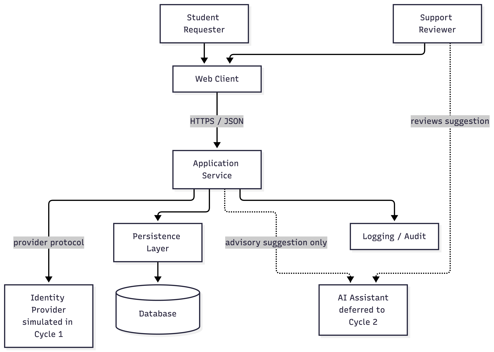

# Architecture Overview — CampusConnect

> **Status:** Baselined for Cycle 1 (A3 architecture phase gate)
> **Baseline version:** `a3-architecture-review` (Git tag)
> **Last updated:** 2026-10-15
> **Owner:** Shú Perez · **Backup:** Giancarlo Herrera
> **Team:** Codex Ramblers (Team 2)

This document describes **what CampusConnect is now** — its structure, components, boundaries, data/context, AI/tool use, risks, and evidence links. It is **not** a home for every architecture decision. Significant decisions are recorded as individual ADRs in `/docs/decisions/` and indexed in Section 10.

---

## 1. Project Information

| Item | Team Response |
|---|---|
| Project name | CampusConnect |
| Team number / name | Team 2 — Codex Ramblers |
| Repository URL (clone) | https://github.com/victordodan/-comp330-f26-team-02.git |
| Architecture owner | Shú Perez |
| Backup owner | Giancarlo Herrera |
| Cycle 1 vertical slice | A student creates a support request and views its status; a support reviewer views the request, updates status, and records a resolution note. |
| AI governance | Team AI Use Policy (`/docs/ai/ai-policy.md`) and AI Use Log (`/docs/ai/ai-use-log.md`) define how AI is used and recorded. |

---

## 2. System Overview

CampusConnect is a **student support request and workflow system**. It gives a student a single, simple entry point to submit a support request, gives a support reviewer a controlled way to triage, clarify, update, and resolve that request, and gives both parties visibility into status and resolution. It replaces informal request handling through scattered email, shared documents, or verbal follow-up with a simple, inspectable workflow.

The primary workflow is: **Student creates request → system stores it with a unique ID → reviewer views it → reviewer updates status → reviewer records a resolution note → student views current status and resolution.**

The current release focus is the **Cycle 1 vertical slice** defined in the CampusConnect brief §4: a single, demonstrable, testable, reviewable end-to-end path using **synthetic data only**. The architecture is considered stable, governable, and reviewable enough for Cycle 1 because: (a) the slice is one bounded workflow over one authoritative data store; (b) role boundaries and status transitions are explicit (Sections 3 and 6); (c) any user-facing AI is advisory with a human approval gate (Section 8); and (d) failure and recovery paths are defined and testable (Section 9).

**Cycle 1 vertical slice (brief §4, all 7 steps):**

1. A student creates a new support request using synthetic data.
2. The system stores the request and gives it a unique identifier.
3. A support reviewer can view the request.
4. The reviewer can change the request status.
5. The reviewer can record a short note or resolution.
6. The student can view the current status and resolution information.
7. The repository contains evidence linking the workflow to requirements, issues, pull requests, tests, and release notes.

### Structural Approach

CampusConnect uses a layered, client/server structure. Presentation (Requester UI / Reviewer UI), workflow logic (Request Workflow Service), and durable storage (Request Repository / local store) are separated so that responsibilities are testable and replaceable. The Request Workflow Service is the only component that writes to the repository boundary, and the UI never accesses the local store directly. Identity is treated as an external dependency and is simulated in Cycle 1. The final production technology stack is intentionally deferred (ADR-001); Cycle 1 uses Java with server-rendered pages and a local class demonstration.

---

## 3. Users, Roles, and Permissions

| User / Role | Primary Goals | Allowed Actions | Limitations / Approvals |
|---|---|---|---|
| Student Requester (Student A / Student B) | Submit a request and understand what is happening | Create a request; view own request status and resolution | Cannot change status; cannot view other students' requests; cannot resolve or close |
| Support Reviewer | Triage, clarify, update, and resolve requests | List and inspect requests; update status; save or replace a note or resolution | Status changes must follow the valid state model (Section 6); resolving requires saved nonblank resolution text |
| Team Administrator | Maintain categories or basic workflow settings | Manage categories; approve escalated closures | Optional in Cycle 1; may be represented through seeded configuration |
| AI Assistant (optional) | Suggest, summarize, classify, or identify missing information | Produce advisory suggestions only | **Advisory only** — no status change, no resolution, no record mutation; every suggestion is human-reviewed before any action |

**Trust boundaries:** the UI is untrusted input; all role and authorization checks are enforced server-side in the Request Workflow Service. Identity is **simulated** in Cycle 1 — demo roles (Student A, Student B, Reviewer) are selected through the demo selector and stored in the server session, then supplied to the Request Workflow Service through the Simulated Role Context (API-007). Form-supplied roles or requester IDs cannot override session context. Real authentication and SSO are out of scope (brief §11; `assumptions-open-questions.md` Q-004).

---

## 4. Architecture Diagram

The diagram shows the Student Requester and Support Reviewer interacting through the Requester UI and Reviewer UI, which call the Request Workflow Service. The Request Workflow Service depends on the Simulated Role Context (API-007) for session identity, writes to the Request Repository (API-006), and is backed by a local data store. Optional user-facing AI sits outside the record-changing path as an advisory suggestion reviewed by a human. Logging and audit evidence capture important status changes and reviewer actions.

---

## 5. Component Responsibility Map

| Component | Owns / Responsible For | Must Not Own | Inputs / Outputs | Evidence Link |
|---|---|---|---|---|
| Requester UI | Present request submission and student-owned request views; collect user input; initiate application actions | Authoritative workflow rules; durable data storage; authentication authority; direct DB access | In: user actions; Out: API calls to Request Workflow Service | Issue #10; PR #43 |
| Reviewer UI | Present reviewer listing and inspection; update status; save or replace notes | Authoritative workflow rules; durable data storage; authentication authority | In: reviewer actions; Out: API calls to Request Workflow Service | Issue #10; PR #43 |
| Request Workflow Service | Enforce workflow behavior; coordinate domain operations; make application-level authorization decisions; enforce role and ownership checks | UI rendering; identity-provider internals; physical database implementation | In: authenticated requests; Out: responses, state changes, repository operations | Issue #10; PR #43 |
| Request Repository | Provide controlled durable storage and retrieval of request state | Workflow policy; presentation logic; user authentication | In: writes from service; Out: reads to service | Issue #10; PR #43 |
| Local Data Store | Store authoritative request records, status, notes/resolutions, and timestamps | Business rules; presentation logic | In: repository writes; Out: reads | Issue #10 |
| Simulated Role Context | Supply session role and identity (Student A, Student B, Reviewer) | Application workflow authorization and business rules | In: demo selector selection; Out: session role and identity | Issue #33; ADR-001; API-007 |
| AI Assistant (optional, deferred to Cycle 2) | Suggest category, summary, or missing-info flag | Approve, resolve, close, or mutate any record | In: request text; Out: advisory suggestion | `/docs/ai/ai-use-log.md` |
| Logging / Audit | Record important status changes and reviewer actions for inspection | Storing sensitive data or full request payloads | In: service events; Out: reviewable logs | `/docs/testing/test-strategy.md` |

Full responsibility detail: `component-responsibilities.md` (PR #43).

---

## 5.5 Architectural Qualities and Tradeoffs

The qualities below materially influenced the Cycle 1 architecture.

| Quality / Concern | Architectural Response | Tradeoff / Consequence |
|---|---|---|
| Maintainability | Separate workflow logic from presentation and persistence responsibilities. | Adds explicit interfaces and some structural overhead. |
| Testability | The Request Workflow Service is the only writer to the repository boundary; role and ownership rules are enforced server-side. | Requires server-side tests, not just UI tests; the UI cannot be the sole verification point. |
| Governability | AI is advisory, logged, and human-reviewed; AI behavior is defined by the AI Use Policy rather than invented in code. | Limits how much AI can accelerate user-facing paths; every suggestion needs a reviewer decision. |
| Reviewability | Architecture claims are linked to issues, PRs, ADRs, and AI-use evidence. | Requires ongoing evidence maintenance; stale links weaken the architecture record. |
| Honesty about uncertainty | Unresolved decisions are recorded as open questions or deferred ADRs instead of being presented as settled. | Some architectural details remain provisional until ADR-001 is revisited. |

---

## 6. Interfaces, APIs, and Tool Boundaries

| Interface / Tool | Consumer | Provider | Purpose | Protocol | Requirement | Status |
|---|---|---|---|---|---|---|
| API-001 | Requester UI | Request Workflow Service | Submit support request | HTTPS / JSON | REQ-001, REQ-003 | Proposed |
| API-002 | Requester UI | Request Workflow Service | Retrieve student-owned requests | HTTPS / JSON | REQ-002 | Proposed |
| API-003 | Reviewer UI | Request Workflow Service | List and inspect requests | HTTPS / JSON | REQ-004 | Proposed |
| API-004 | Reviewer UI | Request Workflow Service | Update request status | HTTPS / JSON | REQ-005 | Proposed |
| API-005 | Reviewer UI | Request Workflow Service | Save or replace note or resolution | HTTPS / JSON | REQ-006 | Proposed |
| API-006 | Request Workflow Service | Request Repository | Persist and retrieve records | Internal | REQ-001 through REQ-006 | Proposed |
| API-007 | Request Workflow Service | Simulated Role Context | Obtain session role and identity | Internal | REQ-001 through REQ-006 | Proposed |
| AI suggestion (optional, deferred to Cycle 2) | AI Assistant | Support Reviewer | Suggest category/summary/missing info | Internal | — | Advisory only |

**Valid status model:** `Submitted → In Progress → Resolved`. Permitted transitions are:

- `Submitted → In Progress` (reviewer authorization)
- `In Progress → Resolved` (reviewer authorization and saved nonblank resolution text)
- `Resolved → In Progress` (reviewer authorization; preserves existing note or resolution)

All other status transitions and unsupported status values are rejected. Transitions are enforced in the Request Workflow Service.

Full contract detail: `api-contracts.md` (PR #43). Specific HTTP paths, request/response schemas, framework choices, and database technology remain subject to accepted architecture decisions.

---

## 7. Data and Context Ownership

Full detail is in `data-context.md`. Summary:

| Data / Context | Authoritative Owner | Persistence | Visible To | Logging Expectation |
|---|---|---|---|---|
| Workflow request (id, title, category, description, status, note/resolution) | Request Workflow Service | Local data store via Request Repository | Owning student; reviewer | Log state transitions, not raw payloads |
| Request status | Request Workflow Service | Local data store via Request Repository | Owning student; reviewer | Log state transitions |
| Reviewer note / resolution | Request Workflow Service | Local data store via Request Repository | Owning student; reviewer | Log that a note was saved, not its body |
| User identity | Simulated Role Context | Server session | Application consumes; does not own | Log demo identity selection only |
| Role assignments (Student A, Student B, Reviewer) | Simulated Role Context | Server session | System | Log demo identity selection |
| AI suggestion context (deferred to Cycle 2) | Request Workflow Service | Not persisted beyond the suggestion | AI boundary only | Log that a suggestion was requested/returned |
| Operational logs / audit events | Request Workflow Service | Local data store | Operations / review workflow | Avoid sensitive data exposure; keep logs reviewable |

**Data rules:** synthetic data only — no real student records, grades, private university data, or regulated records. No live institutional integration. External APIs require instructor approval and a documented risk review.

**Assumption ASM-001:** Authentication remains simulated in Cycle 1; identity is supplied by a Simulated Role Context through API-007, and how the implementation represents or selects the demo roles is tracked as open question Q-004 in `docs/requirements/assumptions-open-questions.md`.

---

## 8. AI / Tool Boundary and Governance Model

CampusConnect operates under the team's AI Use Policy (`/docs/ai/ai-policy.md`). The policy treats AI as a support tool rather than a replacement for team judgment, and it requires that AI-assisted work be reviewed, verified, and documented before it becomes part of the project.

Per the CampusConnect brief (§9), AI is expected to assist engineering work across the lifecycle. User-facing AI is optional and, if used, must remain advisory and human-controlled. The team's AI Use Policy and AI Use Log define how this is governed in practice.

### Governance references

| Question | Where the answer lives |
|---|---|
| What is permitted or prohibited? | `/docs/ai/ai-policy.md` |
| What AI use has actually occurred? | `/docs/ai/ai-use-log.md` |
| Where is detailed verification recorded? | `/docs/ai/ai-verification-notes.md` |
| What did the team accept, modify, or reject? | The "Result / Action" column in the AI Use Log |

### AI boundary questions

The table below summarizes the boundaries the team has established through its AI Use Policy. It is a reference summary, not a substitute for the policy — the policy is authoritative, and the AI Use Log is the authoritative record of what actually happened.

| Boundary Question | How the AI Use Policy governs it | Where evidence is recorded |
|---|---|---|
| **Read** | AI tools may be used with project artifacts and, where a user-facing feature exists, the minimum request text needed for a suggestion. The policy prohibits sharing passwords, tokens, private keys, credentials, confidential project information, or private personal information. | AI Use Log; AI Use Policy §"Sensitive and Protected Information" |
| **Infer** | AI may suggest, summarize, classify, or identify missing information. The policy states AI is a support tool and not a replacement for team judgment; suggestions are advisory and must be reviewed. | AI Use Log; AI Use Policy §"Permitted Uses" |
| **Call** | No external tool calls are made by the running system in Cycle 1. Engineering AI tools are used interactively by team members, consistent with the policy's permitted uses. | AI Use Log; `api-contracts.md` §5 |
| **Change** | AI does not change records or repository state on its own. The policy requires that AI-generated code and technical recommendations be reviewed and, when applicable, tested before being accepted into the project. | AI Use Policy §"Human Review Requirements"; AI Use Log |
| **Approve** | The team member contributing AI-assisted work is responsible for reviewing and understanding it before it enters the repository. For user-facing suggestions, the reviewer decides whether to apply the suggestion. | AI Use Policy §"Human Review Requirements"; AI Use Log |
| **Observe** | Significant AI-assisted work is documented, and human verification explains what was actually checked. | AI Use Log; AI Verification Notes |
| **Log** | Significant AI use is recorded in the AI Use Log with the tool, purpose, artifact affected, human verification, and result/action. | `/docs/ai/ai-use-log.md` |
| **Recover** | If AI-assisted information is found to be incorrect, incomplete, misleading, or unsuitable, the policy requires the team to correct or remove it and to determine whether other work was affected. | AI Use Policy §"Handling Incorrect AI Output"; AI Use Log |

### How to read this section

The architecture treats AI as a **bounded, logged, and human-reviewed** part of the engineering process — not as an autonomous actor in the system. The specific rules are defined by the AI Use Policy, and the specific uses are recorded in the AI Use Log. Reviewers should read those two artifacts alongside this section.

For a representative example of how the team applies these rules in practice, see the AI Use Log entries from 2026-09-17 through 2026-09-29, which document how AI-assisted planning, requirements, and decision work was reviewed, modified, or rejected by team members before being merged.

---

## 9. Testing and Review Implications

| Architecture Claim | What Must Be Tested or Reviewed | Owner | Evidence Link |
|---|---|---|---|
| Request creation | Student can create a request and receive a unique ID; initial status is Submitted | Giancarlo Herrera | AC-REQ-001-01, AC-REQ-003-01; `/docs/testing/test-strategy.md` |
| Status transitions | Submitted → In Progress succeeds; unsupported transitions rejected | Giancarlo Herrera | AC-REQ-005-01; `/docs/testing/test-strategy.md` |
| Resolve requires text | In Progress → Resolved is rejected without saved nonblank resolution text | Giancarlo Herrera | AC-REQ-005-01; `/docs/testing/test-strategy.md` |
| Reopening preserves text | Resolved → In Progress preserves request ID, owner, and note | Giancarlo Herrera | AC-REQ-005-01; `/docs/testing/test-strategy.md` |
| Role boundary | Students cannot change status or save notes; reviewer-only actions enforced | Giancarlo Herrera | AC-REQ-004-02; `/docs/testing/test-strategy.md` |
| Ownership boundary | Student A cannot view Student B's requests | Giancarlo Herrera | AC-REQ-002-01; `/docs/testing/test-strategy.md` |
| API-001 contract | Invalid required input must not create a request; field limits enforced | Mareddy Venkata Aravind | `/docs/architecture/api-contracts.md` (API-001) |
| API-002 contract | Caller must not receive protected info solely by knowing an ID | Mareddy Venkata Aravind | `/docs/architecture/api-contracts.md` (API-002) |
| API-006 persistence | Records survive ordinary application restart | Mareddy Venkata Aravind | `/docs/architecture/api-contracts.md` (API-006) |
| API-007 session context | Missing or invalid session context is rejected | Mareddy Venkata Aravind | `/docs/architecture/api-contracts.md` (API-007) |
| Data/context control | Only synthetic data used; AI sees only permitted request text | Giancarlo Herrera | AI-use log; `/docs/testing/test-strategy.md` |
| AI suggestion (if used) | Suggestion is reviewed before any action | Giancarlo Herrera | AI-use log |
| Operational observability | Important status changes and reviewer actions are inspectable | Giancarlo Herrera | `/docs/testing/test-strategy.md` |
| Recovery | Manual workflow works if AI is unavailable | Giancarlo Herrera | Release notes (future) |

Full plan: `/docs/testing/test-strategy.md` (PR #44).

---

## 10. ADR Index

| ADR ID | Decision Title | Status | Owner | File / Evidence Link |
|---|---|---|---|---|
| ADR-001 | Defer final production technology stack decision | Accepted — Deferred | Giancarlo Herrera | `/docs/decisions/ADR-001-defer-production-technology-stack.md`; Issue #33 |

**Note:** ADR-001 is scheduled for reconsideration **during A3**, before implementation begins. Cycle 1 uses Java with server-rendered pages and a local class demonstration; Spring Boot, Thymeleaf, Maven, and file-backed H2 are recommendations, not approved implementation choices (see `api-contracts.md` §6). If the team commits to a specific stack, that decision should be captured in a new or superseding ADR (e.g., ADR-002) and added to this index.

---

## 11. Known Architecture Risks and Open Questions

| ID | Risk / Question | Impact | Owner | Next Action |
|---|---|---|---|---|
| AR-001 | Auth is simulated in Cycle 1; role enforcement must still be server-side | Medium | Giancarlo Herrera | Verify role checks in tests; document in ADR |
| AR-002 | Status model may need expansion in Cycle 2 (e.g., reassignment) | Medium | Malec Tarabein | Revisit from Cycle 1 evidence (brief §10) |
| AR-003 | Optional AI feature could drift into a product chatbot | Medium | Shú Perez | Keep AI advisory-only; enforce human approval gate |
| AR-004 | ADR-001 deferral could become permanent by default | Medium | Giancarlo Herrera | Revisit during A3; document selected approach |
| AR-005 | Persistence, retry, and concurrent-update policies remain undecided | Medium | Shú Perez | Define transaction, retry, and concurrency behavior before implementation |
| AR-006 | Logging is proposed, not implemented; location and retention undecided | Low | Giancarlo Herrera | Confirm logging approach before construction |

These risks are reflected in `/docs/planning/risk-register.md` (Issue #39) and any re-estimation notes (Issue #32).

---

## 12. Review & Change Control

- **Baseline under review:** Git tag `a3-architecture-review`.
- **Peer review findings:** `/docs/reviews/architecture-review.md` (Giancarlo Herrera, PR #44) with dispositions (accepted / deferred / rejected) and rationale.
- **Action tracking:** GitHub Issues #37, #38, #39, #40, #41; PRs #43, #44 (GitHub Projects may coordinate status but does not replace this document or the ADRs).
- **Change control:** any post-review change to boundaries, responsibilities, data flow, AI/tool use, security assumptions, observability, or recovery is recorded via updated evidence, a new/updated ADR, and planning updates.

### Architecture Evolution

| Effective Gate | Change | Reason | Related Evidence |
|---|---|---|---|
| A3 | Cycle 1 architecture baseline established | A3 architecture phase gate | This document; `data-context.md`; PRs #43, #44 |
| A3 | Status model aligned to Submitted → In Progress → Resolved; APIs aligned to API-001 through API-007; identity aligned to simulated roles | Review feedback; alignment with PR #43 and PR #46 | PR review comments |

---

## Final Check

- [x] Explains the current system structure without becoming a dumping ground for every decision.
- [x] Every significant decision is linked through the ADR index.
- [x] Architecture claims connect to issues, PRs, tests, reviews, AI-use logs, or release evidence.
- [x] Another engineering team can inspect the architecture evidence without relying on private explanation.
- [x] Supports engineering understanding, review, governance, and operational reasoning.
