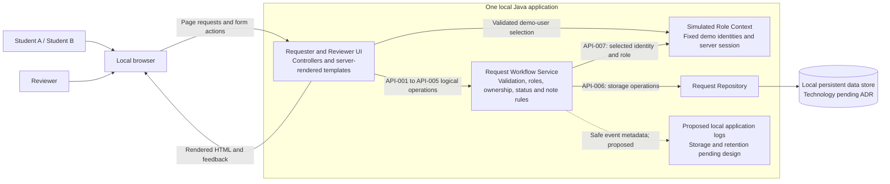

# Architecture Overview — CampusConnect

> **Status:** Proposed for Cycle 1; final A3 review pending
> **Baseline version:** PR #48 working draft; final submission tag pending
> **Last updated:** 2026-10-15
> **Owner:** Shú Perez · **Backup:** Giancarlo Herrera
> **Team:** Codex Ramblers (Team 2)

This document describes the proposed CampusConnect structure and workflow. It
aligns with the requirements from merged PR #46, component/API contracts from
merged PR #43, planned testing from merged PR #44, and data/context document
from merged PR #47 (including #49). It does not claim a running application or
final architecture approval. Significant technology decisions belong in ADRs.

---

## 1. Project Information

| Item | Team Response |
|---|---|
| Project name | CampusConnect |
| Team number / name | Team 2 — Codex Ramblers |
| Repository URL (clone) | https://github.com/victordodan/-comp330-f26-team-02.git |
| Architecture owner | Shú Perez |
| Backup owner | Giancarlo Herrera |
| Cycle 1 vertical slice | Student submits a synthetic request; Reviewer processes and resolves it; the owner views the result. Reviewer may reopen it. Local Java application with server-rendered pages and persistent local data. |
| AI governance | Development assistance follows the [AI Use Policy](../ai/ai-policy.md) and [AI Use Log](../ai/ai-use-log.md). Runtime AI is excluded from Cycle 1. |

---

## 2. System Overview

CampusConnect provides one bounded student support-request workflow. Students
submit and view their own synthetic requests. A reviewer inspects requests,
changes status, and records an editable student-visible note or resolution.

The intended path is **student submission → validation and storage → reviewer
inspection → In Progress → saved resolution → Resolved → student views result**.
Reviewer may reopen Resolved to In Progress while preserving the current note.

Cycle 1 runs locally for a classroom demonstration, using Java and
server-rendered pages. No paid hosting, paid runtime services, shared deployed
website, or external runtime integration is required. The rules are proposed
behavior; implementation and verification remain future work.

**Cycle 1 vertical slice:**

1. Select Student A or Student B and submit title, category, and description.
2. Validate the request, assign its ID/owner/timestamps and status Submitted, and persist it before confirming success.
3. Select Reviewer and inspect requests from both students.
4. Move Submitted to In Progress.
5. Save a nonblank resolution and move In Progress to Resolved; reopen to In Progress if needed, preserving text.
6. Select the owning student and view the current stored status and note/resolution.
7. Preserve requirement, contract, review, and later test evidence as that work occurs; verify persistence across ordinary application restarts.

### Structural Approach

One local Java application contains the Requester and Reviewer UI, Request
Workflow Service, Request Repository, and Simulated Role Context. Controllers
and server-rendered templates implement the UI boundary. Services enforce
validation, role/ownership checks, and workflow rules. Repository code owns
storage operations. These logical components do not require separately deployed
services or a separate frontend application.

Only the workflow service initiates business storage operations through the
repository. The browser has no direct database access. Demo identity options
are application-owned configuration; the selected identity is stored in the
server session. The persistence technology and framework remain pending ADR
choices. Spring Boot, Thymeleaf, Maven, and file-backed H2 are recommendations.

---

## 3. Users, Roles, and Permissions

| User / Role | Primary Goals | Allowed Actions | Limitations / Approvals |
|---|---|---|---|
| Student Requester (Student A / Student B) | Submit a request and view its progress | Submit valid requests; list/view only their own requests, current status, and current note/resolution | Cannot change status, edit reviewer notes, access reviewer operations, or edit/delete submitted requests |
| Support Reviewer (Reviewer) | Inspect and process requests | List/inspect both students' requests; make permitted status changes; save or replace note/resolution text | Cannot use student-only submission; resolving requires saved nonblank text; clearing text while Resolved is prohibited |

**Trust boundaries:** browser inputs and normal form-supplied roles/requester IDs
are untrusted. Workflow operations use server-session identity and check roles
and ownership on every call. Missing or invalid context is rejected. The demo
selector validates a selection from Student A, Student B, and Reviewer, then
updates the session; it deliberately permits switching identities and is not
real authentication or production privacy protection. Switching users does not
reassign stored requests. No administrator or role-management workflow exists.

---

## 4. Architecture Diagram

The diagram is versioned in this document. It shows logical boundaries, not
separate servers. No external identity provider, administrator, runtime AI,
paid service, or institutional integration is part of the Cycle 1 architecture.

---

## 5. Component Responsibility Map

| Component | Owns / Responsible For | Must Not Own | Inputs / Outputs | Evidence Link |
|---|---|---|---|---|
| Requester and Reviewer UI | Page rendering, form handling, user feedback, student views, and reviewer queue/detail views | Final workflow/permission decisions or direct storage access | In: page/form actions; Out: HTML, feedback, logical service operations | [Component responsibilities](component-responsibilities.md) |
| Request Workflow Service | Validation, role/ownership enforcement, status/note rules, coordination of storage and success/failure responses | HTML rendering, database implementation, or real authentication | In: request data and session context; Out: authorized results and repository operations | [API-001 through API-007](api-contracts.md) |
| Request Repository | Persistent request IDs, owners, fields, timestamps, current status/text, retrieval, and write results | Authorization policy or status-transition decisions | In: service storage operations; Out: records or storage failures | [API-006](api-contracts.md#api-006--request-repository-operations) |
| Local persistent data store | Durable request records across ordinary restarts | Workflow policy, role decisions, or browser access | In/out: repository storage operations; technology pending | [Data/context ownership](data-context.md) |
| Simulated Role Context | Fixed demo identities and selected session context | Real identity verification or final workflow authorization | In: validated demo selection/session state; Out: role and stable requester identity | [API-007](api-contracts.md#api-007--simulated-role-context) |
| Proposed local logging | Diagnostic metadata for accepted/rejected operations and storage failures | Request descriptions, note bodies, credentials, or user-visible edit history | In: safe event metadata; output location/retention pending | [Proposed logging](data-context.md#6-logging-and-observability-expectations) |

Full logical component detail: [component-responsibilities.md](component-responsibilities.md).

---

## 5.5 Architectural Qualities and Tradeoffs

| Quality / Concern | Architectural Response | Tradeoff / Consequence |
|---|---|---|
| Maintainability | Separate page handling, workflow rules, session context, and persistence within one application. | Requires clear internal interfaces and consistent names. |
| Testability | Service-side validation/authorization and controlled repository failures supplement browser tests. | UI demonstrations alone cannot prove permission or failure behavior. |
| Governability | Reviewer-only updates and explicit status/resolution rules; development AI use is disclosed separately. | Demo identity switching supports classroom testing but provides no real authentication. |
| Reviewability | Link the overview to requirements, contracts, data/context rules, ADRs, and planned tests. | Cross-document alignment and review records need maintenance. |
| Honesty about uncertainty | Keep framework/database, concurrency, retries, logging, and recovery decisions explicit. | Dependent implementation must wait for suitable decisions; no final readiness claim yet. |

---

## 6. Interfaces, APIs, and Tool Boundaries

| Interface / Tool | Consumer | Provider | Purpose | Protocol | Requirement | Status |
|---|---|---|---|---|---|---|
| API-001 | Requester UI | Request Workflow Service | Submit valid request | Logical service operation behind local page/form handling; routes pending | REQ-001, REQ-003 | Proposed |
| API-002 | Requester UI | Request Workflow Service | List/view student-owned requests | Logical service operation behind local page handling; routes pending | REQ-002 | Proposed |
| API-003 | Reviewer UI | Request Workflow Service | List/inspect all demo requests | Logical service operation behind local page handling; routes pending | REQ-004 | Proposed |
| API-004 | Reviewer UI | Request Workflow Service | Change status under transition rules | Logical service operation behind local form handling; routes pending | REQ-005 | Proposed |
| API-005 | Reviewer UI | Request Workflow Service | Save/replace note or resolution | Logical service operation behind local form handling; routes pending | REQ-006 | Proposed |
| API-006 | Request Workflow Service | Request Repository | Persist/retrieve request records | Internal storage boundary; technology pending | REQ-001 through REQ-006 | Proposed |
| API-007 | Request Workflow Service | Simulated Role Context | Obtain selected session identity/role | Internal session/context boundary; implementation pending | REQ-001 through REQ-006 | Proposed |

These seven logical contracts do not require seven public endpoints or a JSON
API. HTTP routes, form schemas, and framework details require a stack ADR.

**Valid status model:** Submitted → In Progress → Resolved, with Resolved →
In Progress for reopening. Only Reviewer may change status; other transitions
are rejected. Resolving requires saved nonblank note/resolution text. Reopening
preserves the text, request ID, and owner. Reviewer may edit the current text
(up to 2,000 trimmed characters) but cannot clear it while Resolved. See the
[requirements](../requirements/requirements.md) and [full contracts](api-contracts.md)
for field validation, permissions, and failure behavior.

---

## 7. Data and Context Ownership

Full detail is in [data-context.md](data-context.md).

| Data / Context | Authoritative Owner | Persistence | Visible To | Logging Expectation |
|---|---|---|---|---|
| Request (id, title, category, description, requester id, status, note/resolution, created/updated timestamps) | Request Workflow Service controls changes; stored records are authoritative | Local store via Request Repository | Owning student; Reviewer | Proposed operation/state metadata only; no request text |
| Demo identity | Application-owned fixed configuration, exposed by Simulated Role Context | Stable demo IDs; current selection in server session | Demo selector options visible to users; current context consumed by service | Proposed synthetic identity-selection metadata; no session tokens |
| Student/reviewer role mapping | Application-owned demo configuration | Fixed identity-to-role mapping | Application and users inspecting demo options | No role-management workflow or real-authentication log |
| Runtime AI context | Not applicable in Cycle 1 | None | No runtime AI access | Development AI assistance is recorded separately |
| Operational logs | Request Workflow Service | Proposed local logs; location/retention pending design | Developers inspecting the local demonstration | No note bodies, descriptions, credentials, or session cookies |

**Data rules:** synthetic data only. The server assigns ID, owner, timestamps,
and initial status Submitted; normal form values cannot override them. Request
data and stable owner identities survive ordinary restarts. Successful updates
preserve ID, owner, and creation time and update last-updated time. Rejected
operations leave records unchanged; failed writes must not produce success
confirmations. Failed listings must be distinguishable from empty lists.

**Assumptions:** ASM-001 means one current request status; ASM-002 means one
short current note/resolution without threaded messaging. Q-004's recorded
answer uses the demo selector and server session. These meanings are preserved
from [assumptions-open-questions.md](../requirements/assumptions-open-questions.md).
Longer-term retention/reset policy, logging, retries, and concurrent edits need
further decisions; no live identity or institutional integration is required.

---

## 8. AI / Tool Boundary and Governance Model

The [AI Use Policy](../ai/ai-policy.md) governs development assistance. The
[AI Use Log](../ai/ai-use-log.md) records actual assistance and human checking.
Runtime AI is excluded from Cycle 1. A future integration requires explicit
scope/risk review, an ADR, and applicable instructor approval.

### Governance references

| Question | Where the answer lives |
|---|---|
| What is permitted or prohibited? | [AI Use Policy](../ai/ai-policy.md) |
| What AI use has actually occurred? | [AI Use Log](../ai/ai-use-log.md) |
| Where is detailed verification recorded? | [AI verification notes](../ai/ai-verification-notes.md) |
| What did the team accept, modify, or reject? | The AI Use Log's Result / Action column; no unperformed review is claimed |

### AI boundary questions

This table distinguishes the selected Cycle 1 runtime exclusion from the
policy for development assistance; it does not approve future AI functionality.

| Boundary Question | How the AI Use Policy governs it | Where evidence is recorded |
|---|---|---|
| **Read** | Development tools may use approved project artifacts under the data restrictions; runtime models receive no request data. | AI Use Policy; data-context.md |
| **Infer** | Development suggestions require review; no runtime inference is performed. | AI Use Log; review records |
| **Call** | No runtime model, external tool, or paid service calls are required. | api-contracts.md; data-context.md |
| **Change** | No runtime AI changes records. Assisted repository changes follow the authorized development/review workflow. | AI Use Log; commits and PRs |
| **Approve** | Humans review assisted work; a future runtime integration needs separate scope and architecture approval. | AI Use Policy; review records; future ADR if applicable |
| **Observe** | Record significant development assistance and actual checking; runtime AI monitoring is not applicable. | AI Use Log; AI verification notes |
| **Log** | The repository AI Use Log records development assistance, not runtime prompts or operational request events. | AI Use Log; data-context.md |
| **Recover** | Review and correct unsuitable assisted work and affected artifacts. The application has no runtime AI dependency. | AI Use Policy; corrective commits/reviews |

### How to read this section

Development AI disclosure does not establish an operational AI component,
audit service, or passing application tests. Proposed operational events and
sensitive-data exclusions are described separately in [data-context.md](data-context.md).

---

## 9. Testing and Review Implications

All checks below are planned. No application execution or passing test is claimed.

| Architecture Claim | What Must Be Tested or Reviewed | Owner | Evidence Link |
|---|---|---|---|
| Request creation | Valid fields produce a stored Submitted request, unique ID, owner, and timestamps; invalid input creates none | Giancarlo Herrera | AC-REQ-001-01, AC-REQ-001-02, AC-REQ-003-01; [criteria](../requirements/acceptance-criteria.md) |
| Status transitions | Three permitted transitions; resolution requires text; reopening preserves ID/note; reject invalid changes | Giancarlo Herrera | AC-REQ-005-01, AC-REQ-005-02, AC-REQ-002-01 |
| Role boundary | Reviewer sees both students' requests; students cannot call reviewer operations or override roles with form data | Giancarlo Herrera | AC-REQ-004-01, AC-REQ-004-02 |
| Resolution note | Reviewer saves/replaces current text; owner sees it; oversized text and clearing while Resolved are rejected | Giancarlo Herrera | AC-REQ-006-01, AC-REQ-002-02 |
| API-001 contract | Exercise trimmed title/description boundaries, category validation, and failed storage | Mareddy Venkata Aravind | AC-REQ-001-02; [contracts](api-contracts.md) |
| API-002 contract | Student B cannot list or directly retrieve Student A's records; unknown IDs disclose no unrelated data | Mareddy Venkata Aravind | AC-REQ-002-03; [contracts](api-contracts.md) |
| Data/context control | Synthetic data only, stable ownership across identity changes, and no runtime AI access | Giancarlo Herrera | [Data/context rules](data-context.md); [test strategy](../testing/test-strategy.md) |
| Restart persistence | Status, owner, fields, and current text remain available after an ordinary restart and identity reselection | Giancarlo Herrera | AC-REQ-003-02 |
| Operational observability | Review proposed safe event metadata; simulate failures and distinguish failed listings from empty ones | Giancarlo Herrera | [Proposed logging](data-context.md#6-logging-and-observability-expectations); [test strategy](../testing/test-strategy.md) |

The 12 criteria are currently Proposed; baseline acceptance and executed test
results are separate milestones. Full plan: [test-strategy.md](../testing/test-strategy.md).
Retry and concurrency expectations must be decided before dependent tests.

---

## 10. ADR Index

| ADR ID | Decision Title | Status | Owner | File / Evidence Link |
|---|---|---|---|---|
| ADR-001 | Defer final production technology stack decision | Accepted — Deferred | Giancarlo Herrera | [ADR-001](../decisions/ADR-001-defer-production-technology-stack.md) |

**Note:** retain ADR-001 as historical evidence. Java, server-rendered pages,
and local execution are selected in the requirements baseline. Record the
implementation framework, database, build/test tools, and relevant tradeoffs in
new or superseding ADRs before dependent construction. Spring Boot, Thymeleaf,
Maven, and file-backed H2 remain recommendations; this overview does not accept
them or claim the ADR revisit is complete.

---

## 11. Known Architecture Risks and Open Questions

| ID | Risk / Question | Impact | Owner | Next Action |
|---|---|---|---|---|
| AR-001 | Demo selection permits impersonation; service-side roles and ownership must still hold within the selected context | Medium | Giancarlo Herrera | Test direct operations and forged form context; keep the authentication limitation explicit |
| AR-002 | Uncontrolled status expansion could invalidate contracts and tests | Medium | Malec Tarabein | Preserve the three-state baseline; review future changes through requirements and ADRs |
| AR-003 | Runtime AI or external integrations could expand the class-project scope or introduce costs | Medium | Shú Perez | Keep them excluded; require explicit scope/risk review for any future addition |
| AR-004 | Framework/database choices remain pending despite ADR-001's A3 revisit trigger | Medium | Giancarlo Herrera | Evaluate recommendations, record the stack ADR, and review estimates before implementation |
| AR-005 | Concurrent updates, retries, or storage failures could violate valid status/text combinations | High | Victor Dodan | Decide transaction/retry/concurrency behavior and local recovery; preserve the resolution invariant |

These concerns relate to R-001 (scope), R-002 (technology), R-004 (requirements),
R-005 (integration), and R-006 (late testing) in the [risk register](../planning/risk-register.md).
The detailed A3 planning and re-estimation update remains pending; this overview
does not claim those updates or available team hours have been confirmed.

---

## 12. Review & Change Control

- **Baseline under review:** PR #48's current proposed revision. Record the exact reviewed commit in the architecture review; create `a3-architecture-review` only at the final reviewed submission commit.
- **Peer review findings:** [architecture-review.md](../reviews/architecture-review.md) contains the partial review. Update findings and dispositions against the corrected overview, diagram, contracts, and data/context document; no final approval is implied.
- **Action tracking:** follow-up PRs and review actions must link actual corrections and closure evidence. The merged #43/#46 and #47 corrections need a follow-up review entry; historical findings must not be treated as current defects without rechecking them.
- **Change control:** material changes update affected requirements, overview/diagram, contracts, ADRs, tests, and planning evidence together. Preserve the A2 checkpoint.

### Architecture Evolution

| Effective Gate | Change | Reason | Related Evidence |
|---|---|---|---|
| A3 draft | Align the overview and inline diagram with the local Java behavior baseline and merged components/data rules | Remove conflicting states, roles, identity/API references, and premature baseline claims | PR #43, #44, #46, #47/#49; final review and stack ADRs pending |

---

## Final Check

- [x] Describes the proposed local system structure and logical boundaries.
- [ ] Record and review the remaining stack, concurrency, retry, logging, and recovery decisions in the appropriate ADRs/design evidence.
- [x] Links requirements, contracts, data/context rules, and planned verification without claiming passing tests.
- [ ] Complete independent cross-document review and resolve or explicitly disposition remaining findings.
- [ ] Confirm final A3 package readiness before creating the submission tag.
