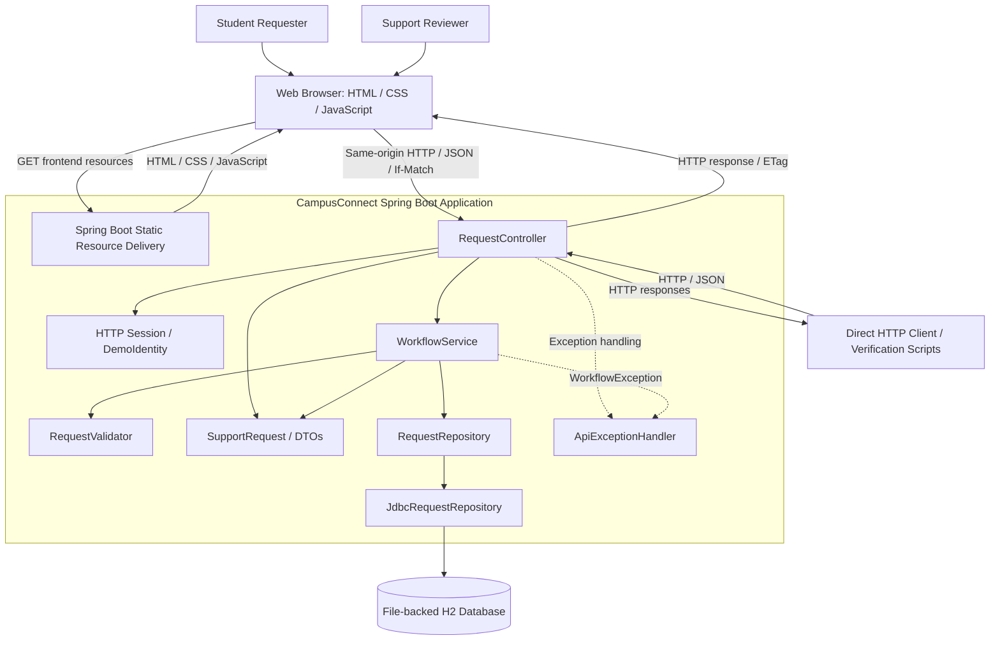
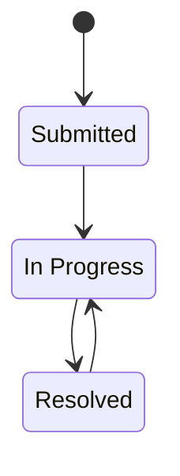

# Architecture Overview — CampusConnect

> **Status:** Assignment 6 — Cycle 2 Release Candidate
> **Baseline version:** Integrated implementation; final release tag pending
> **Target release tag:** `a6-final-release`
> **Last updated:** 2026-11-24
> **Owner:** Shú Perez
> **Team:** Codex Ramblers (Team 2)

This document describes the implemented CampusConnect architecture, its component boundaries, technical decisions, security controls, persistence mechanisms, and release verification requirements.

The original Assignment 3 architecture remains available through Git history. This revision reconciles the original design with the implemented REST API and same-origin browser presentation layer and establishes the architectural documentation for the Assignment 6 release candidate.

Final release approval remains subject to integrated testing, independent human review, and Team Lead authorization.

---

## 1. Project Information

| Item | Team Response |
|---|---|
| Project name | CampusConnect |
| Team number / name | Team 2 — Codex Ramblers |
| Repository URL (clone) | https://github.com/victordodan/-comp330-f26-team-02.git |
| Architecture owner | Shú Perez |
| Architecture & Development role backup | Venkata Aravind Mareddy, per the [team role matrix](../team/roles.md). |
| Architecture document backup | Giancarlo Herrera, as listed in the preceding revision of this document. |
| Cycle 1 scope | Student request submission, request tracking, reviewer triage, status transitions, and resolution notes. |
| Default application address | `http://127.0.0.1:8080/`. `campusconnect.local` is an optional local alias. |
| Cycle 2 release focus | Browser presentation, system reliability, architectural consistency, negative-path verification, security governance, observability, and operational readiness evidence. |
| Release target | `a6-final-release` |
| AI governance | [AI Use Policy](../ai/ai-policy.md) and [AI Use Log](../ai/ai-use-log.md) |

---

## 2. System Overview

CampusConnect is a student support request and workflow management system designed to replace fragmented request handling through email, spreadsheets, and informal communication with a centralized, structured workflow.

Students can submit support requests, retrieve their own requests, monitor request status, and view reviewer resolution notes. Support reviewers can inspect submitted requests, update their status, and record resolution information.

The primary workflow is:

1. A student selects a synthetic demo identity.
2. The student submits a support request.
3. The system validates and persists the request.
4. The system assigns a unique UUID, initial status, timestamps, and record version.
5. A reviewer retrieves the request through the reviewer API.
6. The reviewer updates its status and records resolution information.
7. The student retrieves the updated request and resolution note.

### 2.1 Structural Approach

CampusConnect uses a layered, single-application architecture implemented in Java and Spring Boot.

The application serves a same-origin HTML, CSS, and vanilla JavaScript browser client from `src/main/resources/static/`. The browser uses the Fetch API to communicate with the existing REST HTTP API, which accepts and returns JSON. Direct HTTP clients remain supported.

The controller manages HTTP communication and session identity, while the service layer enforces validation, authorization, ownership, and workflow rules.

The persistence layer uses Spring JDBC and a file-backed H2 database. Database operations are coordinated through Spring transactions.

The architecture separates:

- Browser presentation and temporary interface state.
- HTTP request handling.
- Input validation.
- Business and workflow logic.
- Domain data representation.
- Session-based identity management.
- Database access and persistence.
- HTTP error handling.

The backend and static resources are delivered through one Spring Boot application rather than independently deployed microservices. Browser presentation logic executes in the user's browser.

### 2.2 Technology Stack

| Technology | Purpose |
|---|---|
| Java | Backend implementation |
| Spring Boot | Application framework, static resource delivery, and REST API |
| HTML / CSS | Browser interface and responsive presentation |
| Vanilla JavaScript / Fetch API | Browser interaction, temporary state, and REST integration |
| Spring JDBC | Database access |
| H2 Database | Local persistent storage |
| Maven | Dependency and build management |
| HTTP / JSON | Client-server communication |
| HTTP Sessions | Synthetic demo identity context |
| ETags / If-Match | Optimistic concurrency control |
| GitHub | Version control, review, and release evidence |

The original architecture proposed server-rendered Thymeleaf pages. The implemented architecture instead uses a REST API extended by a same-origin static browser client, as approved in the [Cycle 2 Maturity Plan](../planning/cycle2-maturity-plan.md).

The interface decision is documented in [ADR-006](../decisions/ADR-006-rest-api-interface-alignment.md).

The custom application hostname requires local configuration and does not establish public hosting.

---

## 3. Users, Roles, and Permissions

### 3.1 Implemented Roles

| User / Role | Allowed Actions | Restrictions |
|---|---|---|
| Student Requester | Create requests, list owned requests, retrieve owned request details and resolution notes | Cannot access another student's requests or perform reviewer operations |
| Support Reviewer | List and inspect requests, update status, save or replace resolution notes | Must follow lifecycle rules and provide the current request version when modifying records |

### 3.2 Synthetic Identity Management

The application supports three fixed synthetic identities:

- `student-a`
- `student-b`
- `reviewer`

Identity selection is performed through:

`POST /api/demo/identity`

The selected identity is stored in the server-side HTTP session.

The application does not accept client-supplied role or ownership headers as authorization.

Headers such as `X-User-ID` and `X-User-Role` do not grant permissions.

### 3.3 Trust Boundaries

All client-provided data is treated as untrusted.

Authorization is enforced on the server. The workflow service remains responsible for enforcing role and ownership restrictions even when controller-level checks are present.

The demo identity selector intentionally permits switching between synthetic identities. It is not a production authentication mechanism.

Browser controls do not constitute authorization. Any caller who can access the demonstration identity selector can deliberately select the Reviewer identity.

Multiple tabs sharing a session cookie may share the selected synthetic identity. Independent browser profiles should be used for simultaneous student and reviewer demonstrations.

The backend remains authoritative for permissions, request ownership, workflow rules, and stored data.

Real institutional authentication, Loyola SSO, and real student account management remain outside the verified implementation scope.

### 3.4 Deferred Roles and Features

The original design identified potential future administrator and advisory AI roles.

These are not represented as implemented release capabilities.

Future implementation requires requirements review, architectural approval, and appropriate security verification.

---

## 4. Architecture Diagram



The diagram represents logical component boundaries between the browser, direct HTTP clients, and one Spring Boot application.

The browser executes the presentation layer using resources served by Spring Boot.

The HTTP client communicates with the controller rather than directly accessing the workflow service or database.

The workflow service coordinates business operations and delegates persistence through the repository interface.

The database is not directly accessible through the REST API.

The [architecture diagram](architecture-diagram.png) updated in `398ea7f` shows the same browser, REST, service, and JDBC/H2 boundaries.

---

## 5. Component Responsibility Map

| Component | Responsibility | Boundary |
|---|---|---|
| `index.html` | Identity selection, dashboards, request forms, and feedback structures | Does not enforce backend authorization |
| `styles.css` | Responsive presentation, status indicators, and visual feedback | Does not modify application data |
| `app.js` | Browser state, REST requests, conditional updates, and response handling | Does not replace server-side validation or persistence |
| Static resource delivery | Serves frontend resources | Does not grant protected API permissions |
| `RequestController` | REST endpoints, HTTP request handling, session identity, ETag parsing and response construction | Does not directly perform database operations |
| `RequestValidator` | Request field validation and normalization | Does not determine user permissions or perform persistence |
| `WorkflowService` | Authorization, ownership enforcement, lifecycle rules, transaction coordination and version validation | Does not directly handle HTTP rendering |
| `SupportRequest` | Domain representation of a support request | Does not independently grant permissions or perform database operations |
| `CreateRequestDto` | Input contract for request creation | Does not determine stored ownership |
| `UpdateStatusDto` | Input contract for status changes | Does not independently authorize transitions |
| `UpdateNoteDto` | Input contract for reviewer resolution notes | Does not independently authorize updates |
| `DemoIdentity` | Fixed synthetic identity and role representation | Does not provide real authentication |
| `RequestRepository` | Persistence abstraction | Does not determine workflow authorization |
| `JdbcRequestRepository` | JDBC-based storage, retrieval, and version-aware updates | Does not own business workflow policy |
| `ApiExceptionHandler` | Translation of application exceptions into HTTP error responses | Does not perform business operations |
| H2 Database | Persistent request records | Does not determine application-level permissions |

### 5.1 Source Code References

- [Browser Interface](../../src/main/resources/static/index.html)
- [Frontend Styling](../../src/main/resources/static/styles.css)
- [Browser Application Logic](../../src/main/resources/static/app.js)
- [RequestController](../../src/main/java/edu/loyola/campusconnect/controller/RequestController.java)
- [ApiExceptionHandler](../../src/main/java/edu/loyola/campusconnect/controller/ApiExceptionHandler.java)
- [RequestValidator](../../src/main/java/edu/loyola/campusconnect/validation/RequestValidator.java)
- [WorkflowService](../../src/main/java/edu/loyola/campusconnect/service/WorkflowService.java)
- [SupportRequest](../../src/main/java/edu/loyola/campusconnect/model/SupportRequest.java)
- [RequestRepository](../../src/main/java/edu/loyola/campusconnect/repository/RequestRepository.java)
- [JdbcRequestRepository](../../src/main/java/edu/loyola/campusconnect/repository/JdbcRequestRepository.java)

### 5.2 Request Processing

A typical request follows this sequence:

1. The HTTP client submits a request to `RequestController`.
2. The controller retrieves the selected identity from the server session.
3. The controller delegates the operation to `WorkflowService`.
4. The service checks role and ownership requirements.
5. Input and lifecycle rules are validated.
6. The service coordinates the appropriate repository operation within a transaction.
7. The repository retrieves or persists the record.
8. The controller returns the corresponding HTTP response.

For individual request responses, the controller includes an ETag representing the current record version.

### 5.3 Browser Interaction

The browser loads the static presentation resources and allows the user to select a supported synthetic identity.

After identity selection, the browser retrieves the appropriate student or reviewer request list.

Student interactions include request submission, request tracking, status filtering, and viewing saved resolution notes.

Reviewer interactions include queue inspection, status filtering, resolution note saving, status updates, and reopening resolved requests.

The browser processes HTTP responses and displays operation feedback. Relevant request information is refreshed following successful modifications.

A confirmed modification followed by a failed dashboard refresh is distinct from a failed modification.

### 5.4 Browser Component Boundaries

The browser presentation layer coordinates user interaction and temporary interface state.

It does not independently establish request ownership, authorize workflow operations, enforce authoritative consistency rules, or maintain a separate persistent request database.

The existing backend remains authoritative for all protected application operations.

### 5.5 Architectural Qualities and Tradeoffs

| Quality | Architectural Response | Tradeoff |
|---|---|---|
| Maintainability | Separation of presentation, controllers, validation, workflow logic, domain models, and persistence | Component contracts must remain synchronized |
| Testability | Business rules and persistence are separated from HTTP handling | Multiple test layers are required |
| Reliability | Transactional persistence and explicit workflow invariants | Database failures still require operational handling |
| Consistency | Optimistic concurrency through version checks | Conflicting updates require the reviewer to reload |
| Security | Server-side role and ownership enforcement | Synthetic identity selection is not real authentication |
| Simplicity | Single Spring Boot application and local H2 storage | Limited production scalability |
| Reviewability | Source code, ADRs, tests, and release documentation are linked | Documentation must be maintained alongside implementation |
| Governability | Explicit human review and AI-use boundaries | Additional verification and documentation effort |
| Usability | Browser-based student and reviewer dashboards | Browser interaction and feedback require maintenance |
| Deployment simplicity | Same-origin static frontend served by Spring Boot | Frontend and backend share a deployment lifecycle |
| Browser state consistency | Server-authoritative records with temporary browser state | Displayed information may require refresh |

---

## 6. Interfaces, APIs, and Tool Boundaries

### 6.1 Implemented REST Endpoints

| Method | Endpoint | Authorized Identity | Purpose |
|---|---|---|---|
| POST | `/api/demo/identity` | Demo participant | Select a fixed synthetic identity |
| POST | `/api/requests` | Student | Create a support request |
| GET | `/api/requests` | Student | List owned requests |
| GET | `/api/requests/{id}` | Student | Retrieve an owned request |
| GET | `/api/reviewer/requests` | Reviewer | List all support requests |
| GET | `/api/reviewer/requests/{id}` | Reviewer | Retrieve an individual request |
| PATCH | `/api/requests/{id}/status` | Reviewer | Update request status |
| PATCH | `/api/requests/{id}/note` | Reviewer | Save or replace a resolution note |

Both PATCH endpoints require a valid `If-Match` header containing the expected request version.

Detailed HTTP contracts are documented in:

- [API Contracts](api-contracts.md)
- [HTTP API Guide](../testing/a4-http-api.md)

### 6.2 HTTP Response Semantics

| Status Code | Meaning |
|---|---|
| 200 OK | Successful retrieval or update |
| 201 Created | Successful request creation |
| 400 Bad Request | Invalid input, malformed version, or prohibited workflow operation |
| 403 Forbidden | Missing required demo identity or unauthorized operation |
| 404 Not Found | Request does not exist or is inaccessible to the selected student |
| 412 Precondition Failed | Submitted request version is stale |
| 428 Precondition Required | Required If-Match header is missing |
| 503 Service Unavailable | Storage or transaction failure prevents successful operation confirmation |

Storage failures must not produce successful operation confirmations.

### 6.3 Request Lifecycle

The supported request states are:

- Submitted
- In Progress
- Resolved



The following workflow invariants are enforced:

- New requests begin in the Submitted state.
- Only reviewers can change request status.
- Unsupported transitions are rejected.
- Resolution requires previously saved, nonblank resolution text.
- A resolved request may be reopened.
- Reopening preserves the request identifier, owner, and existing resolution note.
- Resolution text cannot be cleared while the request is Resolved.
- Resolution text cannot exceed 2,000 characters after normalization.

### 6.4 Optimistic Concurrency Control

Each request contains a numeric version.

New requests begin at version `0`.

Individual request responses expose the version through an ETag.

Example:

```http
ETag: "0"
```

Reviewer modifications must include the expected version:

```http
If-Match: "0"
```

The application compares the supplied version with the stored version.

Successful modifications increment the version.

Stale modifications are rejected rather than silently overwriting newer data.

The reviewer must retrieve the current request before attempting another update.

This mechanism implements the consistency objectives established in ADR-003.

### 6.5 Browser-to-REST Integration

The browser presentation layer uses seven of the eight existing REST endpoints.

| Method | Endpoint | Browser Responsibility |
|---|---|---|
| POST | `/api/demo/identity` | Select or switch synthetic identity |
| POST | `/api/requests` | Submit a student support request |
| GET | `/api/requests` | Load the selected student's request dashboard |
| GET | `/api/reviewer/requests` | Load the reviewer queue |
| GET | `/api/reviewer/requests/{id}` | Retrieve current request details and ETag information |
| PATCH | `/api/requests/{id}/status` | Submit a conditional status modification |
| PATCH | `/api/requests/{id}/note` | Submit a conditional resolution note modification |

The student request-detail endpoint remains available through the REST API but is not directly invoked by the implemented browser workflow.

The browser presentation layer introduces no additional business REST endpoints.

Before submitting a reviewer modification, the browser retrieves current request details and compares the retrieved version and ETag with the version originally displayed to the reviewer.

If the versions differ, the browser prevents the stale modification and displays conflict feedback.

Eligible modifications include the applicable `If-Match` header.

The backend remains responsible for the authoritative version comparison and conditional database update, including conflicts occurring after the browser retrieves the current version.

The browser does not automatically overwrite newer stored data or automatically retry conflicting reviewer modifications.

---

## 7. Data and Context Ownership

### 7.1 Data Ownership

| Data | Authoritative Owner | Persistence |
|---|---|---|
| Request UUID | Workflow service and stored record | H2 |
| Student ownership | Server-selected student identity at creation | H2 |
| Title, category, and description | Validated request record | H2 |
| Request status | Workflow service | H2 |
| Resolution note | Authorized reviewer through workflow service | H2 |
| Creation timestamp | Server | H2 |
| Last-updated timestamp | Server | H2 |
| Request version | Workflow service and version-aware repository | H2 |
| Selected demo identity | Server HTTP session | Session context |
| Displayed request records | Server response represented in browser state | Temporary browser memory |
| Displayed identity | Browser representation of selected session identity | Temporary browser memory |
| Active status filter | Browser presentation layer | Temporary browser memory |
| Unsaved request form input | Browser presentation layer | Temporary browser memory |
| Unsaved reviewer note | Browser presentation layer until explicitly saved | Temporary browser memory |
| Loading and operation feedback | Browser presentation layer | Temporary browser memory |
| Runtime AI context | Not applicable | None |

### 7.2 Persistence

The application uses Spring JDBC and a file-backed H2 database.

The documented default database location is:

`jdbc:h2:file:./data/campusconnect`

The database path is relative to the application's working directory.

Persistent records remain available across ordinary application restarts when the same database location is reused, as demonstrated by the recorded November 24, 2026, same-store restart exercises.

The integrated operational verification at revision `0860160bc458af670c7944ccd035d21425e7511d` confirmed retention of the original request identifier, status, resolution note, and ETag.

Giancarlo Herrera separately reported successful request retention during the Windows operational exercise.

A different working directory or datasource configuration may select a different database.

Restart persistence must not be interpreted as proof of backup restoration or disaster recovery.

Reference: [Runtime Evidence](../observability/runtime-evidence.md).

### 7.3 Transactional Integrity

The workflow service uses Spring's `TransactionTemplate` to coordinate database operations.

The persistence mechanism supports:

- Unique UUID-based request identifiers.
- Stable request ownership.
- Transactional storage operations.
- Version-aware updates.
- Preservation of immutable request fields.
- Rejection of conflicting updates.
- Failure handling without false success confirmation.

Successful updates preserve the original request ID, owner, and creation timestamp while updating the modification timestamp and record version.

### 7.4 Data Protection

CampusConnect is restricted to synthetic demonstration data.

Real student information, institutional credentials, confidential records, and other sensitive personal information must not be introduced into the demonstration environment.

Operational evidence must avoid exposing request descriptions, resolution note bodies, credentials, and session tokens.

Additional data ownership documentation is available in [data-context.md](data-context.md).

### 7.5 Browser State and Demonstration Data

The browser maintains temporary interface state required for user interaction.

Temporary browser state is not an independent authoritative request database.

Unsaved form input and reviewer note text may be lost when the interface refreshes, changes identity, or re-renders relevant components.

Reviewer resolution notes become authoritative only after a successful backend save operation.

The [demonstration data script](../../scripts/demo-data.sh) prepares synthetic records through the existing REST API and modifies the configured persistent application database.

The initial recorded local execution created six synthetic requests and completed ten reviewer updates.

A separate integrated browser candidate exercise at revision `373a0f6` recorded a repeated setup execution that skipped all six existing matching requests.

Sequential existing-record matching reduces unnecessary duplicate creation. It does not establish atomic duplicate prevention across concurrent executions or automatic recovery from interrupted setup.

---

## 8. AI / Tool Boundary and Governance Model

CampusConnect operates under the team's AI Use Policy.

AI is used as an engineering support tool rather than an independent decision-maker.

The reviewed application does not include a runtime AI component that can create requests, modify records, approve workflow changes, or access institutional systems.

### 8.1 Governance Boundaries

| Boundary | Rule |
|---|---|
| Read | Development AI may inspect permitted project artifacts |
| Infer | AI may suggest architectural improvements, code, documentation, and test scenarios |
| Call | No runtime AI or external AI service is part of the reviewed workflow |
| Change | AI-assisted changes require human review before integration |
| Approve | Release and architecture approval remain human responsibilities |
| Record | Material AI assistance must be documented in the AI Use Log |

### 8.2 Governance Evidence

- [AI Use Policy](../ai/ai-policy.md)
- [AI Use Log](../ai/ai-use-log.md)
- [AI Verification Notes](../ai/ai-verification-notes.md)

AI-generated documentation is not independently sufficient to establish implementation correctness, test success, or release readiness.

Human reviewers remain responsible for verifying source-code alignment, technical accuracy, and the disposition of AI-assisted changes.

---

## 9. Testing and Review Implications

Architecture verification must demonstrate both successful workflows and rejected operations.

### 9.1 Positive-Path Verification

| Architecture Claim | Required Evidence |
|---|---|
| Request creation | Valid input creates a persisted request with a UUID and initial version |
| Student visibility | Students retrieve their own requests |
| Reviewer visibility | Reviewer retrieves requests from both synthetic students |
| Status transitions | Permitted lifecycle transitions succeed |
| Resolution notes | Reviewer saves notes that are visible to the owning student |
| Persistence | Records remain available after restarting against the same store |
| Versioned updates | Successful modifications increment the request version |
| Browser presentation | Required HTML, CSS, and JavaScript resources are available |
| Browser interaction | Student and reviewer workflows operate through the browser |
| Session switching | Synthetic identity changes produce corresponding API permission changes |

### 9.2 Negative-Path and Boundary Verification

| Scenario | Expected Result |
|---|---|
| Request submitted with invalid fields | 400 Bad Request |
| Protected operation without selected identity | 403 Forbidden |
| Forged reviewer headers without reviewer session | 403 Forbidden |
| Student attempts reviewer-only listing | 403 Forbidden |
| Student attempts status modification | 403 Forbidden |
| Student attempts resolution note modification | 403 Forbidden |
| Student retrieves another student's request | 404 Not Found |
| Request identifier does not exist | 404 Not Found |
| Reviewer attempts unsupported status transition | 400 Bad Request |
| Reviewer resolves request without saved resolution text | 400 Bad Request |
| Reviewer clears resolution text while Resolved | 400 Bad Request |
| Resolution text exceeds allowed length | 400 Bad Request |
| Reviewer supplies malformed If-Match value | 400 Bad Request |
| Reviewer submits stale request version | 412 Precondition Failed |
| Reviewer omits required If-Match header | 428 Precondition Required |
| Database operation fails | No false success confirmation |
| Missing frontend resource | 404 Not Found |
| Unsupported synthetic identity | 403 Forbidden |
| Reviewer attempts protected reviewer operation after switching to a student identity | 403 Forbidden |

Rejected operations must preserve existing stored data.

### 9.3 Verification Evidence

Relevant repository evidence includes:

- [Controller Tests](../../src/test/java/edu/loyola/campusconnect/controller/RequestControllerTest.java)
- [Workflow Service Tests](../../src/test/java/edu/loyola/campusconnect/service/WorkflowServiceTest.java)
- [Frontend Integration Tests](../../src/test/java/edu/loyola/campusconnect/controller/FrontendIntegrationTest.java)
- [Frontend Smoke Testing Script](../../scripts/frontend-smoke-test.sh)
- [Demonstration Data Script](../../scripts/demo-data.sh)
- [Test Strategy](../testing/test-strategy.md)
- [HTTP API Verification](../testing/a4-http-api.md)
- [CI Evidence](../testing/ci-evidence.md)
- [A5 Acceptance Evidence Matrix](../testing/a5-acceptance-evidence-matrix.md)
- [Final Testing Evidence](../testing/final-test-evidence.md)

#### Recorded Cycle 2 Verification

| Verification Context | Recorded Results |
|---|---|
| Local frontend verification by Shú Perez, November 24, 2026 | 38 smoke checks passed, zero failed; six demonstration requests created; ten reviewer updates completed |
| Recorded local checkout | `f09bd551456c539c92b185dcbbabc0d29f192be6` |
| Integrated browser candidate `373a0f6` | 38 passing HTTP smoke checks; Chromium workflow verification covering student submission, student isolation, reviewer modifications, stale-edit rejection, and owner visibility; repeat setup skipped six matching records |
| Integrated revision `0860160bc458af670c7944ccd035d21425e7511d` | Codex-performed Linux build and operational verification: 51 Maven tests passed with zero failures, errors, or skips; 36 packaged HTTP checks and five restart checks passed |
| Separate Windows exercise reported by Giancarlo Herrera | Ten of ten manual workflow checks passed; same-store restart retention reported |

Supporting evidence:

- [Runtime Evidence](../observability/runtime-evidence.md)
- [Recorded CI Execution](https://github.com/victordodan/-comp330-f26-team-02/actions/runs/45543404188)
- [Packaged Workflow Transcript](../../test-evidence/a6-operations-0860160/workflow.jsonl)
- [Packaged Restart Transcript](../../test-evidence/a6-operations-0860160/restart.jsonl)

HTTP smoke checks, automated regression tests, and browser exercises are distinct evidence categories.

The local checkout identifier does not independently establish the running application binary.

Historical test evidence must remain associated with the revision on which it was produced.

Final Assignment 6 test results must identify the tested release candidate and record actual outcomes, failures, blocked scenarios, and remaining limitations.

This architecture document does not independently certify that every listed test has passed.

### 9.4 Observability and Operational Evidence

Operational readiness is supported through separate observability and operations documentation.

Relevant evidence includes:

- [Observability Plan](../observability/observability-plan.md)
- [Runtime Evidence](../observability/runtime-evidence.md)
- [Metrics Notes](../observability/metrics-notes.md)
- [Operational Runbook](../operations/runbook.md)

Operational evidence should distinguish successful requests, rejected operations, storage failures, and concurrency conflicts where supported by the implementation.

The existence of an observability plan does not establish that all proposed metrics, logging mechanisms, or recovery procedures have been implemented or verified.

---

## 10. ADR Index

Architecture Decision Records preserve significant technical decisions, alternatives, rationale, and tradeoffs.

| ADR | Decision | Evidence |
|---|---|---|
| ADR-001 | Defer final production technology stack | [ADR-001](../decisions/ADR-001-defer-production-technology-stack.md) |
| ADR-002 | Cycle 1 technology stack | [ADR-002](../decisions/ADR-002-cycle-1-technology-stack.md) |
| ADR-003 | Request consistency and concurrent updates | [ADR-003](../decisions/ADR-003-request-consistency.md) |
| ADR-004 | Local persistence and recovery | [ADR-004](../decisions/ADR-004-local-persistence-and-recovery.md) |
| ADR-0005 | Persistence implementation clarification | [ADR-0005](../decisions/ADR-0005-in-memory-persistence.md) |
| ADR-006 | REST API interface alignment and browser presentation | [ADR-006](../decisions/ADR-006-rest-api-interface-alignment.md) |

ADR-001 preserves the historical production-stack deferral.

ADR-002 through ADR-004 establish the accepted local technology, consistency, and persistence decisions.

ADR-0005 clarifies that the integrated implementation uses transactional JDBC and file-backed H2 rather than in-memory request storage.

ADR-006 documents the accepted REST interface direction and the browser presentation extension. The frontend amendment remains subject to integration confirmation and independent review.

Historical ADR titles and decisions must be interpreted alongside their current implementation clarifications.

Future changes affecting persistence, authentication, deployment, concurrency, external integrations, or architectural boundaries require documented review and appropriate ADR updates.

---

## 11. Known Architecture Risks and Open Questions

| Risk ID | Risk / Limitation | Mitigation | Remaining Boundary |
|---|---|---|---|
| AR-001 | Synthetic identity impersonation | Loopback-only operation and synthetic data limit exposure | Demo participants can switch to any supported identity, including Reviewer. Role and ownership checks apply to the currently selected identity. |
| AR-002 | Invalid workflow transitions | Explicit lifecycle and resolution rules | Future state expansion requires review |
| AR-003 | Runtime AI or external integration risk | Runtime AI and institutional integrations excluded | Future integration requires governance review |
| AR-004 | Architecture and implementation divergence | Source-linked documentation and ADR maintenance | Final independent review required |
| AR-005 | Concurrent request modifications | Optimistic concurrency and transactional updates | Conflicting clients must reload |
| AR-006 | Local database loss | Persistent H2 storage and controlled local operation | Backup restoration requires separate verification |
| AR-007 | Limited operational visibility | Observability planning and runtime evidence | Final monitoring coverage requires verification |
| AR-008 | Limited production scalability | Bounded single-application architecture | Distributed deployment and sustained load are not established |

### 11.1 Known Limitations

The architecture does not establish:

- Production authentication or institutional SSO.
- Real student account management.
- Production deployment readiness.
- Verified distributed or multi-instance operation.
- Verified disaster recovery or backup restoration.
- Automated notification delivery.
- Comprehensive browser compatibility or accessibility compliance.
- Independent identities across tabs sharing the same session.
- Automatic recovery of unsaved browser input.
- Atomic demonstration data duplicate prevention or automatic recovery from interrupted setup.
- Runtime AI integration.
- Production-scale performance guarantees.

The graphical frontend is implemented and supported by recorded HTTP smoke checks and scoped browser exercises.

Same-store restart persistence has also been demonstrated; backup restoration remains unverified.

These limitations define the boundaries of the reviewed classroom implementation.

They must not be represented as completed features without corresponding implementation and verification evidence.

Additional information is maintained in:

- [Known Limitations](../release/known-limitations.md)
- [Defect Log](../quality/defect-log.md)
- [Risk Register](../planning/risk-register.md)

---

## 12. Review and Change Control

### 12.1 Architecture Evolution

| Assignment | Architectural Development |
|---|---|
| A3 | Established the proposed layered architecture, component responsibilities, logical contracts, and initial ADRs |
| A4 | Implemented the REST workflow, validation, synthetic identity context, persistence, and versioned updates |
| A5 | Reconciled implementation evidence, persistence clarification, release limitations, and quality-gate documentation |
| A6 | Extends the REST architecture with a same-origin browser presentation layer and reconciles final architectural documentation with the integrated release candidate and its reliability, security, observability, and verification evidence |

### 12.2 Change Control

Changes affecting the following areas require architectural review:

- Component boundaries and responsibilities.
- Browser presentation, REST integration, and session behavior.
- REST endpoints and DTO contracts.
- Database schema and persistence.
- Authorization and identity management.
- Workflow states and transition rules.
- Concurrency mechanisms.
- Runtime AI and external integrations.
- Observability and recovery mechanisms.
- Release limitations and technical debt.

Significant changes must be traceable through GitHub commits, pull requests, relevant ADRs, and supporting test evidence.

### 12.3 Release Baseline

The intended Assignment 6 release tag is:

`a6-final-release`

The release tag must identify the final integrated revision after required verification and release approval.

Architecture documentation, source code, API contracts, diagrams, and decision records must correspond to the tagged release.

The Architecture Lead is responsible for reviewing technical consistency and communicating unresolved architectural risks to the Team Lead.

The Team Lead retains responsibility for the final release decision.

---

## Final Architecture Release Checklist

### Documentation and Implementation Alignment

- [x] Describe the implemented REST-based architecture.
- [x] Describe the browser presentation layer and browser-to-REST integration.
- [x] Distinguish temporary browser state from persistent application data.
- [x] Identify recorded frontend and integrated operational evidence.
- [x] Identify controller, validation, service, domain, and persistence boundaries.
- [x] Document implemented HTTP endpoints.
- [x] Document session-based synthetic identity management.
- [x] Document transactional JDBC and file-backed H2 persistence.
- [x] Document optimistic concurrency using ETags and If-Match.
- [x] Identify workflow invariants and permission boundaries.
- [x] Identify known architectural limitations.
- [x] Reference existing ADRs and supporting evidence.

### Final Verification and Release Approval

- [ ] Verify the architecture against the exact final release candidate.
- [ ] Confirm architecture diagram and API contract alignment.
- [ ] Confirm frontend alignment in component responsibilities and data context.
- [ ] Confirm ADR-006 amendment integration and review.
- [x] Confirm the architecture role backup against the [team role matrix](../team/roles.md).
- [ ] Review all applicable ADRs for final implementation consistency.
- [ ] Confirm negative-path and boundary test results.
- [ ] Confirm final CI evidence.
- [ ] Confirm observability and operational evidence.
- [ ] Record unresolved defects and accepted limitations.
- [ ] Record independent human architecture review.
- [ ] Update the AI Use Log with human verification evidence.
- [ ] Obtain final release authorization.
- [ ] Confirm the `a6-final-release` tag identifies the approved revision.

---

**Architecture Lead:** Shú Perez

See [Team Roles](../team/roles.md)

**Release status:** Candidate documentation; final verification and approval pending.
