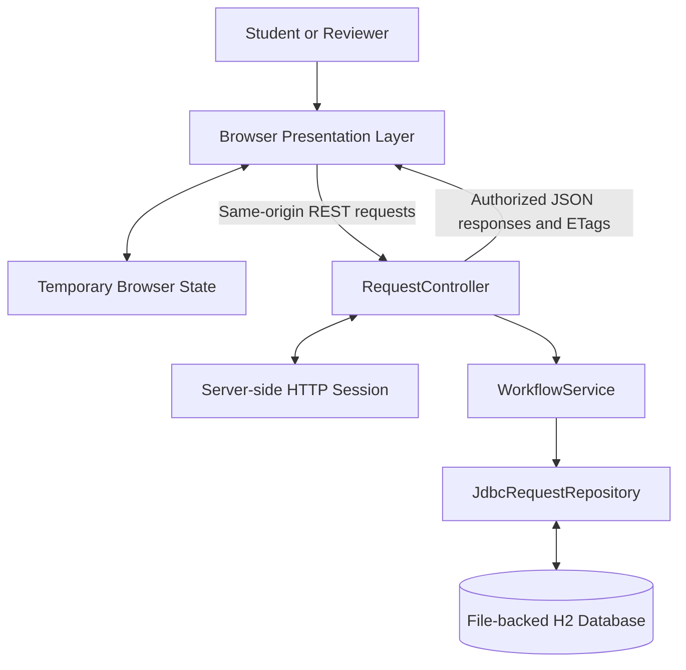

# Data and Context Ownership — CampusConnect

**Project:** CampusConnect  
**Team:** Team 2 — Codex Ramblers  
**Assignment:** A6 — Cycle 2 Final Release Candidate  
**Owner:** Shú Perez  
**Backup:** Giancarlo Herrera  
**Last Updated:** 2026-11-24  
**Target Release:** `a6-final-release`  
**Status:** Implementation-aligned documentation; final verification pending

---

## 1. Purpose and Scope

This document defines authoritative data ownership, data visibility, identity context, persistence, data lifecycle, security boundaries, browser state, and AI access restrictions for CampusConnect.

The implemented architecture uses HTML, CSS, vanilla JavaScript, Java, Spring Boot, REST HTTP endpoints, Spring JDBC, Maven, and file-backed H2.

The approved Cycle 2 browser presentation layer communicates with the existing REST API through same-origin HTTP requests.

The application is accessible through the locally configured address:

`http://campusconnect.local:8080`

This document replaces the proposed Assignment 3 data architecture with the reviewed implementation structure and aligns with:

- Architecture overview.
- Architecture diagram.
- API contracts.
- Component responsibilities.
- Requirements and acceptance criteria.
- Applicable architecture decision records.
- Security and operational limitations.
- Browser presentation and temporary interface state.

The following scope restrictions remain applicable:

- Synthetic request data only.
- No real student records or regulated information.
- No live institutional integrations.
- No real authentication or Loyola single sign-on.
- Local classroom demonstration.
- No required paid hosting or cloud deployment.
- No runtime user-facing AI.

Final acceptance remains subject to integrated verification and independent human review.

---

## 2. Data Ownership Summary

| Data or State | Authoritative Component | Persistence | Visibility |
|---|---|---|---|
| Request identifier | WorkflowService | File-backed H2 | Owning student and Reviewer |
| Student ownership | WorkflowService using selected session identity | File-backed H2 | Owning student and Reviewer |
| Request title | RequestValidator / WorkflowService | File-backed H2 | Owning student and Reviewer |
| Request category | RequestValidator / WorkflowService | File-backed H2 | Owning student and Reviewer |
| Request description | RequestValidator / WorkflowService | File-backed H2 | Owning student and Reviewer |
| Request status | WorkflowService | File-backed H2 | Owning student and Reviewer |
| Resolution note | WorkflowService | File-backed H2 | Owning student and Reviewer |
| Creation timestamp | WorkflowService | File-backed H2 | Owning student and Reviewer |
| Last-updated timestamp | WorkflowService | File-backed H2 | Owning student and Reviewer |
| Request version | WorkflowService / JdbcRequestRepository | File-backed H2 | Owning student and Reviewer |
| ETag | RequestController | Derived from stored version | Client receiving individual request response |
| Supported demo identities | DemoIdentity | Application-defined constants | Demo participants |
| Selected demo identity | RequestController / HTTP Session | Server-session state | Current session context |
| Displayed browser identity | Browser presentation layer | Temporary browser state | Current browser interface |
| Loaded browser request records | Backend REST response; browser maintains displayed copies | Temporary browser state | Current browser interface |
| Unsaved request form input | Browser presentation layer | Temporary browser state | Current browser interface |
| Unsaved reviewer note text | Browser presentation layer | Temporary browser state | Current browser interface |
| Selected status filter | Browser presentation layer | Temporary browser state | Current browser interface |
| Loading and operation feedback | Browser presentation layer | Temporary browser state | Current browser interface |
| Browser session cookie | Server-issued session context / Browser | Browser-managed session cookie | Applicable browser session |
| Runtime AI context | Not applicable | None | No runtime AI access |
| Operational evidence | Development and operations team | According to documented evidence procedures | Authorized project reviewers |

### Authoritative Data Rule

Stored request records represent the authoritative current request state.

WorkflowService owns application-level validation, authorization, ownership enforcement, lifecycle rules, and transaction coordination.

JdbcRequestRepository performs physical database operations.

RequestController exposes authorized results through the REST API.

HTTP clients cannot establish authoritative ownership, status, timestamps, or request versions.

The browser presentation layer maintains temporary copies of authorized REST responses for display and interaction.

Displayed browser information does not supersede the authoritative backend state.

### 2.1 Data and Context Boundaries

CampusConnect distinguishes three primary data and context boundaries.

| Boundary | Purpose | Lifetime |
|---|---|---|
| Browser presentation state | Display request information and coordinate user interactions | Temporary interface lifetime |
| Server-side HTTP session | Retain the selected synthetic identity | Applicable server-session lifetime |
| File-backed H2 database | Retain authoritative request records | Across ordinary restarts using the same database store |

The browser does not directly access the database.

The selected browser identity is not independently authoritative for authorization.

Persistent request records remain separate from temporary browser state and server-session identity.



---

## 3. Data Model and Database Structure

### 3.1 Domain Model

The implemented domain model is the immutable SupportRequest Java record.

**Source:** `src/main/java/edu/loyola/campusconnect/model/SupportRequest.java`

| Field | Java Type | Data Origin | Mutable Through API |
|---|---|---|---|
| id | String | Server-generated UUID | No |
| studentID | String | Selected student session identity | No |
| title | String | Student input, validated | No |
| category | String | Student input, validated | No |
| description | String | Student input, validated | No |
| status | String | Server-initialized; reviewer transition | Reviewer only |
| resolutionNote | String | Server-initialized; reviewer input | Reviewer only |
| createdAt | Instant | Server-generated | No |
| updatedAt | Instant | Server-managed | Automatically |
| version | long | Server-managed | Automatically |

The domain model represents the current request state rather than a complete history of previous changes.

The browser consumes the JSON representation of this model when rendering student and reviewer request information.

The browser does not independently generate authoritative values for system-managed fields.

### 3.2 Physical Database Schema

**Source:** `src/main/resources/schema.sql`

The implemented database contains the `support_request` table.

| Database Column | SQL Type | Constraint |
|---|---|---|
| id | VARCHAR(64) | Primary key |
| title | VARCHAR(100) | NOT NULL |
| category | VARCHAR(32) | NOT NULL |
| description | VARCHAR(2000) | NOT NULL |
| student_id | VARCHAR(32) | NOT NULL |
| status | VARCHAR(20) | NOT NULL |
| resolution_note | VARCHAR(2000) | NOT NULL |
| created_at | TIMESTAMP(9) WITH TIME ZONE | NOT NULL |
| updated_at | TIMESTAMP(9) WITH TIME ZONE | NOT NULL |
| version | BIGINT | NOT NULL |

The database primary key enforces unique stored request identifiers.

Application-level validation and workflow restrictions remain the responsibility of WorkflowService and RequestValidator.

The reviewed schema does not independently enforce the supported status transitions, allowed categories, or student identity permissions.

The Cycle 2 browser presentation layer introduces no additional database tables or schema requirements.

### 3.3 Database Configuration

**Source:** `src/main/resources/application.properties`

| Configuration | Default Value |
|---|---|
| Database engine | H2 |
| Storage mode | File-backed |
| Database URL | `jdbc:h2:file:./data/campusconnect` |
| Application bind address | `127.0.0.1` |
| Application port | `8080` |
| SQL initialization mode | Always |
| H2 browser console | Disabled |

These settings describe the default local classroom configuration.

The locally configured application address is:

`http://campusconnect.local:8080`

The custom hostname requires local configuration and does not establish public hosting or production deployment.

The database path is relative to the application's working directory.

Persistence across ordinary restarts requires reuse of the same database location.

The local database configuration is not a production security configuration. Configuration overrides and direct filesystem access remain outside the demonstrated application-role boundary.

### 3.4 Database Mapping

JdbcRequestRepository maps database rows into SupportRequest records.

The repository converts:

- Database `student_id` into Java `studentID`.
- Database `resolution_note` into Java `resolutionNote`.
- Database `created_at` into Java `createdAt`.
- Database `updated_at` into Java `updatedAt`.
- Database `version` into the Java long version field.

Timestamps are written using UTC offsets and retrieved as Java Instant values.

### 3.5 Browser Data Representation

The browser presentation layer consumes authorized JSON responses returned by the REST API.

Browser request information includes:

- Request identifier.
- Synthetic student ownership.
- Request title.
- Request category.
- Request description.
- Current status.
- Saved resolution note.
- Creation timestamp.
- Last-updated timestamp.
- Record version.

These values represent copies of backend responses rather than independently persisted browser records.

Client-side formatting and filtering do not modify the underlying stored request data.

---

## 4. Identity and Role Context

### 4.1 Supported Identities

CampusConnect uses three fixed synthetic identities.

| Identity | Role | Authorized Scope |
|---|---|---|
| student-a | Student | Create requests and retrieve own requests |
| student-b | Student | Create requests and retrieve own requests |
| reviewer | Reviewer | Retrieve all requests and perform permitted modifications |

These identities are defined in DemoIdentity.

No administrator identity or role-management interface is established by the reviewed implementation.

### 4.2 Session Context

Identity selection occurs through:

`POST /api/demo/identity`

RequestController validates the selected identity and stores it in the server-side HTTP session.

Session attribute:

`campusconnect.demoIdentity`

The controller retrieves the selected identity for protected operations and passes it to WorkflowService.

WorkflowService enforces the appropriate role and ownership rules.

The client must retain its session cookie between protected requests.

The browser presentation layer uses browser-managed session cookies through same-origin REST requests.

### 4.3 Identity Trust Boundary

The application does not trust client-provided role or ownership information as authoritative identity.

The following values cannot grant authorization:

- X-User-ID headers.
- X-User-Role headers.
- Client-provided studentID fields.
- Knowledge of another student's request identifier.
- Browser-displayed role or identity.
- Client-side visibility of reviewer controls.

CreateRequestDto contains a studentID field, but RequestController does not use that field to establish ownership.

Stored ownership is assigned from the selected server-session identity.

Switching the selected identity changes subsequent application permissions without changing stored request ownership.

### 4.4 Authentication Limitations

The demo selector intentionally permits switching between synthetic identities.

It does not establish:

- Real user authentication.
- Password verification.
- Institutional identity verification.
- Loyola single sign-on.
- Production account management.
- Protection from a participant who deliberately selects another demo identity.

The implemented authorization rules demonstrate application-level role and ownership behavior within the synthetic classroom environment.

They must not be represented as production authentication or institutional privacy protection.

### 4.5 Browser Identity and Session Boundaries

The browser provides identity selection controls for Student A, Student B, and Reviewer.

Following successful identity selection, the browser loads the corresponding student or reviewer dashboard.

The displayed browser identity is a presentation representation of the selected session context.

The server-side HTTP session remains authoritative.

Multiple tabs or windows within the same browser profile may share the same session cookie.

Selecting another identity in one tab may change the server-side identity used by subsequent requests from another tab.

Previously displayed browser information may become outdated until the interface refreshes or processes an authorization failure.

Independent browser profiles or isolated HTTP client sessions should be used for simultaneous student and reviewer demonstrations.

Switching identities does not modify stored request ownership.

Returning to the identity selection interface is not equivalent to invalidating the server-side session or performing production logout.

---

## 5. Sensitive and Protected Data

Only synthetic request data is permitted in the classroom demonstration.

| Data Category | Handling Rule |
|---|---|
| Synthetic request titles and descriptions | Permitted |
| Synthetic reviewer notes | Permitted |
| Synthetic student identities | Permitted |
| Real student records | Prohibited |
| Real grades or academic records | Prohibited |
| FERPA-protected information | Prohibited |
| HIPAA-protected information | Prohibited |
| Private personal information | Prohibited |
| Institutional credentials | Prohibited |
| API keys, access tokens, and private keys | Never commit or share with AI tools |
| Session cookies and session identifiers | Do not include in shared evidence or AI logs |
| Confidential institutional information | Prohibited |

These restrictions apply to:

- Request payloads.
- Database records.
- Test fixtures.
- Screenshots.
- Browser form inputs.
- Browser developer tools.
- Browser network inspection evidence.
- Runtime evidence.
- Operational logs.
- GitHub documentation.
- AI-assisted development context.

Sensitive-data restrictions follow the project AI Use Policy and classroom scope.

The application does not claim automated detection or removal of real personal information entered into free-text fields.

Human participants remain responsible for using synthetic data.

The browser presentation layer does not change the application's sensitive-data restrictions.

---

## 6. Data Visibility and Access Boundaries

### 6.1 Application-Level Visibility

| Data or Operation | Student A | Student B | Reviewer |
|---|---|---|---|
| Create Student A request | Allowed | Denied | Denied |
| Create Student B request | Denied | Allowed | Denied |
| Read Student A request | Allowed | Denied | Allowed |
| Read Student B request | Denied | Allowed | Allowed |
| List all requests | Denied | Denied | Allowed |
| Modify request status | Denied | Denied | Allowed |
| Save or replace resolution note | Denied | Denied | Allowed |
| Modify stored request ownership | Denied | Denied | Denied |
| Delete submitted request through API | Not implemented | Not implemented | Not implemented |

Permissions in this table refer to the currently selected synthetic identity.

They do not prevent a demonstration participant from selecting another available identity.

### 6.2 Student Request Isolation

Student-specific listing uses the selected student's identity to retrieve matching records.

Direct student retrieval checks the stored request owner against the selected identity.

If the selected student attempts to retrieve another student's request, the service returns a NOT_FOUND failure.

ApiExceptionHandler translates this failure into HTTP 404.

Returning HTTP 404 avoids explicitly disclosing the existence of another student's request through that operation.

The browser student dashboard retrieves the authorized student-owned request list through the existing REST API.

Client-side status filtering operates only on the returned request records.

The browser does not establish student isolation by filtering an unrestricted reviewer queue.

### 6.3 Reviewer Access

Reviewer may:

- List requests across both synthetic students.
- Retrieve individual request details.
- Perform permitted status transitions.
- Save or replace resolution notes.

Reviewer cannot modify immutable request fields through the implemented endpoints.

The browser reviewer dashboard displays the records returned by the authorized reviewer endpoints.

Reviewer controls remain subject to server-side authorization, validation, and concurrency enforcement.

### 6.4 Direct Database and Filesystem Access

Application-level role restrictions apply to the implemented REST workflow.

Direct access to the local database files or application host is outside the demonstrated role permission model.

The local implementation does not establish production database encryption, institutional access management, or protection against a privileged local operator.

### 6.5 Browser Presentation Visibility

The browser presentation layer provides role-specific interfaces.

| Interface | Displayed Data and Controls |
|---|---|
| Identity selection | Supported synthetic identity choices |
| Student dashboard | Authorized student-owned requests, request submission form, statuses, and saved notes |
| Reviewer dashboard | Authorized reviewer queue, request information, status controls, and resolution note controls |
| Operation feedback | Relevant success, loading, conflict, and failure information |

Browser visibility restrictions are not substitutes for backend authorization.

Frontend HTML, CSS, and JavaScript resources may be retrieved independently of protected REST data.

Static resource availability does not grant access to student or reviewer request records.

---

## 7. Data Lifecycle

### 7.1 Request Creation

Related contract: API-001.

The student submits:

- title
- category
- description

RequestValidator normalizes and validates the submitted fields.

| Field | Validation Rule |
|---|---|
| Title | 5–100 characters after trimming |
| Category | Academic, IT, Campus Services, or Other |
| Description | 10–2,000 characters after trimming |

WorkflowService generates:

- UUID-based request identifier.
- Stable student ownership.
- Creation timestamp.
- Last-updated timestamp.
- Initial status Submitted.
- Initial empty resolution note.
- Initial version 0.

The complete request is inserted through RequestRepository.

Successful creation returns HTTP 201 and the initial ETag.

Invalid submissions must not create stored records.

The browser request form maintains submitted field values as temporary interface state until the corresponding REST operation is processed.

The browser does not independently persist the request or assign system-managed fields.

### 7.2 Request Retrieval

Related contracts: API-002 and API-003.

Students retrieve only records associated with their selected identity.

Reviewer may retrieve records across both synthetic students.

Individual request responses contain the current stored request state and version-derived ETag.

List responses return arrays of authorized records.

An empty successful list is distinguishable from a failed storage operation.

The browser maintains temporary copies of retrieved records for display and status filtering.

These displayed copies may become outdated when another authorized operation modifies the stored record.

### 7.3 Status Updates

Related contract: API-004.

| Current Status | New Status | Required Condition |
|---|---|---|
| Submitted | In Progress | Reviewer authorization and current version |
| In Progress | Resolved | Reviewer authorization, current version, and saved nonblank resolution note |
| Resolved | In Progress | Reviewer authorization and current version |

All other transitions are rejected.

Successful status updates preserve existing ownership, request content, creation timestamp, and resolution note.

The browser submits status modifications through the existing conditional REST endpoint.

Displayed status changes are not authoritative until the backend confirms successful modification.

### 7.4 Resolution Note Updates

Related contract: API-005.

Each request stores one current resolution note.

The note:

- Is editable only by Reviewer.
- Is trimmed before storage.
- May contain a maximum of 2,000 characters.
- Is normalized to an empty string when null.
- May be cleared while Submitted or In Progress.
- Cannot be cleared while Resolved.
- Is preserved when a resolved request is reopened.

Replacing a note replaces the current stored value.

Comment threads and note-edit history are not implemented.

Unsaved reviewer note text remains temporary browser state.

The browser provides a separate save operation for resolution notes.

Unsaved note text does not satisfy the backend requirement for a previously saved nonblank resolution note.

### 7.5 Retention

File-backed H2 retains request records across ordinary application restarts using the same database location.

Stable synthetic student identifiers allow a student to retrieve previously stored requests after reselecting the appropriate identity.

Same-store restart persistence was demonstrated during the recorded November 24, 2026, operational exercises.

The reviewed implementation does not establish:

- Automatic record expiration.
- A formal long-term retention period.
- Scheduled data deletion.
- Production archival procedures.
- Verified backup restoration.
- Verified disaster recovery.

Long-term retention and controlled fixture-reset procedures remain documented open questions.

Reference: [Runtime Evidence](../observability/runtime-evidence.md).

### 7.6 Deletion

No user-facing request deletion endpoint exists in the reviewed REST interface.

Students and reviewers cannot delete submitted requests through the implemented workflow.

Any controlled database reset or fixture cleanup must follow separately documented operational procedures.

Clearing temporary browser state does not delete persistent request records.

### 7.7 Temporary Browser State Lifecycle

The browser presentation layer maintains temporary interface state during application use.

| State | Origin | Lifecycle |
|---|---|---|
| Displayed identity | Successful identity selection | Updated when identity context changes |
| Loaded request records | Authorized REST responses | Replaced when request information refreshes |
| Status filter | User interaction | Maintained as temporary interface state |
| Request form input | Student interaction | Temporary until submission or interface reset |
| Unsaved reviewer note | Reviewer interaction | Temporary until saved or discarded |
| Loading indicators | Pending HTTP operations | Updated when operations complete |
| Operation feedback | HTTP responses and communication outcomes | Temporary interface feedback |
| Displayed record version | Authorized request response | Updated when newer request information is loaded |

The reviewed browser implementation does not establish an independent persistent request datastore using localStorage or another browser database.

Refreshing the page, changing identity, or re-rendering relevant interface components may discard unsaved input.

The application does not establish persistent browser draft recovery.

Saved request data remains in the configured H2 database independently of temporary browser state.

### 7.8 Synthetic Demonstration Data Lifecycle

The demonstration preparation script is located at:

`scripts/demo-data.sh`

The script creates and modifies synthetic request records through the existing REST API.

It uses the supported synthetic identities and existing request creation, reviewer inspection, status update, and resolution note contracts.

The script does not directly modify database files or bypass application authorization.

Its responsibilities include:

- Preparing synthetic student request records.
- Establishing representative workflow statuses.
- Saving synthetic reviewer resolution notes.
- Using current ETags for reviewer modifications.
- Checking for existing matching demonstration records before creating additional records.
- Reporting operation outcomes.

The script modifies the configured persistent database.

Successfully created demonstration records remain stored after the script completes.

Repeated sequential preparation can skip existing matching records.

The implementation does not establish:

- Atomic duplicate prevention across concurrent executions.
- A single transaction covering the complete preparation process.
- Automatic rollback of all previously completed operations.
- Automatic recovery of partially prepared demonstration records.
- Automatic deletion of previously created demonstration records.

Demonstration preparation must remain restricted to synthetic data and the intended local database store.

---

## 8. Data Consistency and Optimistic Concurrency

### 8.1 Immutable Request Fields

Successful status and note modifications preserve:

- id
- studentID
- title
- category
- description
- createdAt

Only the applicable status or resolution note, updatedAt, and version are modified.

### 8.2 Timestamp Management

WorkflowService assigns creation and modification timestamps.

During creation, createdAt and updatedAt are initialized to the same server-generated Instant.

During successful updates, WorkflowService ensures that updatedAt advances beyond the previous stored timestamp.

If the current clock value is not later than the stored timestamp, the service advances the stored timestamp by one nanosecond.

The database stores timestamps with nanosecond precision and time-zone information.

### 8.3 Version Management

Each request begins with version 0.

Successful status and note updates increment the version by one.

RequestController returns the current version through an ETag.

Example:

`ETag: "0"`

Reviewer modification requests must supply the expected version through If-Match.

Example:

`If-Match: "0"`

The supplied version must be a single quoted, nonnegative numeric value within the Java long range.

### 8.4 Atomic Version-Aware Updates

WorkflowService checks the supplied version against the current stored version.

JdbcRequestRepository performs the physical update using:

```sql
UPDATE support_request
SET status = ?,
    resolution_note = ?,
    updated_at = ?,
    version = ?
WHERE id = ? AND version = ?
```

The repository reports success only when exactly one row is updated.

This prevents a stale reviewer update from silently overwriting a newer stored version.

A stale update returns HTTP 412.

The client must retrieve the latest request and ETag before attempting another modification.

### 8.5 Transaction Boundaries

WorkflowService coordinates repository operations through Spring TransactionTemplate.

Database and transaction exceptions are translated into storage failures.

Successful responses must not be returned before the corresponding storage operation completes.

Rejected operations must preserve existing stored records.

The implemented concurrency mechanism addresses conflicting status and note modifications.

It does not establish exactly-once request creation, automatic deduplication, or complete idempotency guarantees.

### 8.6 Browser State Synchronization

The browser presentation layer supplements backend optimistic concurrency enforcement.

Before submitting a reviewer modification, the browser:

1. Identifies the version associated with the displayed request.
2. Retrieves current reviewer request details through the existing REST endpoint.
3. Obtains the current stored version and ETag.
4. Compares the retrieved version and ETag with the originally displayed version.
5. Prevents the modification when a mismatch is detected.
6. Submits the conditional modification when the versions agree.
7. Processes the authoritative backend response.
8. Refreshes relevant request information following successful modification.

The browser-side comparison does not eliminate the possibility of a concurrent update occurring between retrieval and modification.

WorkflowService and JdbcRequestRepository remain responsible for authoritative version checking and atomic conditional updates.

The browser does not automatically retry conflicting modifications or overwrite newer stored data.

### 8.7 Browser and Persistent Data Consistency

The following consistency boundaries apply to browser interaction.

| Situation | Required Interpretation |
|---|---|
| Unsaved request form input | Not a stored request |
| Unsaved reviewer note text | Not an authoritative resolution note |
| Previously loaded request record | Temporary representation that may become outdated |
| Successful creation response | Backend confirms stored request creation |
| Successful modification response | Backend confirms stored request modification |
| Failed conditional update | Existing newer stored state must remain protected |
| Successful modification followed by failed refresh | Modification succeeded; displayed information may remain outdated |
| Network failure during modification | Final operation outcome may be unconfirmed |
| Successful empty list | No matching authorized records returned |
| Failed listing | Retrieval failure rather than confirmed absence of records |

The browser must not treat temporary display state as authoritative persistent data.

---

## 9. Failure Handling and Data Protection

| Failure Scenario | HTTP Status | Data Protection Behavior |
|---|---|---|
| Invalid submission fields | 400 | No request created |
| Malformed JSON | 400 | Request rejected |
| Unsupported status transition | 400 | Existing status preserved |
| Resolve without saved note | 400 | Existing status preserved |
| Clear note while Resolved | 400 | Existing note preserved |
| Missing or unauthorized identity | 403 | Protected operation rejected |
| Student attempts reviewer modification | 403 | Existing request preserved |
| Cross-student request retrieval | 404 | No unauthorized request data returned |
| Unknown request identifier | 404 | No unrelated request returned |
| Stale expected version | 412 | Newer stored state preserved |
| Missing or blank If-Match | 428 | Modification rejected |
| Storage or transaction failure | 503 | No success confirmation |

ApiExceptionHandler translates handled application exceptions into structured HTTP error responses.

Error responses contain:

- code
- errors

Failure messages should not unnecessarily disclose request descriptions, resolution notes, credentials, or sensitive operational information.

The listed outcomes describe reviewed implementation behavior and expected verification results, not independently executed Assignment 6 tests.

### 9.1 Browser Failure Handling

The browser presentation layer interprets REST responses and communication failures.

Its responsibilities include:

- Communicating invalid submission and workflow errors.
- Communicating authorization failures.
- Clearing or resetting protected interface state when applicable.
- Communicating missing or inaccessible resources.
- Communicating stale-version conflicts.
- Communicating missing conditional update information.
- Communicating storage and transaction failures.
- Distinguishing unsuccessful retrieval from successful empty results.
- Distinguishing confirmed modifications from subsequent refresh failures.

A network failure does not independently establish whether a submitted operation was committed.

Automatic repetition of an operation with an unconfirmed outcome may create duplicate requests or conflicting modifications.

The browser does not establish exactly-once operation guarantees.

---

## 10. AI Context Sources and Limits

### 10.1 Development-Time AI Assistance

AI may assist with approved engineering activities, including:

- Requirements documentation.
- Architecture documentation.
- Source code development.
- Frontend development.
- Test planning.
- Documentation reconciliation.
- Engineering review preparation.

AI assistance does not replace human engineering judgment or release approval.

Team members must review, understand, and verify AI-assisted work before acceptance.

### 10.2 AI Access Restrictions

| Boundary | Rule |
|---|---|
| Read | Approved project artifacts and synthetic development context only |
| Infer | Development assistance within approved project scope |
| Call | No runtime AI tool calls in the support request workflow |
| Change | No runtime AI authorization to create or modify requests |
| Approve | AI cannot approve architecture decisions or final releases |
| Observe | No runtime AI monitoring capability is established |
| Log | Significant development assistance must be recorded |
| Recover | Core request workflow has no runtime AI dependency |

AI tools must not receive:

- Real student records.
- Private personal information.
- Institutional credentials.
- API keys or access tokens.
- Session cookies.
- Confidential institutional information.
- Unapproved sensitive project data.

### 10.3 AI Retention

The reviewed application does not create runtime AI prompts, responses, or model context.

The repository AI Use Log records development assistance rather than runtime application interactions.

Future runtime AI integration requires separate scope review, architecture decisions, security assessment, and applicable instructor approval.

The browser presentation layer introduces no runtime AI integration or independent AI context store.

References:

- [AI Use Policy](../ai/ai-policy.md)
- [AI Use Log](../ai/ai-use-log.md)

---

## 11. Logging and Observability Boundaries

Operational evidence should support investigation of request creation, authorized updates, rejected operations, and persistence failures without exposing unnecessary request content.

The following table defines expected safe observability boundaries.

| Event | Appropriate Evidence | Data to Exclude |
|---|---|---|
| Request creation | Request ID, synthetic actor reference, operation result, timestamp | Full request description |
| Status transition | Request ID, previous and new status, operation result | Free-text resolution note |
| Note modification | Request ID, operation result, timestamp | Full note content |
| Authorization rejection | Operation and safe failure category | Session cookies or credentials |
| Concurrency conflict | Request ID, expected version, failure category | Unnecessary request content |
| Storage failure | Operation and safe failure category | Credentials or sensitive configuration |
| Demo identity selection | Synthetic identity reference when appropriate | Session identifiers |
| Browser workflow verification | Synthetic identity, operation, response status, and outcome | Session cookies and unnecessary request content |
| Browser concurrency rejection | Request identifier, relevant version information, and outcome | Unsaved note text |
| Demonstration preparation | Synthetic record counts and operation outcomes | Credentials and session identifiers |
| Runtime AI activity | Not applicable | No runtime AI payloads |

These are observability and data-handling expectations.

They do not independently establish that every listed event is emitted by the application.

Actual runtime logging and metrics evidence must be reconciled with:

- [Observability Plan](../observability/observability-plan.md)
- [Runtime Evidence](../observability/runtime-evidence.md)
- [Metrics Notes](../observability/metrics-notes.md)
- [Operational Runbook](../operations/runbook.md)

Logs must not become an uncontrolled secondary store of request descriptions, resolution notes, or historical request content.

A complete production audit trail is not claimed.

Browser notifications and temporary interface feedback do not constitute a persistent audit log.

---

## 12. Assumptions and Architecture Dependencies

| Reference | Implemented Behavior or Remaining Boundary |
|---|---|
| ASM-001 | One current request status |
| ASM-002 | One current resolution note without threaded messaging |
| Q-001 | Submission validation and supported categories |
| Q-002 | Supported status transitions and reopening |
| Q-003 | Resolution note restrictions |
| Q-004 | Fixed synthetic identities and stable ownership |
| DC-DEP-001 | Session identity supplied through API-007 |
| DC-DEP-002 | Local Java, Spring Boot, Maven, and H2 architecture |
| ADR-001 | Production technology decisions remain deferred |
| ADR-002 | Local application and persistence technology selection |
| ADR-003 | Transactional updates and optimistic concurrency |
| ADR-004 | Local persistence and recovery expectations |
| ADR-0005 | Transactional JDBC and file-backed H2 implementation clarification |
| ADR-006 | REST interface alignment and approved browser presentation extension |

ADR-002 through ADR-004 were historically approved on October 16, 2026.

The original architecture proposed server-rendered pages and Post/Redirect/Get.

The reviewed implementation instead exposes REST HTTP endpoints extended by a same-origin static browser presentation layer.

Post/Redirect/Get is not claimed as implemented functionality.

The Cycle 2 browser presentation direction is documented in the [Cycle 2 Maturity Plan](../planning/cycle2-maturity-plan.md) and the corresponding [ADR-006](../decisions/ADR-006-rest-api-interface-alignment.md) amendment.

Original decisions remain historical engineering evidence. Implementation deviations and remaining limitations require explicit documentation and review.

The browser presentation layer does not change the authoritative request data model, persistence architecture, or existing ownership rules.

---

## 13. Open Questions and Remaining Limitations

| ID | Question or Limitation | Owner | Next Action |
|---|---|---|---|
| DQ-001 | Long-term retention and controlled synthetic data reset policy | Malec Tarabein | Define retention and reset procedures without undermining restart persistence |
| DQ-002 | Future runtime AI integration | Shú Perez | Retain as deferred unless separately approved |
| DQ-003 | Logging retention and visibility boundaries | Shú Perez | Reconcile observability evidence and operational procedures |
| Proposed DQ-004 | Production authentication and institutional identity integration | Ownership pending | Remain outside classroom release scope |
| Proposed DQ-005 | Duplicate submissions and exact retry behavior | Ownership pending | Document limitations and assess future idempotency requirements |
| Proposed DQ-006 | Backup restoration and disaster recovery verification | Ownership pending | Reconcile runbook and recovery evidence |

DQ-001 through DQ-003 preserve the original open-question identifiers and assigned owners.

DQ-004 through DQ-006 are proposed additional tracking items and require team reconciliation before adoption.

### 13.1 Browser and Demonstration Data Limitations

The following additional implementation boundaries must remain visible in the release documentation.

| Limitation | Current Boundary |
|---|---|
| Shared browser sessions | Multiple tabs may share the selected synthetic identity |
| Unsaved browser input | May be lost during refresh, identity switching, or interface re-rendering |
| Browser state synchronization | Displayed request information may become outdated |
| Browser draft recovery | Persistent draft recovery is not established |
| Network interruption | Modification outcome may remain unconfirmed |
| Duplicate demonstration preparation | Sequential matching reduces duplicate creation but does not establish atomic deduplication |
| Interrupted demonstration preparation | Previously completed operations may remain persisted |
| Demonstration data cleanup | No user-facing request deletion endpoint exists |
| Browser compatibility | Comprehensive cross-browser verification is not established |
| Backup restoration | Same-store restart retention is verified within recorded exercises; backup restoration remains unverified |

These limitations do not introduce additional formal DQ identifiers.

They must be reconciled with the existing known limitations, risk register, and operational procedures.

No production readiness, institutional compliance, or disaster recovery capability is established by this document.

---

## 14. Final Release Verification

### 14.1 Recorded Data and Persistence Evidence

The following previously recorded November 24, 2026, verification results support the reviewed data ownership, browser state, and persistence boundaries.

| Verification Context | Recorded Results |
|---|---|
| Local frontend verification by Shú Perez | 38 smoke checks passed, zero failed |
| Local demonstration data preparation | Six synthetic requests created and ten reviewer updates completed |
| Integrated browser candidate `373a0f6` | Scoped Chromium workflow verification, including student isolation, reviewer modifications, stale-edit rejection, and owner visibility |
| Repeated demonstration preparation | Six existing matching records skipped |
| Integrated revision `0860160bc458af670c7944ccd035d21425e7511d` | 51 Maven tests passed with zero failures, errors, or skips |
| Packaged HTTP workflow verification | 36 checks passed |
| Packaged restart verification | Five checks passed |
| Separate Windows exercise reported by Giancarlo Herrera | Ten of ten manual workflow checks passed and same-store restart retention reported |

The local frontend verification was performed using checkout:

`f09bd551456c539c92b185dcbbabc0d29f192be6`

The Linux build, packaged HTTP workflow, and restart checks were performed by Codex.

Giancarlo Herrera performed and reported the separate Windows browser and restart exercise.

The recorded restart exercises demonstrated retention of stored request information after a controlled application stop and restart using the same database store.

The packaged restart evidence includes retention of request identity, status, resolution note, and version-derived ETag.

These results do not establish verified backup restoration, crash recovery, production disaster recovery, or final tagged release acceptance.

Supporting evidence:

- [Runtime Evidence](../observability/runtime-evidence.md)
- [Integrated CI Execution](https://github.com/victordodan/-comp330-f26-team-02/actions/runs/45543404188)
- [Final Test Evidence](../testing/final-test-evidence.md)
- [Packaged Workflow Transcript](../../test-evidence/a6-operations-0860160/workflow.jsonl)
- [Packaged Restart Transcript](../../test-evidence/a6-operations-0860160/restart.jsonl)

The recorded results retain their original execution contexts, operators, and tested revisions.

### 14.2 Final Review Checklist

Before final Assignment 6 acceptance:

- [ ] Confirm domain model fields against the final Java implementation.
- [ ] Confirm database columns and constraints against schema.sql.
- [ ] Confirm database configuration against application.properties.
- [ ] Confirm synthetic identity and session boundaries.
- [ ] Confirm student ownership isolation.
- [ ] Confirm reviewer-only modifications.
- [ ] Confirm immutable request fields.
- [ ] Confirm timestamp management.
- [ ] Confirm version increments.
- [ ] Confirm atomic version-aware database updates.
- [ ] Confirm stale-version rejection.
- [ ] Confirm rejected operations preserve stored data.
- [ ] Confirm storage failures do not return false success.
- [ ] Reconcile recorded same-store restart evidence with the final release revision.
- [ ] Confirm temporary browser state and persistent data boundaries.
- [ ] Confirm browser session-sharing limitations.
- [ ] Confirm browser-side concurrency handling.
- [ ] Confirm unsaved browser input limitations.
- [ ] Confirm demonstration data persistence and duplicate-prevention boundaries.
- [ ] Reconcile backup restoration expectations with operational evidence.
- [ ] Reconcile logging expectations with actual runtime evidence.
- [ ] Confirm sensitive-data restrictions.
- [ ] Reconcile open questions and known limitations.
- [ ] Confirm architecture and API contract alignment.
- [ ] Confirm ADR-006 amendment integration.
- [ ] Confirm final test and CI evidence.
- [ ] Record independent human review.
- [ ] Record AI assistance and human verification.
- [ ] Confirm alignment with the approved a6-final-release revision.

Source-level documentation review does not replace runtime verification or final release authorization.

---

## 15. Related Engineering Evidence

### Architecture

- [Architecture Overview](architecture.md)
- [Architecture Diagram](architecture-diagram.png)
- [API Contracts](api-contracts.md)
- [Component Responsibilities](component-responsibilities.md)
- [ADR-006 — REST API Interface Alignment](../decisions/ADR-006-rest-api-interface-alignment.md)

### Requirements and Planning

- [Requirements](../requirements/requirements.md)
- [Acceptance Criteria](../requirements/acceptance-criteria.md)
- [Assumptions and Open Questions](../requirements/assumptions-open-questions.md)
- [Scope](../planning/scope.md)
- [Traceability](../planning/traceability.md)
- [Risk Register](../planning/risk-register.md)
- [Cycle 2 Maturity Plan](../planning/cycle2-maturity-plan.md)

### Implementation

- [Browser Presentation Resources](../../src/main/resources/static/)
- [Browser Interface](../../src/main/resources/static/index.html)
- [SupportRequest](../../src/main/java/edu/loyola/campusconnect/model/SupportRequest.java)
- [DemoIdentity](../../src/main/java/edu/loyola/campusconnect/model/DemoIdentity.java)
- [RequestController](../../src/main/java/edu/loyola/campusconnect/controller/RequestController.java)
- [WorkflowService](../../src/main/java/edu/loyola/campusconnect/service/WorkflowService.java)
- [RequestValidator](../../src/main/java/edu/loyola/campusconnect/validation/RequestValidator.java)
- [RequestRepository](../../src/main/java/edu/loyola/campusconnect/repository/RequestRepository.java)
- [JdbcRequestRepository](../../src/main/java/edu/loyola/campusconnect/repository/JdbcRequestRepository.java)
- [ApiExceptionHandler](../../src/main/java/edu/loyola/campusconnect/controller/ApiExceptionHandler.java)
- [Database Schema](../../src/main/resources/schema.sql)
- [Application Configuration](../../src/main/resources/application.properties)

### Testing, Release, and Operations

- [Test Strategy](../testing/test-strategy.md)
- [HTTP API Guide](../testing/a4-http-api.md)
- [CI Evidence](../testing/ci-evidence.md)
- [A5 Acceptance Evidence Matrix](../testing/a5-acceptance-evidence-matrix.md)
- [Final Test Evidence](../testing/final-test-evidence.md)
- [Frontend Smoke Testing Script](../../scripts/frontend-smoke-test.sh)
- [Demonstration Data Script](../../scripts/demo-data.sh)
- [Known Limitations](../release/known-limitations.md)
- [Operational Runbook](../operations/runbook.md)
- [Observability Plan](../observability/observability-plan.md)
- [Runtime Evidence](../observability/runtime-evidence.md)
- [Metrics Notes](../observability/metrics-notes.md)
- [Permission Boundaries](../security/permission-boundaries.md)

### AI Governance

- [AI Use Policy](../ai/ai-policy.md)
- [AI Use Log](../ai/ai-use-log.md)

### Related Pull Requests

- [PR #43](https://github.com/victordodan/-comp330-f26-team-02/pull/43) — Original Component Responsibilities and API Contracts.
- [PR #44](https://github.com/victordodan/-comp330-f26-team-02/pull/44) — Test Strategy Alignment.
- [PR #46](https://github.com/victordodan/-comp330-f26-team-02/pull/46) — Requirements and Acceptance Criteria Updates.
- [PR #48](https://github.com/victordodan/-comp330-f26-team-02/pull/48) — Historical Architecture Overview.
- [PR #119](https://github.com/victordodan/-comp330-f26-team-02/pull/119) — Assignment 6 Component Responsibilities Update.

### Cycle 2 Review References

- PR #116 — Architecture Overview.
- PR #117 — Architecture Diagram.
- PR #118 — API Contracts.
- PR #119 — Component Responsibilities.
- PR #120 — Data Context.
- PR #126 — HTML Browser Interface.
- PR #127 — Frontend Styling.
- PR #128 — Browser Application Logic.
- PR #129 — Frontend Integration Tests.
- PR #130 — Frontend Smoke Testing.
- PR #131 — Synthetic Demonstration Data Generation.

---

**Architecture Lead:** Shú Perez

**Backup:** Giancarlo Herrera

**Evidence Status:** Data and context ownership aligned with the reviewed backend implementation, database configuration, and documented Cycle 2 browser presentation layer. Final integrated verification, independent review, and release authorization remain pending.
