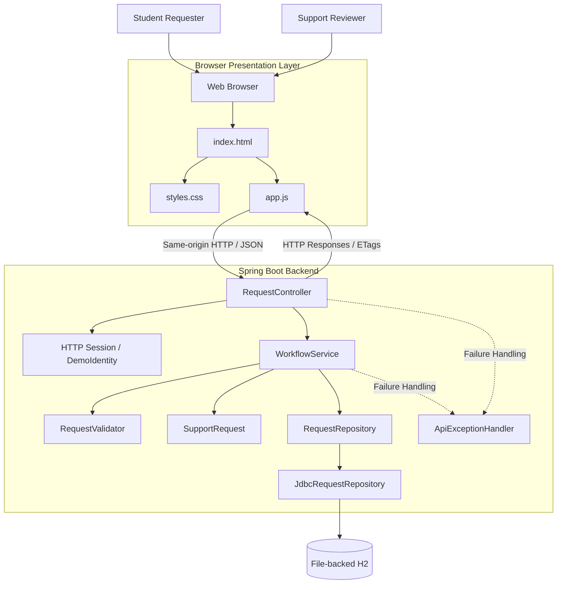
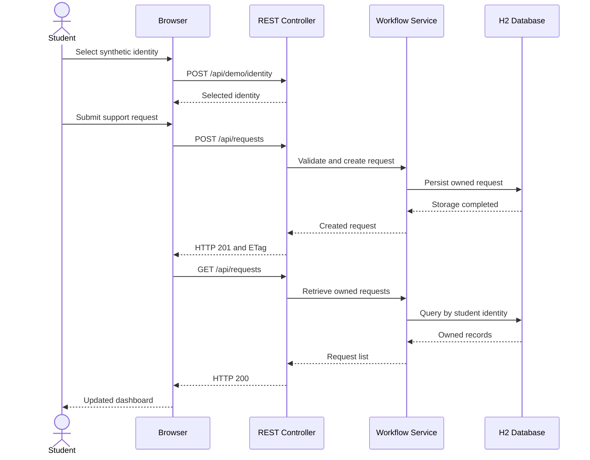
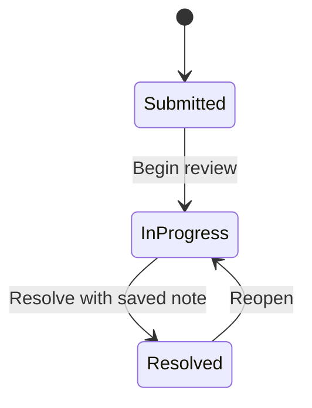
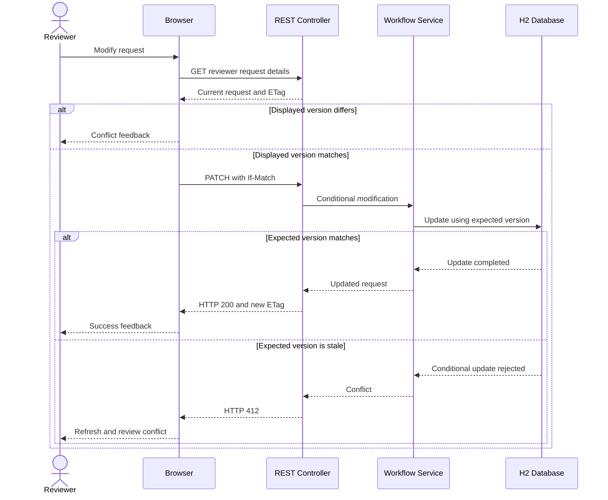

---

## 14. Cycle 2 Amendment — Browser Presentation Layer

### 14.1 Amendment Information

| Field | Details |
|---|---|
| Amendment Date | November 24, 2026 |
| Release Phase | Assignment 6 — Cycle 2 |
| Architecture Owner | Shú Perez |
| Decision | Extend the existing REST architecture with a same-origin browser presentation layer |
| Application Address | `http://campusconnect.local:8080` |
| Implementation Status | Implemented |
| Scope | Local classroom demonstration |
| Team Approval | Frontend scope approved as documented in the Cycle 2 maturity plan |
| Final Release Authorization | Pending final release-gate review |

This amendment extends the accepted REST architecture documented in ADR-006.

The original REST architecture decision and its recorded approval remain preserved.

The amendment does not replace the existing backend architecture or introduce a separate production technology stack.

---

### 14.2 Context and Motivation

The original implementation provided a complete support request workflow through REST HTTP endpoints.

Although the REST interface supported the required application behavior, users needed an HTTP client or scripted requests to interact with the system.

This introduced a usability limitation for classroom demonstrations and ordinary student and reviewer interactions.

The team approved a lightweight browser presentation layer to improve application usability while preserving the implemented REST backend.

The approved frontend scope is documented in:

[Cycle 2 Maturity Plan](../planning/cycle2-maturity-plan.md)

The objective is to provide a usable graphical interface without introducing unnecessary architectural complexity or replacing verified backend behavior.

---

### 14.3 Architectural Decision

Extend the existing Spring Boot application with a same-origin browser client implemented using:

- HTML.
- CSS.
- Vanilla JavaScript.
- Browser Fetch API.
- Existing REST endpoints.
- Existing server-side HTTP sessions.

The browser presentation layer is served directly by the Spring Boot application.

Frontend resources are located in:

`src/main/resources/static/`

The browser client communicates with the existing backend using HTTP requests and JSON representations.

No separate frontend application server, JavaScript framework, package manager, or additional frontend build pipeline is required.

The existing Spring Boot REST API remains the authoritative application interface.

---

### 14.4 Updated Architectural Structure

The browser presentation layer introduces an additional interaction boundary without transferring authoritative application responsibilities away from the backend.

---

### 14.5 Frontend Component Responsibilities

| Component | Responsibility | Implementation |
|---|---|---|
| Browser interface | Provides the graphical interaction structure | `index.html` |
| Presentation styling | Provides layout, responsive design, status indicators, and visual feedback | `styles.css` |
| Browser application logic | Coordinates interface state, HTTP requests, user actions, and response handling | `app.js` |
| HTTP client | Communicates with the existing REST endpoints | Browser Fetch API |
| Session handling | Associates API operations with the selected synthetic identity | Existing server-side HTTP session |
| Backend controller | Receives and processes HTTP requests | `RequestController.java` |
| Workflow service | Enforces application workflow and authorization rules | `WorkflowService.java` |
| Persistence layer | Stores and retrieves authoritative request records | `JdbcRequestRepository.java` |

The browser components are responsible for presentation and interaction coordination.

The backend remains responsible for:

- Authorization.
- Request ownership.
- Input validation.
- Workflow transition enforcement.
- Resolution note requirements.
- Concurrency control.
- Transaction management.
- Persistent storage.
- Authoritative error responses.

---

### 14.6 Frontend Implementation Artifacts

| Artifact | Purpose | Related PR |
|---|---|---|
| [`index.html`](../../src/main/resources/static/index.html) | Browser interface and dashboard structure | [#126](https://github.com/victordodan/-comp330-f26-team-02/pull/126) |
| [`styles.css`](../../src/main/resources/static/styles.css) | Responsive presentation and visual feedback | [#127](https://github.com/victordodan/-comp330-f26-team-02/pull/127) |
| [`app.js`](../../src/main/resources/static/app.js) | Browser workflow and REST integration | [#128](https://github.com/victordodan/-comp330-f26-team-02/pull/128) |
| [`FrontendIntegrationTest.java`](../../src/test/java/edu/loyola/campusconnect/controller/FrontendIntegrationTest.java) | Frontend integration verification | [#129](https://github.com/victordodan/-comp330-f26-team-02/pull/129) |
| [`frontend-smoke-test.sh`](../../scripts/frontend-smoke-test.sh) | Runtime HTTP smoke verification | [#130](https://github.com/victordodan/-comp330-f26-team-02/pull/130) |
| [`demo-data.sh`](../../scripts/demo-data.sh) | Synthetic demonstration data preparation | [#131](https://github.com/victordodan/-comp330-f26-team-02/pull/131) |

---

### 14.7 Browser-to-REST Interface

The browser presentation layer uses the following existing REST endpoints.

| Method | Endpoint | Browser Responsibility |
|---|---|---|
| POST | `/api/demo/identity` | Select a synthetic identity |
| POST | `/api/requests` | Submit a student support request |
| GET | `/api/requests` | Retrieve the selected student's requests |
| GET | `/api/reviewer/requests` | Retrieve the reviewer queue |
| GET | `/api/reviewer/requests/{id}` | Retrieve current reviewer request details and version information |
| PATCH | `/api/requests/{id}/status` | Submit a conditional workflow status update |
| PATCH | `/api/requests/{id}/note` | Submit a conditional resolution note update |

The existing student request-detail endpoint remains available through the REST API but is not directly required by the implemented browser workflow.

The browser presentation layer does not introduce additional business API endpoints.

The existing API contracts remain authoritative.

Reference:

[API Contracts](../architecture/api-contracts.md)

---

### 14.8 Student Interaction Workflow

The student-facing browser interface supports:

1. Selecting Student A or Student B.
2. Loading the selected student's dashboard.
3. Entering request information.
4. Submitting a support request.
5. Receiving operation feedback.
6. Retrieving owned support requests.
7. Filtering requests by workflow status.
8. Viewing current request information.
9. Viewing saved resolution notes.
10. Refreshing the request list.

Request ownership is determined by the server-side session rather than a browser-supplied ownership value.

---

### 14.9 Reviewer Interaction Workflow

The reviewer-facing browser interface supports:

1. Selecting the Reviewer identity.
2. Loading the reviewer request queue.
3. Inspecting submitted support requests.
4. Filtering requests by workflow status.
5. Moving eligible requests to In Progress.
6. Entering and saving resolution notes.
7. Resolving eligible requests.
8. Reopening resolved requests.
9. Refreshing current request information.
10. Receiving operation and conflict feedback.

The browser follows the existing workflow transition rules.

The backend remains responsible for determining whether a requested transition is permitted.

Resolution notes are saved separately from status updates.

The browser does not bypass the backend requirement for a saved nonblank resolution note before resolution.

---

### 14.10 Identity and Security Boundaries

The browser presentation layer uses the existing synthetic identity mechanism.

Supported identities remain:

- `student-a`
- `student-b`
- `reviewer`

The selected identity is maintained in the server-side HTTP session.

Browser controls may hide operations that are unavailable to the selected identity.

However, hiding an interface control does not constitute authorization.

Every protected operation remains subject to backend role and ownership checks.

The browser presentation layer does not introduce:

- Production authentication.
- University single sign-on.
- Real student account management.
- Institutional identity verification.
- Public deployment authorization.

Any caller who can access the synthetic identity selector can deliberately select Reviewer.

Multiple browser tabs may share the same HTTP session.

Separate browser profiles should be used when demonstrating independent identities.

The application remains restricted to synthetic classroom data and local operation.

References:

- [Permission Boundaries](../security/permission-boundaries.md)
- [Known Limitations](../release/known-limitations.md)
- [Request Controller](../../src/main/java/edu/loyola/campusconnect/controller/RequestController.java)

---

### 14.11 Browser State and Data Ownership

The browser maintains temporary presentation state, including:

- Displayed identity.
- Loaded request records.
- Status filters.
- Form input.
- Unsaved resolution note text.
- Loading state.
- Operation feedback.

Temporary browser state is not authoritative persistent application data.

The server remains authoritative for:

- Request identifiers.
- Student ownership.
- Request content.
- Workflow status.
- Saved resolution notes.
- Creation and modification timestamps.
- Record versions.

The browser does not introduce an independent persistent request database.

Unsaved input may be lost when the interface refreshes, changes identity, or re-renders relevant components.

Reference:

[Data Context](../architecture/data-context.md)

---

### 14.12 Optimistic Concurrency Integration

The browser presentation layer preserves the existing optimistic concurrency architecture.

Before submitting a reviewer modification, the browser retrieves current request details and associated ETag information.

The browser compares the retrieved version with the version originally displayed to the reviewer.

If the versions differ, the browser prevents the stale modification and reports a conflict.

Eligible modifications include the applicable `If-Match` header.

The backend performs the authoritative conditional update.

Browser-side version comparison improves interaction feedback.

It does not replace the atomic backend consistency mechanism.

References:

- [ADR-003 — Request Consistency](ADR-003-request-consistency.md)
- [API Contracts](../architecture/api-contracts.md)

---

### 14.13 Error Handling

The browser presentation layer communicates backend operation outcomes through visible interface feedback.

| HTTP Response | Meaning | Browser Handling |
|---|---|---|
| 200 | Successful retrieval or modification | Display or refresh current information |
| 201 | Successful request creation | Confirm submission and refresh request list |
| 400 | Invalid input or unsupported operation | Display validation or operation feedback |
| 403 | Missing or unauthorized identity | Display access restriction and reconcile interface state |
| 404 | Missing or inaccessible resource | Display resource-unavailable feedback |
| 412 | Stale request version | Report conflict and require refreshed information |
| 428 | Missing update precondition | Report the failed update requirement |
| 503 | Storage or service failure | Report unsuccessful operation without claiming persistence |

The browser does not represent a failed backend operation as a confirmed successful modification.

A successful modification and a subsequent failed dashboard refresh are distinct operation outcomes.

---

### 14.14 Alternatives Considered

This amendment supplements the alternatives considered in the original ADR.

| Alternative | Advantages | Disadvantages | Disposition |
|---|---|---|---|
| REST API without graphical client | Minimal implementation complexity | Requires manual HTTP interaction | Retained as an available interface, but extended |
| Thymeleaf server-rendered interface | Integrated server-side rendering | Requires additional template and rendering implementation | Not selected |
| Separate frontend application | Greater frontend deployment independence | Additional dependencies, deployment configuration, and integration complexity | Not selected |
| Same-origin static HTML/CSS/JavaScript | Reuses existing REST backend, lightweight deployment, minimal dependencies | Requires explicit browser state and interaction handling | Selected |

The selected approach improves usability while preserving the established backend architecture and limiting additional deployment complexity.

---

### 14.15 Verification Evidence

#### A. Local Frontend Runtime Verification

Execution date: November 24, 2026.

Operator: Shú Perez.

Recorded local checkout:

`f09bd551456c539c92b185dcbbabc0d29f192be6`

| Verification Item | Observed Result |
|---|---:|
| Frontend smoke checks passed | 38 |
| Frontend smoke checks failed | 0 |
| Synthetic demonstration requests created | 6 |
| Confirmed reviewer updates | 10 |
| Student A demonstration records retrieved | 3 |
| Student B demonstration records retrieved | 3 |
| Reviewer demonstration records retrieved | 6 |

The observed results support frontend resource availability, synthetic session permissions, request creation, reviewer modifications, and role-specific demonstration record visibility.

The recorded checkout identifies the local source checkout reported during execution rather than independently proving the exact running binary.

#### B. Integrated Browser Candidate Verification

The team recorded additional browser candidate verification at revision:

`373a0f6`

The recorded evidence includes:

- 38 passing HTTP smoke checks.
- Chromium browser workflow verification.
- Student request submission.
- Student request isolation.
- Reviewer modifications.
- Stale-edit rejection.
- Owner visibility.
- Repeated demonstration setup that skipped all six existing matching records.

These results extend the available verification beyond the initial local HTTP smoke execution.

Reference:

[Runtime Evidence — Earlier Browser Candidate](../observability/runtime-evidence.md#earlier-browser-candidate)

#### C. Integrated Build and Operational Verification

The team recorded additional verification at:

`0860160bc458af670c7944ccd035d21425e7511d`

| Verification Item | Recorded Result |
|---|---|
| Maven regression suite | 51 passed |
| Test failures | 0 |
| Test errors | 0 |
| Test skips | 0 |
| Packaged HTTP workflow checks | 36 passed |
| Packaged restart checks | 5 passed |
| Windows manual workflow checks | 10 of 10 passed, as reported by Giancarlo Herrera |
| Same-store restart | Saved request retained |

The Linux build, HTTP workflow, and restart checks were performed by Codex.

Giancarlo Herrera performed and reported the separate Windows browser and restart exercise.

References:

- [CI Execution](https://github.com/victordodan/-comp330-f26-team-02/actions/runs/45543404188)
- [Runtime Evidence](../observability/runtime-evidence.md)
- [Workflow Transcript](../../test-evidence/a6-operations-0860160/workflow.jsonl)
- [Restart Transcript](../../test-evidence/a6-operations-0860160/restart.jsonl)

These verification records retain their original execution operators, environments, and tested revisions.

They must not be represented as verification of a different final release revision without appropriate reconciliation.

---

### 14.16 Architectural Consequences

Positive consequences:

- Improved application usability.
- Browser-based student and reviewer interaction.
- Simplified classroom demonstration.
- Reuse of the existing REST architecture.
- Preservation of backend authorization.
- Preservation of transactional persistence.
- Preservation of optimistic concurrency.
- No separate frontend deployment service.
- No additional frontend package management.
- Additional frontend verification capabilities.

Residual consequences:

- Browser state requires explicit synchronization.
- Unsaved interface input may be lost.
- Shared browser sessions require careful identity handling.
- Browser-side error handling requires maintenance.
- Comprehensive accessibility verification remains outstanding.
- Production authentication remains outside scope.
- Backup restoration remains unverified.
- Demonstration setup modifies persistent synthetic records.
- Duplicate detection is not atomic across concurrent setup executions.

These consequences are documented further in:

[Known Limitations](../release/known-limitations.md)

---

### 14.17 Architecture Reconciliation Checklist

- [x] Existing REST architecture retained.
- [x] Browser presentation layer implemented.
- [x] Frontend implementation artifacts identified.
- [x] Browser-to-REST integration documented.
- [x] Backend authorization boundary preserved.
- [x] Synthetic identity restrictions documented.
- [x] Browser state and persistent data responsibilities distinguished.
- [x] Optimistic concurrency integration documented.
- [x] Local frontend runtime evidence recorded.
- [x] Integrated browser candidate evidence identified.
- [x] Integrated regression evidence identified.
- [x] Same-store restart evidence identified.
- [ ] Architecture overview reconciled with this amendment.
- [ ] Architecture diagram reconciled with this amendment.
- [ ] Component responsibilities reconciled with this amendment.
- [ ] API contracts reconciled with this amendment.
- [ ] Data context reconciled with this amendment.
- [ ] Independent human architecture review recorded.
- [ ] Final release revision and CI evidence reconciled.
- [ ] Final release authorization recorded.

The unchecked items identify remaining documentation and release reconciliation responsibilities.

They do not establish implementation defects.

---

### 14.18 Related Engineering Evidence

- [Architecture Overview](../architecture/architecture.md)
- [Architecture Diagram](../architecture/architecture-diagram.png)
- [Component Responsibilities](../architecture/component-responsibilities.md)
- [API Contracts](../architecture/api-contracts.md)
- [Data Context](../architecture/data-context.md)
- [Cycle 2 Maturity Plan](../planning/cycle2-maturity-plan.md)
- [Permission Boundaries](../security/permission-boundaries.md)
- [Runtime Evidence](../observability/runtime-evidence.md)
- [Operational Runbook](../operations/runbook.md)
- [Final Testing Evidence](../testing/final-test-evidence.md)
- [Known Limitations](../release/known-limitations.md)
- [Final Release Notes](../release/final-release-notes.md)
- [Changed Files Since Assignment 5](../release/changed-files-since-a5.md)
- [AI Use Log](../ai/ai-use-log.md)

---

### 14.19 Amendment Approval and Accountability

The Cycle 2 maturity plan records team approval of the lightweight HTML, CSS, and JavaScript browser client.

This amendment documents that approved implementation direction and reconciles it with the original REST architecture decision.

The original ADR approval remains preserved in Section 12.

Approval of the frontend implementation scope does not independently establish approval of this documentation amendment or final release authorization.

| Approval Item | Status |
|---|---|
| Original REST architecture decision | Accepted |
| Browser presentation layer scope | Team-approved, as recorded in the maturity plan |
| Browser presentation implementation | Completed |
| Local frontend runtime verification | Completed |
| Integrated browser candidate verification | Recorded |
| Integrated build and restart verification | Recorded |
| Independent review of this amendment | Pending |
| Final architecture reconciliation | Pending |
| Final release authorization | Pending |

The architecture owner is responsible for maintaining consistency between the approved architecture, implemented system, verification evidence, and documented technical limitations.

The team lead retains responsibility for final release authorization.

---

### 14.20 AI Assistance Disclosure

ChatGPT assisted with drafting this architecture amendment, documenting component boundaries, organizing verification evidence, and describing browser-to-REST interaction. 

The amendment incorporates existing implementation information, the documented team-approved frontend scope, local runtime results, and additional repository-recorded verification evidence, and no additional runtime tests were performed through preparation of this amendment.

AI assistance does not constitute independent human architecture review, formal risk acceptance, or final release authorization. The corresponding AI assistance and actual human verification must be recorded in:

[AI Use Log](../ai/ai-use-log.md)
