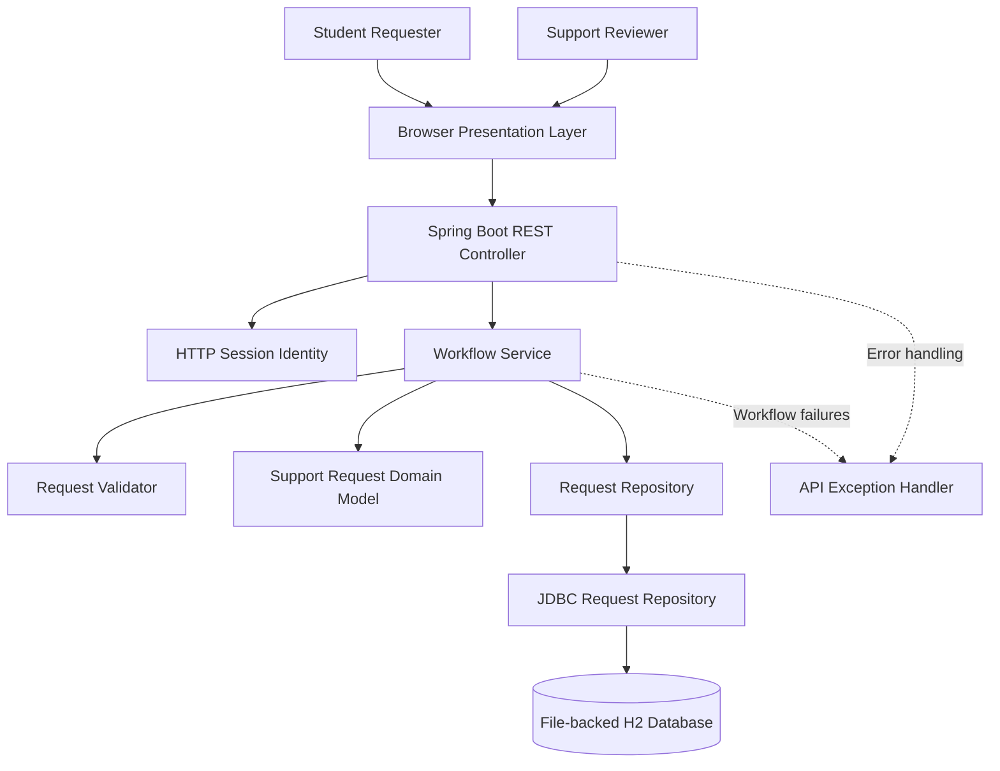
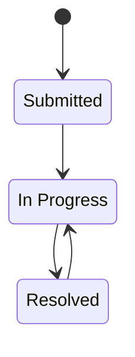

# CampusConnect — Assignment 6 Final Release Notes

## 1. Release Information

| Field | Details |
|---|---|
| Project | CampusConnect — University Support Portal |
| Course | COMP 330 — Software Project Management |
| Team | Team 02 — Codex Ramblers |
| Release Phase | Assignment 6 — Final Cycle 2 Release |
| Planned Release Tag | `a6-final-release` |
| Release Environment | Local classroom demonstration |
| Release Status | Release candidate — pending final integrated verification and approval |
| Team Lead | Victor Dodan |
| Architecture & Development Lead | Shú Perez |
| Documentation Date | November 24, 2026 |
| Repository | https://github.com/victordodan/-comp330-f26-team-02.git |

The final release tag must identify the exact repository revision approved for submission. Local integration evidence must not be represented as verification of the final tagged release until the corresponding changes have been merged and reviewed.

---

## 2. Executive Summary

CampusConnect provides a centralized university support request management system designed to replace fragmented communication through email, spreadsheets, and informal follow-ups.

The application allows student requesters to submit support requests, monitor request status, and review resolution notes. Support reviewers can inspect the support queue, update request statuses, and record resolution information.

Cycle 2 builds upon the REST-based workflow established during Cycle 1 by improving the presentation layer, architecture documentation, verification evidence, demonstration readiness, and release traceability.

The addition of a browser-based interface provides a more accessible way to interact with the existing application without requiring users to manually construct HTTP requests.

The application remains a bounded classroom demonstration rather than a production-ready university information system.

---

## 3. Cycle 1 Baseline

Cycle 1 established the core CampusConnect workflow through a Spring Boot REST application.

The implemented baseline included:

- Synthetic student and reviewer identities.
- Student support request creation.
- Student-specific request retrieval.
- Reviewer access to the support queue.
- Controlled request status transitions.
- Resolution note management.
- Server-side input validation.
- Role-based access restrictions.
- Request ownership enforcement.
- Optimistic concurrency control using ETags.
- JDBC-based persistence.
- File-backed H2 database storage.
- Structured HTTP error responses.
- Automated backend verification.

The Cycle 1 implementation established the functional foundation for subsequent improvements.

Cycle 2 retains these architectural foundations while improving accessibility, documentation alignment, verification coverage, and operational readiness.

---

## 4. Cycle 2 Release Scope

### 4.1 Browser-Based Presentation Layer

Cycle 2 introduces a browser-based interface implemented using:

- HTML.
- CSS.
- Vanilla JavaScript.
- Existing Spring Boot static resource hosting.
- Existing REST API endpoints.

The presentation layer is located in:

- `src/main/resources/static/index.html`
- `src/main/resources/static/styles.css`
- `src/main/resources/static/app.js`

The frontend provides:

- Synthetic identity selection.
- Student and reviewer dashboards.
- Support request submission.
- Request status summaries.
- Request filtering.
- Request details.
- Resolution note visibility.
- Reviewer status management.
- Reviewer resolution note editing.
- Loading and empty states.
- User-facing error notifications.
- Responsive interface styling.

The presentation layer does not replace the existing REST API or introduce an independent source of authoritative request data.

All authoritative workflow decisions remain within the backend application.

### 4.2 Backend Workflow

The existing backend continues to enforce:

- Request ownership.
- Role-specific permissions.
- Input validation.
- Valid workflow transitions.
- Resolution note requirements.
- Optimistic concurrency.
- Persistent request storage.

The frontend consumes the existing backend interfaces rather than duplicating business logic as an independent authority.

### 4.3 Architecture Documentation

Cycle 2 architecture documentation is intended to reconcile the implemented application with its documented design.

Relevant architecture artifacts include:

- [Architecture Overview](../architecture/architecture.md)
- [Architecture Diagram](../architecture/architecture-diagram.png)
- [Component Responsibilities](../architecture/component-responsibilities.md)
- [API Contracts](../architecture/api-contracts.md)
- [Data Context](../architecture/data-context.md)
- [Architecture Decision Records](../decisions/)

The final documentation must reflect the actual integrated release rather than an earlier proposed architecture.

### 4.4 Verification and Demonstration Improvements

Cycle 2 frontend contributions include:

- Automated frontend integration tests.
- HTTP-based frontend smoke testing.
- Synthetic demonstration data generation.
- Runtime verification of frontend resource availability.
- Runtime verification of synthetic identity permissions.
- Runtime verification of request creation and reviewer updates.

These additions support repeatable inspection and classroom demonstration of the application.

---

## 5. Changes Since Assignment 5

| Area | Cycle 1 Baseline | Cycle 2 Improvement | Engineering Benefit |
|---|---|---|---|
| User interaction | REST API interaction | Browser-based interface | Improved accessibility and demonstration usability |
| Presentation | API responses | Structured student and reviewer dashboards | Improved workflow visibility |
| Request submission | Direct HTTP requests | Browser submission form | Reduced interaction complexity |
| Request tracking | API retrieval | Visual request cards and status summaries | Improved request visibility |
| Reviewer workflow | Direct API operations | Browser-based reviewer controls | Improved usability |
| Error communication | Structured HTTP responses | User-facing error notifications | Improved failure visibility |
| Verification | Backend automated tests | Additional frontend integration and smoke testing | Broader verification coverage |
| Demonstration setup | Manually prepared requests | Synthetic demonstration data script | More repeatable demonstration preparation |
| Architecture documentation | Cycle 1 implementation baseline | Cycle 2 reconciliation | Improved design-to-implementation alignment |
| Release evidence | Cycle 1 release artifacts | Final maturity and verification evidence | Improved release traceability |

The complete repository-level change inventory should be maintained in:

[Changed Files Since Assignment 5](changed-files-since-a5.md)

---

## 6. Final Architecture Overview

CampusConnect uses a layered architecture with a same-origin browser presentation layer and a Spring Boot REST backend.

### 6.1 Architecture Layers

| Layer | Responsibility |
|---|---|
| Browser Presentation Layer | User interaction, form input, dashboard rendering, and feedback |
| REST Controller Layer | HTTP request handling, session identity enforcement, and response generation |
| Service Layer | Workflow rules, authorization, transactions, and request management |
| Validation Layer | Server-side input validation |
| Domain Model | Support request representation and workflow data |
| Repository Layer | Persistence abstraction |
| JDBC Implementation | Database queries and conditional updates |
| H2 Database | Persistent local request storage |

### 6.2 Application Data Flow



The browser communicates with the backend through HTTP requests and JSON responses.

Session identity, request ownership, workflow validation, and persistent state remain controlled by the server.

### 6.3 Architecture Decisions

The release retains:

- Java and Spring Boot.
- Maven-based build management.
- REST-based application interfaces.
- JDBC persistence.
- File-backed H2 storage.
- Synthetic session-based identities.
- Optimistic concurrency control.

The browser presentation layer extends the existing REST architecture without introducing a separate frontend server, additional application framework, or independent database.

Relevant architectural decisions are maintained in:

[Architecture Decision Records](../decisions/)

---

## 7. Supported Application Workflows

### 7.1 Student Requester

A student requester can:

1. Select a supported synthetic student identity.
2. Access the student dashboard.
3. Submit a support request.
4. Retrieve requests associated with the active student identity.
5. Inspect request status.
6. Review saved resolution notes.
7. Filter displayed requests by status.

Students are not authorized to access reviewer-only operations or modify reviewer-controlled workflow state.

### 7.2 Support Reviewer

A support reviewer can:

1. Select the synthetic reviewer identity.
2. Access the reviewer dashboard.
3. Inspect support requests across student identities.
4. Review request details.
5. Transition requests to In Progress.
6. Save resolution notes.
7. Resolve requests after required resolution information has been saved.
8. Reopen resolved requests when appropriate.

### 7.3 Request Lifecycle



A request cannot be resolved without a previously saved, nonblank resolution note.

Unsupported transitions are rejected by the backend.

---

## 8. Security and Data Governance

### 8.1 Identity and Authorization

CampusConnect uses synthetic demonstration identities:

- `student-a`
- `student-b`
- `reviewer`

The active identity is maintained through an HTTP session.

Client-provided identity headers do not independently grant authorization.

The application uses backend authorization checks to restrict access to student-owned records and reviewer-only operations.

### 8.2 Data Ownership

Support request ownership is assigned by the backend using the active student identity.

Student requesters are restricted to their own records.

Reviewers can inspect the shared support queue within the classroom demonstration environment.

### 8.3 Sensitive Data Restrictions

The application is intended for synthetic classroom data only.

The release must not be used to process:

- Real student educational records.
- Personally identifiable information.
- University credentials.
- Confidential support requests.
- Financial information.
- Medical information.
- Other regulated or sensitive institutional data.

### 8.4 Security Limitations

The synthetic identity selector is not a production authentication mechanism.

The release does not claim:

- University single sign-on integration.
- Verified real-world user identities.
- Production-grade identity management.
- Production security certification.
- Regulatory compliance certification.
- Authorization for public deployment.

The application must remain within its documented classroom demonstration boundary.

---

## 9. Data Consistency and Persistence

CampusConnect uses a file-backed H2 database accessed through JDBC.

The persistence implementation supports:

- Unique request identifiers.
- Server-assigned request ownership.
- Request status persistence.
- Resolution note persistence.
- Request creation and update timestamps.
- Request version tracking.

Optimistic concurrency control uses request versions and HTTP ETags.

Reviewer modifications require the applicable `If-Match` precondition.

The backend rejects stale updates rather than silently overwriting a more recent modification.

The browser presentation layer does not independently determine authoritative request versions or persist authoritative request records.

The backend and database remain the authoritative sources of application state.

---

## 10. Error Handling and Failure Behavior

The application uses structured HTTP responses to communicate request failures.

| HTTP Status | Meaning | Application Behavior |
|---|---|---|
| 200 | OK | Successful retrieval or modification |
| 201 | Created | Successful support request creation |
| 400 | Bad Request | Invalid input or unsupported operation |
| 403 | Forbidden | Missing identity or insufficient permissions |
| 404 | Not Found | Missing resource or inaccessible request |
| 412 | Precondition Failed | Stale request version |
| 428 | Precondition Required | Required update precondition is missing |
| 503 | Service Unavailable | Storage or transaction failure |

The frontend is designed to communicate these failures through user-facing notifications.

Failed operations must not be represented as successful modifications.

A failed refresh following a confirmed modification must be distinguished from a failed modification.

The complete API behavior is documented in:

[API Contracts](../architecture/api-contracts.md)

---

## 11. Earlier Local Runtime Verification Evidence

The following results were observed during local Cycle 2 integration on November 24, 2026.

These results represent actual local runtime evidence. They do not independently establish the verification status of the final merged or tagged release.

### 11.1 Verification Environment

| Field | Observed Value |
|---|---|
| Operating Environment | Local macOS development environment |
| Application | CampusConnect |
| Integration Branch | `a6-local-integration` |
| Recorded Checkout Commit | `f09bd551456c539c92b185dcbbabc0d29f192be6` |
| Current Application Address | `http://campusconnect.local:8080` |
| Smoke Test Execution | November 24, 2026 |
| Demonstration Setup Execution | November 24, 2026 |

The recorded checkout commit identifies the repository state reported by the smoke testing script. It is not independent proof of the exact running application binary.

### 11.2 Frontend Smoke Testing

The frontend smoke testing script is located at:

[`scripts/frontend-smoke-test.sh`](../../scripts/frontend-smoke-test.sh)

Observed results:

| Verification Category | Passed | Failed |
|---|---:|---:|
| Application Availability | 2 | 0 |
| Frontend Resources | 7 | 0 |
| Required Interface Elements | 11 | 0 |
| Unauthorized API Access | 4 | 0 |
| Student A Session | 3 | 0 |
| Student B Session | 3 | 0 |
| Reviewer Session | 3 | 0 |
| Identity Switching | 4 | 0 |
| Missing Resource Handling | 1 | 0 |
| **Total** | **38** | **0** |

**Observed result: PASS**

The smoke testing execution confirmed:

- Successful homepage retrieval.
- Successful CSS and JavaScript resource retrieval.
- Presence of required interface elements.
- Rejection of unauthorized API access.
- Rejection of forged reviewer identity headers.
- Rejection of unsupported identities.
- Successful synthetic identity selection.
- Role-specific API access.
- Permission changes following identity switching.
- Independent session accessibility.
- HTTP 404 behavior for missing frontend resources.

These checks verify HTTP behavior and frontend resource availability. They do not execute or comprehensively verify browser-side JavaScript interactions.

### 11.3 Demonstration Data Verification

The demonstration setup script is located at:

[`scripts/demo-data.sh`](../../scripts/demo-data.sh)

Observed execution results:

| Verification Item | Expected | Observed |
|---|---:|---:|
| Synthetic identities selected | 3 | 3 |
| New requests created | 6 | 6 |
| Existing requests skipped | 0 | 0 |
| Confirmed reviewer updates | 10 | 10 |
| Student A accessible demonstration requests | 3 | 3 |
| Student B accessible demonstration requests | 3 | 3 |
| Reviewer accessible demonstration requests | 6 | 6 |

**Observed result: Successful completion**

### 11.4 Demonstration Dataset

| Request | Owner | Observed Status |
|---|---|---|
| Unable to access Sakai | Student A | Submitted |
| Course registration issue | Student A | In Progress |
| Library account assistance | Student A | Resolved |
| Campus Wi-Fi connection issue | Student B | Resolved |
| Academic advising appointment | Student B | Submitted |
| Student organization inquiry | Student B | In Progress |

Observed status distribution:

- Submitted: 2 requests.
- In Progress: 2 requests.
- Resolved: 2 requests.

The execution confirmed successful request creation, reviewer status modifications, resolution note saving, and role-specific retrieval of the prepared demonstration records.

The script creates persistent synthetic records and must only be executed against an appropriate classroom demonstration database.

### 11.5 Verification Boundaries

The recorded executions do not independently establish:

- Comprehensive browser interaction verification.
- Browser compatibility across all supported platforms.
- Final Maven regression suite results.
- Persistence across an application restart.
- Concurrent duplicate prevention.
- Successful repeated demonstration setup.
- Final merged-release CI results.
- Production security readiness.

Unperformed verification must remain identified as pending or deferred rather than being recorded as successful.

---

### 11.6 Merged Candidate Verification

The November 24 merged candidate `373a0f6b6d6190d6067099178a8c71862bb12dec` passed [GitHub CI](https://github.com/victordodan/-comp330-f26-team-02/actions/runs/45509064331).
On a clean checkout of that revision, Codex ran 51 Maven tests and 38 HTTP smoke
checks with zero failures. The Chromium exercise covered student submission
and isolation, reviewer status and note updates, stale-edit rejection, and
owner visibility. Demo setup created six requests on the first run. A repeat
run skipped all six and made zero reviewer updates. [Candidate evidence in #112](https://github.com/victordodan/-comp330-f26-team-02/blob/a6-quality-defect-review-gherrera/docs/testing/final-test-evidence.md#november-24-browser-candidate)

Final acceptance, independent integrated review, release authorization, and
tag verification remain pending.

---

## 12. Implementation and Pull Request Traceability

The following pull requests represent the Cycle 2 frontend implementation and supporting verification contributions.

| Pull Request | Contribution |
|---|---|
| [PR #126](https://github.com/victordodan/-comp330-f26-team-02/pull/126) | Browser HTML structure |
| [PR #127](https://github.com/victordodan/-comp330-f26-team-02/pull/127) | Responsive frontend styling |
| [PR #128](https://github.com/victordodan/-comp330-f26-team-02/pull/128) | Browser application logic and REST integration |
| [PR #129](https://github.com/victordodan/-comp330-f26-team-02/pull/129) | Frontend integration tests |
| [PR #130](https://github.com/victordodan/-comp330-f26-team-02/pull/130) | Frontend smoke testing script |
| [PR #131](https://github.com/victordodan/-comp330-f26-team-02/pull/131) | Synthetic demonstration data script |

All six contributions were integrated on the earlier local verification branch and subsequently merged to `main` in PRs #126–#131. The merged verification results are recorded in section 11.6.

Local integration does not establish that the corresponding pull requests have received independent approval or been merged into the final release branch.

Additional Cycle 2 contributions, including quality, security, observability, governance, and operational documentation, should be incorporated through the team's final changed-file inventory.

---

## 13. Defect Management

Cycle 2 defect management should distinguish between:

- Confirmed defects.
- Corrected defects.
- Mitigated defects.
- Deferred defects.
- Accepted residual risks.
- Unverified behavior.

The recorded frontend smoke testing execution reported zero failed checks.

The recorded demonstration setup completed successfully.

These results must not be interpreted as evidence that the application contains no defects.

The authoritative defect disposition is maintained in:

- [Defect Summary](../quality/defect-review.md)
- [Defect Review](../quality/defect-review.md)

Any defect discovered during final integration must receive an appropriate disposition, owner, and supporting evidence before release approval.

---

## 14. Observability and Operational Readiness

The application provides a local environment in which reviewers can inspect:

- Application startup behavior.
- HTTP response status codes.
- Structured API error responses.
- Application console output.
- Request status changes.
- Request retrieval behavior.
- Database-backed application state.
- Smoke testing results.
- Demonstration setup results.

The frontend also provides user-facing feedback for loading, successful operations, empty results, and failed requests.

The release does not claim production-grade observability, centralized monitoring, automated alerting, or comprehensive operational recovery.

Operational instructions and evidence should be maintained in:

- [Operational Runbook](../operations/runbook.md)
- [Observability Plan](../observability/observability-plan.md)
- [Runtime Evidence](../observability/runtime-evidence.md)

---

## 15. Known Limitations and Residual Risks

| Limitation | Potential Impact | Mitigation or Release Boundary |
|---|---|---|
| Synthetic identities | Users can select demonstration roles | Restrict use to classroom demonstrations |
| No production authentication | Real-world identity cannot be established | Do not deploy publicly or process real student data |
| Local database storage | Database availability depends on the local environment | Document storage location and operating assumptions |
| Limited recovery verification | Recovery behavior is not comprehensively established | Document recovery procedures and outstanding verification |
| Shared browser sessions | Multiple tabs may share the same active identity | Use separate browser profiles for independent sessions |
| Browser state is temporary | Unsaved input may be lost during navigation or refresh | Communicate temporary state limitations |
| Limited browser verification | Some interface behavior may remain unverified | Distinguish HTTP smoke checks from browser testing |
| Demonstration data persistence | Setup changes the local database | Use synthetic data and require execution confirmation |
| Sequential duplicate detection | Concurrent setup executions may create duplicate records | Run demonstration setup sequentially |
| Partial setup failure | Some records may remain after an interrupted execution | Inspect existing records before repeating setup |
| Local hostname configuration | Custom hostname may not resolve on another computer | Use localhost as the standard documented address |
| No public deployment | Application is unavailable as an institutional service | Retain the local classroom release boundary |
| Pending integrated release verification | Local evidence may differ from the final merged revision | Verify the final approved repository baseline |

The authoritative residual risk and limitation records are maintained in:

- [Known Limitations](known-limitations.md)
- [Risk Register](../planning/risk-register.md)

Final risk acceptance must be coordinated with the appropriate team owners.

---

## 16. AI-Assisted Engineering

Human monitored AI assistance contributed to the preparation of:

- Architecture documentation.
- Architecture decision record clarifications.
- Browser interface implementation.
- Frontend styling.
- Browser application logic.
- Integration test scaffolding.
- Smoke testing scripts.
- Demonstration data scripts.
- Release documentation.

Human engineering responsibilities include:

- Reviewing generated implementation.
- Checking architectural consistency.
- Reviewing security boundaries.
- Executing the application.
- Inspecting actual runtime output.
- Evaluating verification limitations.
- Correcting identified defects.
- Obtaining independent review.
- Approving the final release baseline.

Observed smoke testing and demonstration setup results were produced through actual local execution rather than generated as hypothetical verification output.

The authoritative AI-use record is maintained in:

[AI Use Log](../ai/ai-use-log.md)

---

## 17. Application Setup and Launch

### 17.1 Prerequisites

- Git.
- Java 17.
- Maven.
- A supported web browser.
- An available local application port.
- Bash and curl for smoke testing.
- Python 3 for demonstration data generation.

### 17.2 Clone the Repository

```bash
git clone https://github.com/victordodan/-comp330-f26-team-02.git

cd -comp330-f26-team-02
```

After the final release tag has been created and pushed, reviewers may inspect the submitted baseline using:

```bash
git checkout a6-final-release
```

### 17.3 Build and Verify

```bash
mvn -B clean verify
```

This command is the documented build and verification procedure. Its final release execution result must be recorded separately.

### 17.4 Start the Application

```bash
mvn spring-boot:run
```

Keep the application process running while accessing the browser interface.


### 17.5 Open CampusConnect

Application address:

```text
http://campusconnect.local:8080
```

CampusConnect uses a locally configured hostname to provide a consistent and professional application address within the classroom demonstration environment.

To configure the hostname, add the following entry to the operating system's hosts file:

```text
127.0.0.1 campusconnect.local
```

This configuration must be completed on each computer used to run the application.

CampusConnect remains a locally hosted application and does not require public domain registration or external hosting.

### 17.6 Optional Smoke Testing

With the application running:

```bash
bash scripts/frontend-smoke-test.sh
```

### 17.7 Optional Demonstration Setup

With the application running:

```bash
bash scripts/demo-data.sh
```

The demonstration script requires confirmation before creating persistent synthetic records.

Only execute the script against an appropriate local demonstration environment.

### 17.8 Stop the Application

Stop the running Spring Boot process using:

```text
Control + C
```

Do not delete the database directory unless an intentional reset has been authorized and any required data has been preserved.

---

## 18. Release Evidence Index

| Evidence Area | Repository Artifact |
|---|---|
| Final Release Package | [Assignment 6 Final Release Package](assignment6-final-release-package.md) |
| Release Notes | [Final Release Notes](final-release-notes.md) |
| Changed Files | [Changed Files Since A5](changed-files-since-a5.md) |
| Architecture | [Architecture Overview](../architecture/architecture.md) |
| Architecture Diagram | [Architecture Diagram](../architecture/architecture-diagram.png) |
| Architecture Decisions | [Decision Records](../decisions/) |
| API Interfaces | [API Contracts](../architecture/api-contracts.md) |
| Component Responsibilities | [Component Responsibilities](../architecture/component-responsibilities.md) |
| Data Ownership | [Data Context](../architecture/data-context.md) |
| Final Testing | [Final Test Evidence](../testing/final-test-evidence.md) |
| CI/CD | [CI Evidence](../testing/ci-evidence.md) |
| Defects | [Defect Summary](../quality/defect-review.md) |
| Risks | [Risk Register](../planning/risk-register.md) |
| Limitations | [Known Limitations](known-limitations.md) |
| Operations | [Operational Runbook](../operations/runbook.md) |
| Observability | [Observability Plan](../observability/observability-plan.md) |
| Runtime Evidence | [Runtime Evidence](../observability/runtime-evidence.md) |
| Security | [Security Governance Checklist](../security/security-governance-checklist.md) |
| AI Accountability | [AI Use Log](../ai/ai-use-log.md) |
| Traceability | [Traceability Summary](traceability-summary.md) |
| Presentation | [Presentation Index](presentation-index.md) |
| Demonstration | [Demo Script](demo-script.md) |

The final release owner must verify that each referenced artifact exists, is current, and corresponds to the submitted release baseline.

---

## 19. Final Release Maturity Assessment

| Maturity Area | Current Assessment |
|---|---|
| Core Workflow | Existing implemented foundation |
| Browser Presentation | Merged and exercised in Chromium on the November 24 candidate |
| Frontend Resource Availability | Verified on the packaged merged candidate |
| HTTP Smoke Testing | 38 of 38 checks passed on the merged candidate |
| Demonstration Data Setup | Successfully executed locally |
| Student Data Visibility | Observed for six demonstration records |
| Reviewer Workflow Updates | Ten successful updates observed |
| Architecture Alignment | Final reconciliation required |
| Automated Regression Verification | 51 Maven tests passed on the merged candidate |
| Independent Review | Final review status requires confirmation |
| Operational Readiness | Bounded classroom readiness; final evidence reconciliation required |
| Security Readiness | Restricted synthetic classroom environment |
| Production Readiness | Outside release scope |
| Final CI Verification | Requires confirmation against approved revision |
| Final Release Authorization | Pending |

The release demonstrates meaningful progress in accessibility, workflow presentation, verification coverage, and engineering evidence.

Final maturity claims must remain proportional to the available evidence.

---

## 20. Final Release Gate

The following conditions must be satisfied or receive an explicitly documented disposition before final release authorization.

- [ ] Required implementation changes are merged into the approved release branch.
- [ ] Independent pull request reviews are complete.
- [ ] Reviewer feedback has been addressed.
- [ ] Final architecture documentation reflects the implemented application.
- [ ] Final automated test results are recorded.
- [ ] Final CI results correspond to the approved repository revision.
- [ ] Outstanding defects have documented dispositions.
- [ ] Residual risks have identified owners and mitigations.
- [ ] Operational instructions are accurate and accessible.
- [ ] Security boundaries are documented.
- [ ] AI-assisted contributions and human verification are recorded.
- [ ] Required evidence links have been verified.
- [ ] Final presentation claims correspond to the release baseline.
- [ ] Team lead has authorized the final classroom release.
- [ ] The `a6-final-release` tag has been created and pushed.
- [ ] The release tag points to the approved final submission revision.

---

## 21. Final Release Authorization

| Field | Status |
|---|---|
| Release Decision | Pending |
| Approved Release Commit | Pending |
| Final CI Run | Pending |
| Independent Review Evidence | Pending |
| Residual Risk Acceptance | Pending |
| Release Tag Verification | Pending |
| Authorization Owner | Team Lead |
| Authorization Date | Pending |

The release candidate must not be represented as formally approved until the final release decision has been recorded.

---

## 22. Conclusion

CampusConnect Cycle 2 extends the existing university support request workflow with a browser-based presentation layer and additional verification capabilities.

The recorded local runtime evidence demonstrates successful frontend resource availability, synthetic identity permissions, request creation, reviewer modifications, and role-specific demonstration data visibility.

The release retains its existing REST architecture, server-controlled workflow rules, optimistic concurrency controls, and JDBC-based persistent storage.

Cycle 2 improvements contribute to a more accessible, inspectable, and demonstrable classroom application.

The final release remains subject to integrated verification, independent review, documentation reconciliation, residual risk disposition, and team authorization.

The objective of this release is not to claim production completeness, but to provide a controlled, traceable, and defensible engineering baseline that accurately represents the team's implementation, verification evidence, architectural decisions, and remaining limitations.
